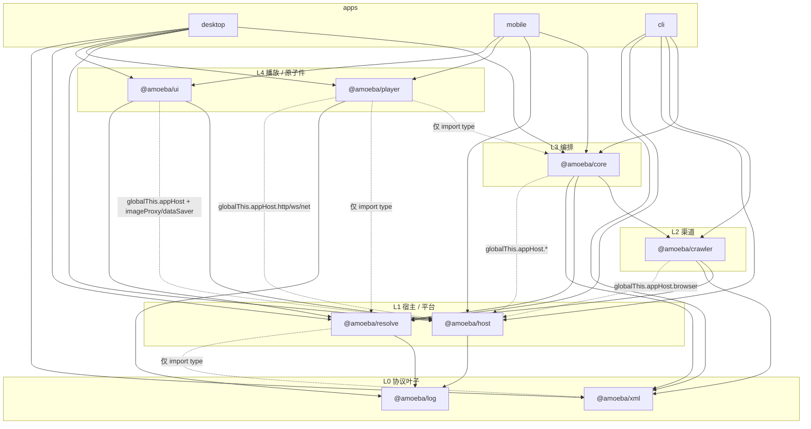
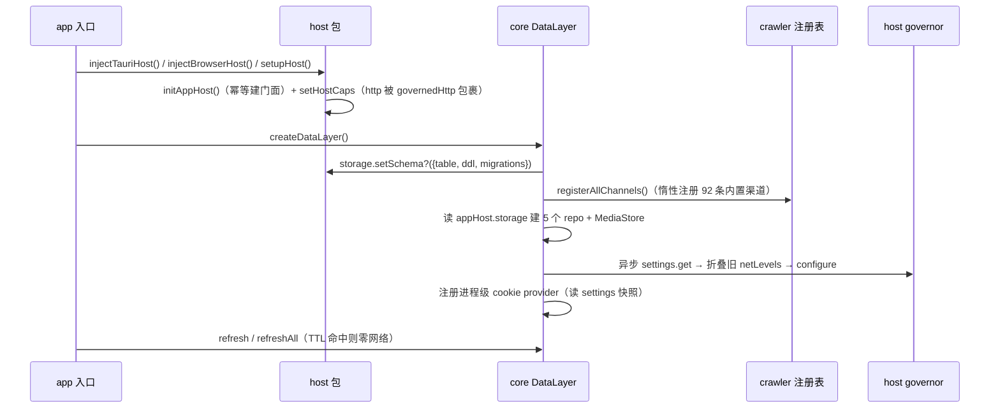

# 00 · 系统总览与运行时拓扑

> 基于 2026-10-23 的 master 快照（v0.6.5，`58b0d77`）。`path:line` 是阅读锚点，重构后会漂移，文件与符号名优先。
> 文档与代码冲突时以代码为准；已知漂移集中登记在 `05-risks.md`，本文不重复。

## 1. 定位与非目标

**一句话**：Amoeba 是一个本地优先的订阅/媒体阅读器 monorepo。一个 Rust crate（`apps/src-tauri`，Cargo package `amoeba`）用 11 个 Tauri command 暴露 HTTP / WebSocket / WebView2 / 数据服务生命周期（`apps/src-tauri/src/lib.rs`），SQLite、外链、自动更新、单实例另由 5 个 Tauri 插件注册（opener / sql / updater / process / single-instance，`apps/src-tauri/src/plugins/mod.rs`；updater/process/single-instance 仅桌面）；10 个私有 TypeScript 包组成「协议 → 平台 → 渠道 → 编排 → 服务客户端 → 播放/原子」链路；desktop 默认是数据服务客户端，CLI 既是探针也是服务载具/客户端。

三个使用端的分工不是「同一产品三套皮」，而是三种不同的数据/状态责任：

| 使用端 | 它是什么 | 实际能力边界 | 代码入口 |
| --- | --- | --- | --- |
| **desktop** | 订阅工作台：rail 侧栏 + reader/media/hot/page/player/shortvideo 六种外壳，抓取、播放、订阅 CRUD、频道发现、登录、诊断全量 | 默认经 `service_endpoint` + `@amoeba/service-client` 读写本地服务；`storage/browser` 注入为拒绝后端，**不再是数据写者**。桌面仍独占 updater 与媒体 Referer | `apps/desktop/src/main.tsx`、`store/data-source.ts`、`App.tsx` |
| **mobile** | 极简「看内容」闭环：未读列表 → 播放/阅读，加 RSS 直链增删 | 只用到 `query/patch/subscribe/refresh/addSubscription/resolveDetail/resolvePlay/resolveLivePlay` 等少数 DataLayer 方法；无 router、无频道发现、无登录 UI | `apps/mobile/src/store.ts:44-57`、`App.tsx` |
| **CLI** | 调试探针：Bun + cac 零构建，12 个命令覆盖注册表、单渠道抓取、by-url 播放/弹幕、DataLayer 冒烟、环境自检、浏览器 profile 清理 | 自行组装 node 宿主与 bun:sqlite；`--browser` 时注入 `amoeba-browser` sidecar（独立 WebView2 + CDP），默认不注入 | `apps/cli/src/main.ts:36`、`:73-149`、`apps/browser-sidecar/src/main.rs` |

**明确非目标**（代码与文档都成立的部分）：

- **不做云端**：没有服务端、账号体系、多端同步。持久化只在各端本地 KV（`packages/core/src/db/schema.ts:15-18`）；凭证只存在本机 settings 与浏览器 profile。
- **桌面数据/爬虫服务已落地（2026-10-26）**：`amoeba-runtime.exe` → `service.js --service`
  单写者独占 SQLite/crawler/浏览器；desktop 默认 `RemoteDataLayer`，
  `VITE_DATA_SERVICE=0` 才回进程内 `createDataLayer()`。见 `06-data-service.md`。
- **mobile 不做工作台**：不做频道发现、完整播放器控件、扫码登录、cookie 快照对齐（`apps/mobile/src/store.ts:1-8` 自述；代码无对应 UI 与调用）。
- **mobile 已冻结（2026-10-26）**：除非主动开启，后续改动**不再为 mobile 做适配/回归**
  （不跑 mobile tsc/Vite build，不为其加注入开关、UI 或平台分支）。它仍是进程内
  `createDataLayer()` 的只读参考实现；core/契约的新增成员保持**可选**即可，不要求移动端同步。
- **不发布公共库**：所有包 `private: true`、`exports` 直指 `src/*.ts`，没有构建产物，也没有版本化 API。
- **XML 只承诺承载列表快照，不承诺播放解析结果**：`Stream` 走 `tpl:streamJson` 完整往返（`url/format/headers/quality/rate/dashManifest`），标准 `enclosure` 在有 `url` 时仍保留作兼容出口；`Article.media[]` 的 image/video/audio 附件与宽高、时长等属性双向保真。`sourceId` / `raw` 是 crawler 内部字段，刻意不过 XML（见 [02-contracts.md](02-contracts.md) §2.5）。播放解析结果本身仍不进 XML（见 §7 决策 1、4）。
- **播放器不做平台判断与二次选流**：不接收 `item.kind`，不重排 `streams`（`packages/player/src/PlayableMedia.tsx:1-16`）。
- **UI 视觉/样式不在系统文档范围**：只在与数据、状态、公共接口相关处提及。

`apps/new_desktop` 是未进 workspaces 的静态 JS 原型，不参与构建，不属于本系统（`package.json:6-18`）。

## 2. 四种运行时形态

| 形态 | 入口与构建 | 宿主注入 | storage | 网络路径 | 可用能力 | 关键限制 |
| --- | --- | --- | --- | --- | --- | --- |
| **Tauri desktop** | `apps/desktop`，Vite `1420`，`tauri.conf.json:8,10` | `injectTauriHost()`（`apps/desktop/src/main.tsx:12` → `packages/host/src/tauri/inject-tauri.ts:28-42`） | `SqliteStorageBackend` → `rss.db` / `rss.dev.db` / `rss.release-debug.db`（`packages/host/src/tauri/sqlite-storage-backend.ts:24-29`） | `appHost.http` → governor → `invoke("http_get")` → Rust reqwest（`packages/host/src/runtime.ts:132`；`apps/src-tauri/src/commands/mod.rs`） | http/js/storage/ws/browser/updater/openExternal + 恒可用 net；WebView2 抓取浏览器（CDP 9334，`webview_browser.rs:56`） | 抓取浏览器仅 Windows（`webview_browser.rs:571-594`）；单实例固定端口；`csp: null`；抓取与 UI 同进程 |
| **Tauri mobile** | `apps/mobile`，Vite `1422`，`tauri.conf.mobile.json:8,10` | `injectTauriHost({ updater: false, browser: false })`（`apps/mobile/src/main.tsx:16`） | 同一 `SqliteStorageBackend`；app data 目录按 identifier `app.amoeba.mobile` 隔离（`tauri.conf.mobile.json:5`） | 与桌面相同的 Rust `http_get` / `ws_*` 隧道 | http/js/storage/ws；**`browser` 显式不注入**（`inject-tauri.ts:28-35`） | 无 updater；无登录/发现/工作台；无抓取浏览器，被动渠道在移动端回落主动抓取 |
| **Bun CLI** | `apps/cli`，`bun run rss`（`package.json:32`） | 自组装 `setupHost()`：`nodeBackend + nodeJsBackend + sqliteStorage + nodeWsBackend`（`apps/cli/src/host/node-host.ts:17-24`） | bun:sqlite → `apps/cli/.data/rss.db`（`apps/cli/src/store/sqlite-storage.ts:14-18`） | node `fetch`，经 `setHostCaps` 包成 governedHttp | http/js/storage/ws；log 用 localStorage shim 默认静音（`node-host.ts:28-40`） | 不注入 browser/updater；`xhs:explore` 等浏览器渠道必失败；入口未 import `rsshub` provider，故 `rsshub:*` 不可用；另有一条旁路 settings 读取（`apps/cli/src/info.ts`） |
| **纯浏览器 dev** | 仅 mobile 入口在无 `__TAURI_INTERNALS__` 时降级（`apps/mobile/src/main.tsx:16-17`） | `injectBrowserHost()`（`packages/host/src/browser/inject-browser.ts:35-41`） | `localStorage`，前缀 `browser-rss:`（`inject-browser.ts:39`） | 浏览器 `fetch`，受 CORS 限制 | http/js/storage；无 ws/browser/updater | 多数平台 API/RSS 无 CORS 头，抓取基本失败；仅能看壳层与本地库。desktop 没有这条降级路径（`main.tsx` 无条件注入 Tauri 宿主） |

> **本表是运行时能力矩阵的唯一权威**：其余文档提到 mobile/CLI 的能力差异时，只描述它对本流程的影响，不再维护第二份矩阵；`injectTauriHost` 的签名变化先改这里。

同一份编排、不同宿主是这套架构的核心收益，也带来两个必须知道的分叉：

1. **能力探测按 `appHost` 字段真值**（`global.d.ts:27-56`），所以「没注入」与「注入了但底层不可用」在类型上无法区分。mobile 因此显式传 `browser:false`，让 core 的被动门按「无浏览器」走；只有桌面走 `injectTauriHost` 的默认注入。
2. **CLI 不是 desktop 的缩小版**：它不经 `DataLayer` 的命令直接调 crawler/resolve，且有自己的 settings 读取与数据库（`apps/cli/src/main.ts:42-48`）。探针结果与应用行为的差异有相当一部分来自这里，而不是内核。

形态差异会造成可观测的行为差异，排查时必须先定位端：

- **被动采集**：`passiveMode = channel.passive && !!appHost.browser`（`packages/core/src/data-layer.ts:463`）。desktop 为真且可用；mobile 因显式 `browser:false` 为假、回落主动抓取；CLI 为假，同样回落主动抓取。
- **RSSHub**：`rsshub` provider 靠 `import "@amoeba/core/source/rsshub"` 的模块副作用注册（`packages/core/src/source/rsshub.ts:97`）。desktop/mobile 入口都 import；CLI 没有，所以 `rsshub:*` 在 CLI 里表现为「渠道不存在」。
- **自动更新与 cookie 对齐**：只有 desktop 注入 updater；cookie 快照对齐已移到数据服务 boot 后 1.5s（desktop 远端层的 `syncBrowserCookies` 是 no-op）。
- **数据库隔离**：dev / `tauri dev --release` / 生产分别用 `rss.dev.db` / `rss.release-debug.db` / `rss.db`（`packages/host/src/tauri/sqlite-storage-backend.ts:24-29`）；CLI 另有 `apps/cli/.data/rss.db`。四者互不共享。

## 3. 包地图分层

| 层 | 包 | 职责（一句话） | 公共入口 | 实际依赖 | 破例/注意 |
| --- | --- | --- | --- | --- | --- |
| L0 | `@amoeba/xml` | RSS 2.0 + 最小 `tpl:*` 编解码、Atom 归一、OPML；唯一持有 `fast-xml-parser` | `packages/xml/src/index.ts` | 仅 `fast-xml-parser` | 不做 HTML、网络、存储；`parseFeed` 也吃外部 RSS/Atom |
| L0 | `@amoeba/log` | 进程级日志域注册、模板事件、级别开关 | `packages/log/src/index.ts` | 无 | 开关读 `localStorage`，CLI 用 shim |
| L1 | `@amoeba/host` | 全局 `appHost` 门面 + 三环境注入 + 网络治理 + 后端实现 | `packages/host/src/index.ts` + `./runtime|governor|node|tauri|browser` | `@amoeba/log`、`@tauri-apps/*`、`ws` | **不依赖 core**：SQL 后端的 schema 由 core 在 `createDataLayer()` 调 `storage.setSchema(...)` 注入（`StorageSchema` 定义在 `global.d.ts`），host 只执行。根入口不再有 import 副作用；应用/CLI 走子路径只加载所需后端 |
| L1 | `@amoeba/resolve` | 平台 client、签名、播放解析、弹幕 codec、CDP 调度、扫码登录 | `packages/resolve/src/index.ts` | `@amoeba/log`、`@amoeba/xml`（仅类型）、`ramda` | 不依赖 host：防盗链 Referer 规则已下沉到 `resolve/media-referrer.ts`（`./media-referrer` 子路径） |
| L2 | `@amoeba/crawler` | 渠道注册表与抓取：一切皆 `RssChannel`，输出 XML | `packages/crawler/src/index.ts` | `@amoeba/resolve`、`@amoeba/xml`；`host` 仅 devDep | 不依赖 core；`Item` 协议寄居在 xml 包，crawler re-export `Kind`（`index.ts:22`） |
| L3 | `@amoeba/core` | 订阅维护、XML 反序列化、MediaStore、KV 持久化、刷新/翻页/详情/播放编排 | `packages/core/src/index.ts` + `./source/rsshub` | `@amoeba/crawler`、`@amoeba/resolve`、`@amoeba/xml`；`host` 仅 devDep | `source/index.ts:17-19` 直接 `import type`/`export type` crawler 的 `RssChannel/SourceInfo/SourceInfoField/LoginCookieSnapshot`；`types/channel-info.ts:7` 也直接 import `SourceInfoField`；只共享渠道契约，不依赖 crawler 条目模型 |
| L4 | `@amoeba/player` | `PlayableMedia` 唯一播放入口 + hls/flv/dash/原生分发 + 弹幕层 + 控件 | `packages/player/src/index.ts` | `@amoeba/core`、`@amoeba/resolve`（均仅类型）、`@amoeba/log`、react、三引擎 | 不声明 host，却直读 `appHost.http/ws/net`（`engines/hlsHostLoader.ts:53`、`PlayerStatsOverlay.tsx:40`） |
| L4 | `@amoeba/ui` | 只剩两个原子件：`MediaImage`、`fmtCount` | `packages/ui/src/index.ts` | `@amoeba/resolve`（仅 `./media-referrer`）、react | `package.json` 仍声明 core/player 但源码零 import；`MediaImage` 是宿主 ABI（`appHost.imageProxy`）的隐式消费者 |
| apps | desktop / mobile / cli | 三端消费者（见 §1、§2） | 各 `src/main.tsx` / `main.ts` | desktop：core/host/player/resolve/ui/xml；mobile：core/host/player/ui；cli：core/crawler/host/resolve/xml | mobile 声明了 crawler/resolve/xml 但源码零 import；desktop 有 2 处直引 resolve 的浏览器调度（AccountPage / Diagnostics） |

分层是「职责」意义上的，不是「编译依赖」意义上的。实际存在两条必须记住的破例：

1. **`globalThis.appHost` 是隐形依赖**：crawler/core/player/ui 都不 import host 运行时，直接读全局门面；类型来自根 `global.d.ts`，不是某个包的 `exports`。所以「谁必须注入、何时注入」无法由 import 图表达。
2. **类型镜像而非共享（已收窄）**：`RssChannel`/`SourceInfo`/`SourceInfoField`/`LoginCookieSnapshot` 现由 core 直接 `import type` 自 crawler（`source/index.ts:17-19`），不再镜像；`LoginResult` 仍在 resolve/crawler/core 各有声明，`SourceInfo` 在 resolve 另有一份；`Kind/MediaKind`、`LivePlatformId` 在 xml 与 core 各一份。靠「结构兼容」与人工同步维持，`as never` 仍会跳过编译器检查。

> 历史破例「host → core（只为取 DDL）」已于 2026-10-23 移除：`StorageSchema`/`setSchema` 让依赖方向恢复为 core → host，详见 `05-risks.md` R2。

## 4. 实际依赖图



依赖图现已恢复 **DAG**：`crawler → resolve`、`core → crawler`、`ui → resolve`（仅 `./media-referrer`）都只有一个方向；resolve 不再指向 host，host 也不再指向 core（schema 由 core 注入）。虚线是「不 import 但依赖全局状态」的边，它们不参与打包器的模块图，却同样约束初始化顺序。

### 4.1 初始化顺序



三个不可调换的顺序约束：`inject*` 必须在 `createDataLayer()` 之前（否则首次 `appHost.storage` 访问直接抛「not set」）；SQL 后端的 `setSchema` 必须发生在任何 storage 读写之前（core 把它放在 `createDataLayer()` 首行）；core 的 cookie provider 是进程级单钩子，后注册者覆盖先注册（`data-layer.ts:178-183`），多实例（测试）会互相覆盖。

### 4.2 DAG 之后还剩什么

依赖图已恢复 DAG，历史环 `resolve → host → core → crawler → resolve` 不再存在，`resolve → host` 也随 Referer 规则下沉而消除（2026-10-23）。**剩下的不是 import 边，而是初始化契约**：`globalThis.appHost` 由 `inject*Host()` / `setHostCaps()` 幂等创建（根入口不再在 import 时建门面），schema 注入又要求 `inject` → `createDataLayer()` 的先后关系。谁先注入、谁在首次读写前调 `setSchema`，仍只能靠入口顺序保证。host 根入口保留为兼容聚合，新代码走 `@amoeba/host/{node,tauri,browser,runtime,governor}` 子路径。详见 `01-packages.md` 与 `05-risks.md` R2。

## 5. 端到端数据管道

```mermaid
flowchart LR
  site["源站<br/>HTTP API / SSR 页面 / CDP"] --> client["resolve 平台 client<br/>签名 · cookie · 请求"]
  client --> channel["crawler channel<br/>Item[]"]
  channel --> ser["xml serializeFeed<br/>RSS 2.0 + tpl:*"]
  channel -. "原生 RSS：透传上游 XML" .-> cache
  ser --> cache["KV content:subId<br/>整份 XML"]
  cache --> de["core parseFeed + deserializeFeedWithTotal"]
  de --> mi["MediaItem[]<br/>注入 subscriptionId / kind / now"]
  mi --> reading["applyReadingState<br/>回填已读 / 星标 / 进度"]
  reading --> mstore["core MediaStore<br/>内存条目库"]
  mstore --> dstore["desktop / mobile store 镜像"]
  dstore --> view["视图：列表 / 网格 / 阅读"]
  view --> pm["PlayableMedia<br/>player 包：只调用注入的 resolve 回调"]
  pm --> bind["app 侧绑定<br/>PlayerPage / ShortVideoView / App.tsx 注入 resolve()"]
  bind --> play["core DataLayer.resolvePlay / resolveLivePlay"]
  play --> find["findItemUrl(itemId, subscriptionId)"]
  find --> route["resolveRoute(item.url)"]
  route --> streams["Stream[] / MediaStream[]"]
  streams --> engines["hls.js / flv.js / dash.js / 原生"]
  cache -. "TTL 命中 · 停用 · 抓取失败 · 被动无数据" .-> de
```



| # | 阶段 | 关键代码 | 失败/退化形态 |
| --- | --- | --- | --- |
| 1 | 平台取数 | crawler 渠道 → `resolve` client（`packages/crawler/src/channels/factory.ts:34-47`） | 签名/风控/登录错误向上抛；经 `apiFetch` 的渠道记 `crawler.fetchError` 后 rethrow，直连渠道可能没有这条日志 |
| 2 | 归一为 `Item[]` | 各渠道的 `fetchPage` / `ugc()` / `noteCardToSocial()` | 渠道可返回 0 条；core 另有 0 条护栏 |
| 3 | 出 XML | `serializeFeed`（`packages/xml/src/serialize.ts:35`）；`Stream` 走 `tpl:streamJson`（`:92-98`）；原生 RSS 直接透传（`channels/rss/raw.ts:52-56`） | `sourceId`/`raw` 是 crawler 内部字段、刻意不过界；`Stream` 与 `Article.media[]` 已完整保真 |
| 4 | 缓存 XML | `content:<subId>`，值 `{fetchedAt, xml}`（`packages/core/src/repo/content-cache-repo.ts:14-34`） | 写失败只 warn，不把刷新判成失败（`data-layer.ts:505-509`） |
| 5 | 反序列化 | `parseFeed` → `deserializeFeedWithTotal`（`packages/core/src/processing/deserialize.ts:31-54`） | 非法 `tpl:kind` 回落白名单；未知 live 平台兜底 `bilibili` |
| 6 | 注入应用语义 | `subscriptionId`、`isUnread=true`、`isStarred=false`，再由 `applyReadingState` 回填（`data-layer.ts:342`） | 阅读态只从 reading repo 来；XML 从不携带 |
| 7 | 内存与持久化 | `MediaStore.replace/append`（`packages/core/src/store/media-store.ts:70-82`）；subscriptions/settings/reading 各一个 KV blob | `patch` 必须带 `subscriptionId`；单 blob 读改写靠串行链 |
| 8 | 视图派生 | desktop `queryView`：base → filter → 搜索 → sort → page 切片（`apps/desktop/src/store/selectors.ts:161-183`） | URL 是位置权威，store 是数据镜像（`apps/desktop/src/router.tsx:62-86`） |
| 9 | 播放懒解析 | app 注入的 `resolve()`（`PlayerPage.tsx:181-185` / `App.tsx:213-215`）→ core `resolvePlay` → `findItemUrl` → `resolveRoute` → 平台解析（`packages/player/src/PlayableMedia.tsx:113-128`；`data-layer.ts:581-645`；`packages/resolve/src/resolver/play.ts:35-62`） | 解析错误透出为 `ResolveError(kind)`（路由不支持 = `unsupported`）；UI 用 `ERROR_KIND_LABEL` 分派文案；弹幕失败静默 |

这条管道最重要的性质：**抓取内容只存 XML，从不存 `MediaItem`**。TTL 命中、订阅停用、抓取失败回退、被动无数据回退都复用同一条 `deserializeFeedWithTotal` 路径（`data-layer.ts:437-456`、`:385-406`、`:511-537`、`:465-479`），所以「内存模型永远从 XML 重建」是一致性来源，也是字段丢失只会在边界发生的根本原因。

## 6. 五类跨包数据形态

| 形态 | 权威定义 | 形状要点 | 生产者 | 消费者 | 存储 / 边界 |
| --- | --- | --- | --- | --- | --- |
| **RSS 2.0 + `tpl:*` XML** | `packages/xml/src/serialize.ts`、`xml-parser.ts` | 标准 RSS 字段 + `tpl:kind/fetchedAt/platform/...`；channel 级 `tpl:total` | crawler 渠道；core 的热搜/详情回灌 | core 的 `parseFeed`；CLI 探针 | `content:<subId>` 原样存字符串；这是 crawler → core 的唯一通道 |
| **`MediaItem` / `Subscription`** | `packages/core/src/types/media-item.ts:37-170`、`types/subscription.ts` | `MediaItem` 是 `kind` 判别联合；`Subscription` = `channelKey + info 参数袋 + enabled/groupId/refreshIntervalSec` | core 反序列化；订阅 repo；OPML 导入 | desktop 全部视图、mobile 列表、player | 条目只在内存；订阅是 `subscriptions` 单 KV blob。**`item.id` 只在订阅内唯一** |
| **`AppSettings` / prefs** | `packages/core/src/types/settings.ts:24-104`；`apps/desktop/src/store/prefs.ts` | 功能型设置（TTL、风控等级、cookie 四字段、开关）vs 表现型偏好（主题/密度/字号/行宽） | core settings repo；desktop `usePrefs` | data-layer（TTL/cookie/网络策略）、设置页、governor | 功能型在 SQLite `settings`；表现型在 `localStorage: ui-prefs`。只有 `imageProxy/dataSaver` 被镜像到 `appHost` |
| **Reading / Playback 状态** | `packages/core/src/types/reading.ts:5-58`；`types/playback.ts:10-14` | `ReadRecord{read,starred,positionSec,scrollRatio,lastReadAt}`，键 `${subscriptionId}\u0000${itemId}`；`ResolvePlayback{streams,danmaku}` 是瞬时结果 | apps 写 reading；core 回填；resolve 产 playback | `applyReadingState`、desktop/mobile 续播、player | reading 在 `reading` 单 KV blob；playback 不落库。`readingKey` 用 `\u0000` 而非 `:` |
| **PlayStream** | `packages/xml/src/types.ts`（`Stream`）；`packages/core/src/types/media-item.ts:109-119`（`MediaStream`） | `{url, format?, headers?, quality?, rate?, dashManifest?}`；`streams[0]` 即最高档 | resolve 各平台播放函数 | core 透传；player 的 `streamKind` / `useStreamSelection` / loader | 只在内存。若经 XML（channel 直链）走 `tpl:streamJson` 完整往返 `url/format/headers/quality/rate/dashManifest`；`enclosure` 仅作标准 RSS 兼容出口。`Article.media[]` 的附件全字段同样保真；剩余有损项只有 `sourceId`/`raw`（[02-contracts.md](02-contracts.md) §2.2/§2.5） |

身份契约贯穿五类数据：**`MediaItem.id` 只保证订阅内唯一**（`types/reading.ts:21-31` 记录了 `bilibili:7734200` 同时出现在两个订阅的实测）；凡「按 id 记、改、查」都要带 `subscriptionId`。视图层已收口：选中态用 `selectedArticleKey`（core `itemRefKey` 复合键），播放路由带 `?sub=<subscriptionId>`，播放队列 / 相关列表 / React key 统一用 `itemKey`。

### 6.1 边界的四个校验点

| 校验点 | 守的是什么 | 机制 | 已知盲区 |
| --- | --- | --- | --- |
| `serialize-roundtrip.check.ts` | serialize 写过的字段能否被 deserialize 原样读回 | 构造 live/video/audio/social/category/article/`Stream`/`Article.media[]` 样本往返断言（39 项） | 不覆盖外部 feed 的容错路径；坏 JSON 等回退分支靠人工 |
| `serialize-contract.check.ts` | 两侧 `tpl:` 键集合是否对称 | 正则扫 `setTpl/setTplN` 与 `@_tpl:*` 属性直写，对比 deserialize 读取键 | 不覆盖动态拼接的键名 |
| repo 串行链 | 单 KV blob 的读改写不丢数据 | 每个 repo 内部一条 Promise 链 | 跨 key 无事务；`get()` 不在链上 |
| `MediaStore.patch` / `findItem` / `readingKey` | 跨订阅同 id 不串条目 | 二元组 `(subscriptionId, id)` 精确匹配 | API 不校验调用方传的是裸 id 还是复合键，新代码仍可绕过 |

这四条决定了「改数据结构要跑什么」：改 `tpl:*` 跑前两个；改 repo/store 跑 `data-layer.check.ts`、`repo-concurrency.check.ts`、`media-store.check.ts`；改阅读态跑 `reading-position.check.ts`。

## 7. 五个核心设计决策与代价

| 决策 | 机制 | 换来的 | 代价（可验证） |
| --- | --- | --- | --- |
| **1. XML 是 crawler → core 的唯一通道** | 渠道产出 `Item[]` → `serializeFeed` → XML；core 不 import crawler 条目类型，自己 `parseFeed` + `deserializeFeed` 重建 `MediaItem`（`packages/xml/src/serialize.ts:35`；`packages/core/src/processing/deserialize.ts:26`） | core 可以用任意 RSS 源；crawler/resolve 可独立演进；缓存直接存字符串，回放零转换 | 两端字段必须手工对称，漏一侧即静默丢字段。`Stream` 已由 `tpl:streamJson` 全字段保真、`Article.media[]` 也全字段往返，但仍有 `sourceId/raw` 等有损项（另有 `Live.quality` 这类两侧都无实现的死字段）。静态契约守卫现已同时覆盖 `setTpl/setTplN` 与 `@_tpl:*` 属性直写。新增字段的改动面固定是「serialize + deserialize + roundtrip + 可能 contract check」 |
| **2. 一切皆 `RssChannel`，渠道是纯描述** | `key/name/kind/sourceInfoTpl/defaultInfo/passive` + `getSource(info)`；可选能力用 `in` 谓词探测（`packages/crawler/src/index.ts:135-151`、`:165-200`） | 92 条内置渠道共享一套注册与大部分装配（`register.ts:73-156`）；core 不需要 crawler 的条目类型 | 能力是鸭子类型，没有统一接口；声明式工厂 `ApiChannelSpec` 表达不了 `passive/fetchPassive/resolveDetail`；渠道注册是手工清单，漏登记不报错。新增平台还要同时改 core 的 `cookieFieldFor` 与 `platformOfChannel` 两张前缀表 |
| **3. `appHost` 全局注入，而不是构造参数** | `import '@amoeba/host'` 即 `initAppHost()`（`packages/host/src/index.ts:24-26`）；门面 getter 在访问时校验必填能力（`runtime.ts:56-117`）；`setHostCaps` 把 http 包成 governedHttp（`:120-141`）。存储 schema 例外地由 core **反向注入**：`createDataLayer()` 首行调 `appHost.storage.setSchema?.(...)`，但门面本身仍是全局 getter，不因此变成构造参数 | crawler/core/resolve/player 不必层层传宿主；换环境只换注入器；所有出站 HTTP 自动受风控治理；host 不 import core 也能拿到 DDL | 依赖不可见、不可按包声明：player 完全不声明 host 却读 `appHost.http`。初始化顺序是隐式契约；多实例 `setHostCaps` 是 last-writer-wins，无资源回收。能力探测只能看真值，所以移动端必须显式 `browser:false`，否则会落入「注入了但命令全 `Err`」的误判（`inject-tauri.ts:28-35`）。SQL 后端在 `setSchema` 前读写会抛错，`createDataLayer` 必须早于任何 storage 访问 |
| **4. 按 `item.url` 懒解析，播放结果不落库** | `MediaItem` 只带页面 URL；播放时 `findItemUrl` 取 URL → `resolveRoute` 按域名/路径选平台 → 平台函数产 `Stream[]`（`packages/core/src/data-layer.ts:605-645`；`packages/resolve/src/resolver/router.ts:29-97`） | 抓取与播放解耦；签名/时效直链不入 XML、不落缓存；新增平台只加路由与解析函数 | 路由表是硬边界：b23 短链、Twitch VOD/clip 等不命中即抛错。YouTube 直播与点播 URL 同形，只能对 `youtube + video route` 特判放行（`play.ts:48-55`）。每次播放至少一次网络解析；`resolveLivePlay` 形参叫 `roomId`，实现却按 `item.id` 查（`data-layer.ts:649-650`）。弹幕解析失败静默 |
| **5. `streams[0]` = 最高清晰度，排序在产出侧** | resolve 各平台负责把最高档排最前；player 的 `pickDefaultStream` 只取首项、不二次排序（`packages/player/src/hooks/streamKind.ts`；`PlayableMedia.tsx:126-128`） | 选流契约只有一个事实来源；player 与 UI 无需理解平台档位 | 正确性分散在各平台实现里，且 `rate` 语义不同（douyu 是档位 ID，huya 最高档 `iBitRate=0`，依赖 API 原序；按 rate 降序反而会把最高档排到最后）。player 按 `rate` 去重后没有同档多线路的 failover（`useStreamSelection.ts:62-71`） |

## 8. 术语表

| 术语 | 含义 | 权威位置 |
| --- | --- | --- |
| **channel** | 渠道的纯描述：key、默认 kind、参数表、能力；不是有状态对象 | `packages/crawler/src/index.ts:165-200` |
| **source** | `channel.getSource(info)` 产出的实例，最小契约 `fetch(): Promise<string>` 返回 XML；可选 `fetchPassive`、`fetchMore`、`resolveHotWord`、`resolveDetail` | `index.ts:35-45`、`:115-128` |
| **provider** | 源插件：crawler 内置一个，`rsshub` 由模块副作用注册；按注册序聚合渠道 | `packages/core/src/source/index.ts:69-116` |
| **subscription** | 用户订阅实例：`channelKey + info`；刷新、翻页、cookie 注入都以它为单位 | `packages/core/src/types/subscription.ts` |
| **node** | desktop 的视图地址：`tab:*`、`today/unread/starred/resume`、`short:*`、裸订阅 id、`group:*`、`page:*`、`play:*`；由 `nodeMeta` 决定外壳类型 | `apps/desktop/src/store/nodes.ts` |
| **item** | 两层含义：crawler 的 `Item`（XML 协议对象）与 core 的 `MediaItem`（渲染模型 + `subscriptionId` + 阅读态） | `packages/xml/src/types.ts`；`packages/core/src/types/media-item.ts` |
| **itemRefKey** | 视图层复合键 `${subscriptionId}:${itemId}`，用于 React key / 队列 / 选中态，不反解；持久化的阅读键仍是 `readingKey`（`\u0000`） | `packages/core/src/types/reading.ts:43-45`；`apps/desktop/src/lib/media.ts:69-77` |
| **stream** | 可播流：resolve 的 `Stream` 与 core 的 `MediaStream` 同形；`url` 可为空串（DASH 只用 `dashManifest`） | `packages/core/src/types/media-item.ts:109-119` |
| **passive** | 渠道属性：正常路径是浏览器被动采集（页面自然产生的响应/SSR），有浏览器时只调 `fetchPassive`，拿不到就回缓存，**绝不回退 `fetch()`** | `packages/crawler/src/index.ts:180-191`；`data-layer.ts:458-484` |
| **TTL** | 内容缓存的复用窗口：订阅级 `refreshIntervalSec` 优先，否则 `settings.refreshIntervalMin`；不是定时任务，只是 `refresh` 的短路条件 | `data-layer.ts:437-456` |
| **buffer** | `PassiveBuffer`：进程内、按 platform+endpoint+canonicalUrl 索引的页面响应缓冲，默认 TTL 30 分钟、单条 4MB、总量 32MB，不落盘 | `packages/crawler/src/passive/buffer.ts` |
| **governor** | host 的网络治理：平台分类、等级缩放、并发/RPM/最小间隔、in-flight 去重、冷却、CDP 闸门、统计；所有 `appHost.http` 出站都经过它 | `packages/host/src/net/governor.ts:679` |
| **fetchedAt** | 条目抓取时刻（epoch ms）；XML 用 `tpl:fetchedAt` 保真，缺失时 core 用 `ctx.now()` 兜底；翻页时 core 会把本页对齐到该订阅已有最小 `fetchedAt` | `serialize.ts:99-101`；`data-layer.ts:779-787` |

## 9. 按角色的阅读路线

| 角色 | 先读 | 再读 | 上手验证 |
| --- | --- | --- | --- |
| **新开发者** | 本文 §1-§5 | `01-packages.md`（包边界与入口）→ `02-contracts.md`（类型/字段保真）→ `03-flows.md`（刷新与播放时序） | `bun run rss channels` 看注册表；`bun packages/core/src/example/data-layer.check.ts` 看编排 |
| **加渠道 / 改平台取数** | §3 的 crawler/resolve 边界、§7 决策 1-2 | `04-extension.md` → `02-contracts.md` 的 `Item`/`tpl:*` 表 → `../platforms/channels.md` | `bun run rss fetch <key> --json`；改字段后跑 `serialize-roundtrip.check.ts` |
| **改播放 / 弹幕** | §5 最后两步、§7 决策 4-5 | `03-flows.md` 的播放链 → `../../playback/playback.md` | `bun run rss item <url>` / `rss dm <url>`；`useStreamSelection.check.ts` |
| **改存储 / 数据契约** | §5 的缓存与反序列化、§6 的五类形态 | `02-contracts.md` → `../data-and-storage.md`（存储 key、TTL、迁移） | `data-layer.check.ts`、`repo-concurrency.check.ts`、`body-cache.check.ts` |
| **调试 / 运维** | §2 的运行时形态表（先确认在哪端复现） | `../../ops/commands.md` → `../../ops/smoke-check.md` | `bun run rss env --probe`；桌面 UI 探针 `bun scripts/ui-probe.ts` |

最小验证集（不依赖桌面实例，按顺序跑）：

```bash
bun run rss channels                      # 注册表是否完整（92 条）
bun run rss fetch rss:url --kv url=<feed> # 单渠道 XML 是否良构
bun packages/core/src/example/serialize-roundtrip.check.ts
bun packages/core/src/example/data-layer.check.ts
```

涉及浏览器或播放的路径没有自动化回归，只能靠 `scripts/ui-play-check.ts` 与实机清单（`../../ops/smoke-check.md`）。

## 延伸阅读

- 同目录：[README.md](README.md)（索引）· [01-packages.md](01-packages.md)（逐包职责与依赖）· [02-contracts.md](02-contracts.md)（类型与字段契约）· [03-flows.md](03-flows.md)（端到端流程）· [04-extension.md](04-extension.md)（扩展改动面）· [05-risks.md](05-risks.md)（约束与风险）
- 现有架构细节：[../host-abi.md](../host-abi.md)（`appHost` 逐能力 ABI）· [../data-and-storage.md](../data-and-storage.md)（XML 通道、存储 key、迁移）· [../crawler-topology.md](../crawler-topology.md)（desktop 服务化决策与移动端 CDP 边界）
- 播放与风控：[../../playback/playback.md](../../playback/playback.md) · [../../playback/danmaku.md](../../playback/danmaku.md) · [../../risk/crawler-risk-control.md](../../risk/crawler-risk-control.md)
- 运维：[../../ops/commands.md](../../ops/commands.md) · [../../ops/smoke-check.md](../../ops/smoke-check.md) · [../../ops/release-updater.md](../../ops/release-updater.md)
