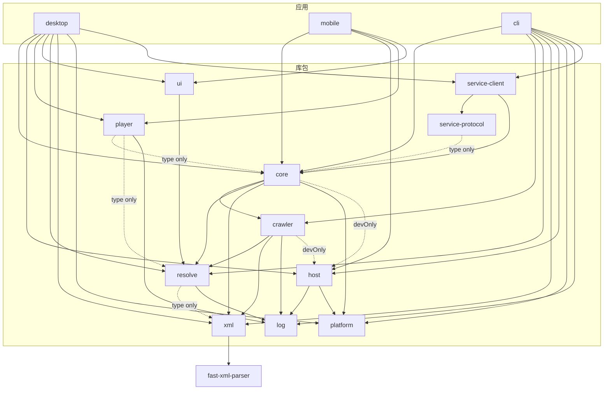
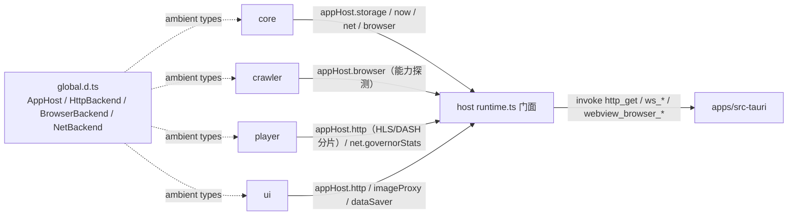
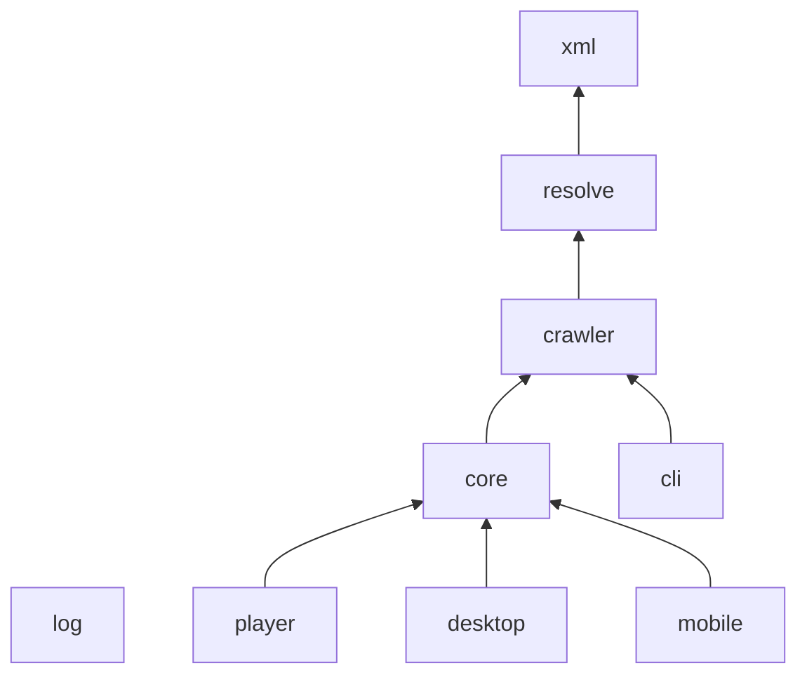

# 01 · 包职责、边界与依赖

> 本文件回答「为什么切成 11 个库 + 3 个 TypeScript 应用 + 3 个 Rust crate、谁可以依赖谁、改动该落在哪」。版本基准 2026-10-27 / v0.7.0；行号是阅读锚点且已整体漂移，一律以符号名与文件为准。
> 跨包数据结构的逐字段说明见 `02-contracts.md`，端到端流程见 `03-flows.md`。
>
> 数据服务（`service-protocol`/`service-client`）的进程/协议/打包以 `06-data-service.md` 为准，
> 平台表 `platform` 见 §1.2；`apps/mobile` 自 2026-10-26 冻结，下列 mobile 行按历史快照阅读。

规模基准（2026-10-27 实测）：`packages/` 下 **11** 个 `@amoeba/*` 包（core/crawler/host/log/platform/player/resolve/service-client/service-protocol/ui/xml）；`apps/` 下 3 个 TypeScript 应用（desktop/mobile/cli）+ 3 个 Rust crate（`src-tauri`/`browser-sidecar`/`runtime`，同属根 `Cargo.toml` workspace）+ 不参与构建的静态原型（`new_desktop`）。根 `package.json` 的 `workspaces` 只收 3 个 app 与 11 个包，`new_desktop`、`src-tauri`、`browser-sidecar`、`runtime` 不在其中。

## 1. 依赖矩阵

### 1.1 声明依赖图

实线 = `dependencies` 里的运行时 import（值）；点线 `type only` = 只有 `import type`/`export type`，编译后被擦除；虚线 `devOnly` = 只被自检脚本使用（`devDependencies`）。

依赖图为 DAG（历史环已拆净，机制见 §4）；host 的子路径导出见 §2.3。

### 1.2 矩阵

**`platform`（R9 单一权威，2026-10-26）**：平台名是字符串协议（governor 分桶 / netLevels
键 / cookie 前缀 / 账号页展示）。此前 host、core、desktop、CLI 各手抄一份，新增平台必漏配。
现在集中到零依赖叶子 `packages/platform`：`PLATFORMS` 一张表（id / 展示名 / 域名 / channelKey
前缀 / cookie 字段 / 浏览器登录站点），host 的 `platformOfHost(host)` 与 core 的
`cookieFieldFor` / `platformOfChannelKey` 全部委托（`packages/platform/src/index.ts:124-151`）。放在叶子里是因为依赖矩阵不允许
host → core、也不允许 core 生产依赖 host —— 这是唯一能同时被两边依赖的位置。

`R` = 运行时（值）import；`T` = 只有 `import type`/`export type`，编译后无运行时代码；`D` = 仅自检/示例（devDep）；`G` = 不 import，只读 `globalThis.appHost`（类型来自 `global.d.ts`）；`U` = `package.json` 声明但源码零 import。

| 行 \ 列 | xml | log | platform | host | resolve | crawler | core | player | ui | 外部依赖 |
| --- | --- | --- | --- | --- | --- | --- | --- | --- | --- | --- |
| **log** | | | | | | | | | | 无（零依赖叶子） |
| **platform** | | | | | | | | | | 无（零依赖叶子，R9 平台表） |
| **xml** | | | | | | | | | | `fast-xml-parser` |
| **host** | | R | R | | | | | | | `@tauri-apps/api` + opener/process/sql/updater、`ws` |
| **resolve** | T | R | | | | | | | | `ramda`（4 个平台文件）；`./media-referrer` 子路径供 ui/desktop 取防盗链规则 |
| **crawler** | R | R | | D | R | | | | | — |
| **core** | R | R | R | D | R | R | | | | — |
| **player** | | R | | G | T | | T（含类型 re-export） | | | `react`、`hls.js`、`flv.js`、`dashjs`、`@radix-ui/react-dropdown-menu` |
| **ui** | | | | | R（仅 `./media-referrer`） | | U | U | | `react`；仍读 `globalThis.appHost.imageProxy/dataSaver` |
| **desktop** | R | | R | R | R | | R | R | R | react-router、zustand、react-virtuoso、masonic、Radix、dompurify、qrcode、lucide、`@tauri-apps/api`（`store/data-source.ts:11`） |
| **mobile** | U | | | R | U | U | R | R | R | react、zustand；`@tauri-apps/api` 也声明未用 |
| **cli** | R | R | R | R | R | R | R | | | `cac`、`picocolors`、`qrcode`、`jsqr` |
| **src-tauri** | — | — | — | — | — | — | —（DDL 由 core 注入、host 执行） | — | — | Rust：tauri、opener/sql/updater/process、single-instance、reqwest、tokio-tungstenite、base64、windows-sys |

`service-protocol`/`service-client` 只出现在服务入口，故不单列为列：desktop 的 `store/data-source.ts:12-13`、CLI 的 `commands/attach.ts:14-15` 与服务进程 `service/server.ts:60` 直接 import，mobile 不依赖。二者只依赖 core —— `service-client` 取 `./media-store`/`./reading` 子路径的运行时函数，`service-protocol` 只 `import type`。

矩阵的四条破例/噪声，读依赖图时必须知道：

| 现象 | 证据 | 含义 |
| --- | --- | --- |
| `host → core` 已消失，改为 core 向 storage 注入 schema | `SqliteStorageBackend.setSchema`（`packages/host/src/tauri/sqlite-storage-backend.ts`）；`createDataLayer` 首行（`packages/core/src/data-layer.ts`）；`StorageSchema` 在 `global.d.ts` | DDL 唯一权威仍在 core，但它以参数形式过界（`storage.setSchema?`），host 不 import core，编译期无反向边。非 SQL 后端可不实现 `setSchema` |
| host 根入口是兼容聚合，应用走子路径 | `packages/host/package.json` 的 `exports`；CLI `@amoeba/host/node\|runtime`；desktop/mobile `@amoeba/host/tauri\|browser` | 子路径避免把三套后端拉进模块图；根入口仍可用，但不再有 import 副作用 |
| crawler/core/player/ui 都读 `appHost`，但 package.json 都不声明 host | `crawler/src/channels/xhs/base.ts:20`、`core/src/data-layer.ts:185-192`、`player/src/PlayerStatsOverlay.tsx`（`appHost.net`）、`ui/src/renderers/atoms/MediaImage.tsx:115-122` | 宿主能力对多数包是**隐式 ABI**；漏注入只能在运行时暴露，类型检查发现不了 |
| `ui` 声明 core/player、`mobile` 声明 crawler/resolve/xml 与 `@tauri-apps/api`，均零 import | `packages/ui/package.json:10-15`；`apps/mobile/package.json:12-19` | 依赖图噪声：ui 早已不 re-export 播放器（`packages/ui/src/index.ts:9-10`）；mobile 的这些能力经 core 间接获得 |

`global.d.ts` 不参与上述矩阵，但它是所有包共享的 ambient 类型源：`tsconfig.app.json:43` 的 `files: ["global.d.ts"]` 对所有 `extends` 它的包生效；CLI 单独 `files` 引用（`apps/cli/tsconfig.json`）。

## 2. 库包

### 2.1 log — 零依赖的日志域

**存在理由**：抓取/解析/播放的日志跨 5 个包，若各包直接 `console.log`，既无法按域开关，也没有统一前缀与颜色；把日志做成叶子包，host/resolve/player 可以共享同一注册表而不制造依赖环。

| 维度 | 内容 |
| --- | --- |
| 负责 | 进程级域注册表（同名幂等、HMR 合并）、模板事件方法（ctx 类型由 `text` 推断）、两级开关、浏览器 `%c` / 终端 ANSI 着色、`formatError` 归一（Error / hls ErrorData / dash `{message}`） |
| 不负责 | 日志落文件、上报、采样；输出通道由 `setLogSink` 注入（服务写 stderr），包内不直写 console。`appHost.log` 已删除，所有包统一走本包 |
| 对外导出 | `createLogDomain` / `getLogDomain` / `resetLogDomains` / `setLogSink` / `formatError`（`packages/log/src/index.ts:3-4`） |
| 内部结构 | `core.ts` = registry + emit + 方法工厂；`env.ts` = 环境判别与开关；`format.ts` = 错误文本化 |
| 依赖 / 被依赖 | 无依赖。被 host（`host/src/log.ts` 的 `host:http`/`host:browser`/`host:net` 三域）、resolve（`resolve/src/log.ts`）、player（`player/src/log/index.ts:13`）使用；crawler 直接 import `formatError`（`channels/factory.ts`、`channels/{bili,douyu,huya,douyin}/live.ts`、`channels/twitch/streams.ts`），渠道日志域仍取自 `resolve/src/log.ts` |
| 常见改动入口 | 新增日志域 → 各包自己的 log 文件，不在此包；改开关优先级 → `env.ts:13`；改输出形态 → `core.ts:76` |
| 关键文件 | `packages/log/src/core.ts:61`（registry）、`:76`（emit）、`:134`（createLogDomain）；`packages/log/src/env.ts:13`（`log:<name>` > `log`） |

不变量：`warn/error` 永不被开关屏蔽，开关只在 **emit 时**读取（`core.ts:78`），因此 CLI 在模块加载后才 shim `localStorage` 也能生效（`apps/cli/src/host/log-shim.ts:11-22`）。

### 2.2 xml — RSS 2.0 + `tpl:` 编解码

**存在理由**：`crawler → core` 的唯一通道是 XML。这条硬契约需要一个地方同时拥有「写」与「读（RSS/Atom）」的解析器配置，并成为全仓唯一持有 `fast-xml-parser` 的包——否则转义/实体/CDATA 行为会随包漂移。

| 维度 | 内容 |
| --- | --- |
| 负责 | `Item` 判别联合协议（Article/Social/Video/Audio/Live/Category）；`Item[] → RSS 2.0 + 最小 tpl:*`；RSS 2.0/Atom → 归一的 `ParsedFeed/ParsedItem`（保留 `raw`）；OPML 2.0 编解码 |
| 不负责 | 把 XML 逆解析成 `MediaItem`（在 core）；网络、HTML 处理、播放/弹幕解析；任何 app 语义（`subscriptionId`/`isUnread`/`isStarred`） |
| 对外导出 | `serializeFeed`、`parseFeed`、`parseOpml`、`serializeOpml` 与全部类型（`packages/xml/src/index.ts:12-36`） |
| 内部结构 | `types.ts` 定义协议；`serialize.ts` 用 XMLBuilder 建树；`xml-parser.ts` 用 XMLParser（`parseTagValue:false`）归一；`opml.ts` 独立子域 |
| 依赖 / 被依赖 | 仅 `fast-xml-parser`，零 `@amoeba/*`。被 crawler（值：`serializeFeed`；类型：`Item`）、core（`parseFeed` + 二次 `serializeFeed`）、resolve（仅类型）、desktop（OPML）、CLI（探针）使用 |
| 常见改动入口 | 新增跨包字段 → 同时改 `serialize.ts` 与 `core/src/processing/deserialize.ts`，然后跑两个 roundtrip 守卫；新增外部 feed 容错 → `xml-parser.ts` |
| 关键文件 | `packages/xml/src/types.ts:13`（Kind）、`:174`（Item）；`packages/xml/src/serialize.ts:35`（serializeFeed）、`:90`（`tpl:kind` 必写）；`packages/xml/src/xml-parser.ts:78`（parseFeed） |

不变量：XML 是 crawler→core 唯一通道；字段级编码与保真矩阵见 `02-contracts.md` §2.2。回归：`packages/core/src/example/serialize-roundtrip.check.ts`、`serialize-contract.check.ts`。

### 2.3 host — 宿主能力层与网络治理

**存在理由**：同一份 crawler/core/resolve 要跑在 Tauri 桌面、移动 WebView、Node（CLI/自检）与纯浏览器四个形态。把「能力从哪来」集中成一个全局门面 + 三个注入器，业务包就不需要知道运行形态；同时所有出站 HTTP 在这里被强制套上风控流水线。

| 维度 | 内容 |
| --- | --- |
| 负责 | `globalThis.appHost` 门面（getter 校验）；Tauri/Node/Browser 三态注入；HTTP、WS、CDP 浏览器、SQLite/localStorage/内存存储、JS 求值、外链白名单、更新；`NetworkGovernor`（分类/冷却/去重/平台并发/RPM/全局并发） |
| 不负责 | 业务重试与订阅编排（core）；渠道/平台协议（crawler/resolve）；DDL 的定义（core 拥有，host 只执行）；媒体 Referer 规则（resolve `media-referrer.ts`）；不 import crawler/resolve/core |
| 对外导出 | 根入口（兼容聚合）导出 `initAppHost`、`setHostCaps`、三个 injector、各 Backend 单件与 governor 函数；子路径 `./runtime`、`./governor`、`./node`、`./tauri`、`./browser`（纯前端注入）、`./cdp`（载具无关的 CDP 核心）供应用按需加载 |
| 内部结构 | `runtime.ts` 门面 + 闭包；`net/governor.ts` 唯一出站准入点；`tauri/*` 生产后端；`node/*` 自检后端 + CLI 浏览器 sidecar driver / `ws` CDP connector；`browser/*` = 与载具无关的 CDP 核心（`transport` / `channel` / `backend`）+ 纯前端注入；`log.ts` 三个域（`host:http`/`host:browser`/`host:net`）；三个环境各有一个 `index.ts` 聚合子路径 |
| 依赖 / 被依赖 | 运行时依赖 log 与 `@amoeba/platform`（`net/governor.ts:20` 的 `platformOfHost`），外加 Tauri JS API 与 `ws`；**不依赖 core**（SQL 后端的 schema 由 core 注入）。被全部应用经子路径注入；被 core/crawler/player/ui 以 `appHost` 全局读取（不 import） |
| 常见改动入口 | 新增宿主能力 → `global.d.ts` + `runtime.ts` 门面 + 三个 injector；改风控 → `net/governor.ts`；加图床 Referer → resolve `media-referrer.ts`（不要写在 ui/host 里） |
| 关键文件 | `packages/host/src/runtime.ts`（`initAppHost` / `setHostCaps` / governedHttp 包装 / 协议白名单）；`packages/host/src/net/governor.ts`（`DEFAULT_NET_POLICY` / `configure` / `governedHttp`）；`packages/host/src/tauri/inject-tauri.ts`；`packages/host/src/tauri/sqlite-storage-backend.ts`（`setSchema` / `requireSchema` / 惰性 `ready()`）；`packages/host/src/browser/backend.ts`（`CdpBrowserBackend`，lane/超时/拦截）与 `packages/host/src/tauri/browser-backend.ts`（Tauri driver + ws 隧道 connector） |

不变量：`http/js/storage` 未注入即抛；`ws/browser/updater` 未注入返回 `undefined` 由消费侧降级；`net` 恒可用（`runtime.ts:59-96`）。所有经 `appHost.http` 的请求必过 governor，但原生 ``/`<video>` 与部分 HLS 不走门面，governor 管不到（`governor.ts:17-18`）。CDP 流量绕过 HTTP 流水线，必须显式过 `browserGate`（`scheduler.ts:107-110`）。**SQL 型 storage 后端必须先 `setSchema` 再读写**：`SqliteStorageBackend` 在 `setSchema` 前调用 `get/set` 会抛「schema 未注入」，且 `setSchema` 只允许在首次连接前调用；KV/localStorage/内存后端不必实现。

### 2.4 resolve — 平台能力层

**存在理由**：反爬签名、cookie、播放流解析、弹幕 codec、扫码登录与 CDP 操作都是「平台」而非「渠道」知识。把它们从 crawler 抽出来，既让 crawler 只关心「取什么、怎么归一成 Item」，也让 `resolver/` 能对 crawler 自家源与 RSSHub 外部源一视同仁（按 `item.url` 路由）。

| 维度 | 内容 |
| --- | --- |
| 负责 | 9 个平台 client（bili/douyin/douyu/huya/twitch/youtube/xhs/weibo/apple）；URL→平台路由；播放流解析（DASH→MPD 装配、HLS/FLV/mp4）；弹幕 codec 与统一 WS 流原语；扫码登录；浏览器调度（lane/gate/renderLease/global 读写锁）与 `withBrowserOp`；发现层；cookie 三级语义；启动登录快照 |
| 不负责 | 订阅/参数/XML 渠道语义（crawler）；持久化与编排（core）；播放器渲染（player）；不 import crawler |
| 对外导出 | `resolvePlayByUrl`/`resolveLivePlayByUrl`/`getDanmakuByUrl`/`resolveRoute`、`setPlatformCookieLookup`/`resolveCookie`、各平台 client 与 discover/login、`withBrowserOp`/`withBrowserGlobal`/`withScanLoginLock`、`createWsStream`、`httpGet/httpText/httpJson`、`log`（`packages/resolve/src/index.ts`，单出口 `export *` 使公共面很宽）；子路径 `@amoeba/resolve/errors`（错误分类）与 `@amoeba/resolve/media-referrer`（防盗链规则），供 player/ui/desktop 只取单文件、避免整包进入模块图 |
| 内部结构 | `platform/<平台>/{client,play,login,discover,danmaku}`；`resolver/{router,play,danmaku}`；`browser/{cdp,scheduler}`；`danmaku/{stream,types}`；`host.ts`/`log.ts`/`media-referrer.ts`/`utils/*`；`example/*.check.ts` |
| 依赖 / 被依赖 | 仅类型依赖 xml（`Stream`/`Item` 等，16 个文件全是 `import type`，编译后擦除）；运行时依赖 log、ramda（4 个平台文件）。**不依赖 host**（Referer 规则已下沉）。被 crawler 大量调用、core 用于播放/弹幕/凭证、player 仅类型、ui 取 `./media-referrer`、desktop 1 处（`SocialDetailModal.tsx:19`）、CLI 9 处 |
| 常见改动入口 | 新平台：`platform/
/` + `resolver/router.ts:29` 路由 + host governor 平台分类 + core `cookieFieldFor`；改播放解析：`resolver/play.ts:35,46`；改浏览器并发：`browser/scheduler.ts` |
| 关键文件 | `packages/resolve/src/resolver/router.ts:17`（平台枚举）、`:29`（路由表）；`packages/resolve/src/resolver/play.ts:35`/`:46`；`packages/resolve/src/platform/credentials.ts:41`（三级语义）；`packages/resolve/src/browser/cdp.ts:61`（withBrowserOp）；`packages/resolve/src/browser/scheduler.ts:42,71,107,162`（四原语）；`packages/resolve/src/danmaku/stream.ts:62` |

不变量：`streams[0]` = 最高清晰度（排序在产流侧完成）；路由 host 用 `(?:^|[./])` 锚定防伪造子域（`router.ts:36-37`）；登录流程刻意不传 `platform`，不过 `browserGate`（`cdp.ts:110`）。

### 2.5 crawler — 渠道层

**存在理由**：把「有哪些订阅源、每个源要什么参数、怎么把上游数据归一成标准条目」变成可枚举、可注册、可探测的纯描述。它存在的另一个理由是**不稳定面的隔离**：渠道数量多、平台规则易变，但对外只承诺 `fetch(): Promise<string>`（XML），所以新增/改坏一个渠道不会波及 core 的模型与 apps。

| 维度 | 内容 |
| --- | --- |
| 负责 | `RssChannel` 契约与注册表（92 条内置渠道）；声明式装配 `makeApiChannel`；各平台取数→`Item[]`→XML；原生 RSS 直传；被动采集（CDP Network → 内存 buffer）；能力（Pageable/HotWordSource/ItemDetailSource/Loginable/readLoginCookie）；扫码登录的平台实现委托 |
| 不负责 | 播放流/弹幕解析（resolve 的 by-url）；订阅状态与持久化（core）；不做 XML 逆解析；不 import core |
| 对外导出 | 契约类型、能力谓词、`getChannel`/`listChannels`/`registerChannel`/`registerAllChannels`、`PassiveBuffer`、`httpGet/httpText/httpJson` 再导出（`packages/crawler/src/index.ts:28-241`） |
| 内部结构 | `register.ts` 手工登记；`channels/<平台>/*`；`channels/factory.ts` 收敛接线；`passive/{buffer,capture}.ts`；`example/*.check.ts`、`browser-sim.ts` |
| 依赖 / 被依赖 | 运行时依赖 resolve（98 处）与 xml（71 处）；devDep host 仅 `example/browser-sim.ts:18` 用。被 core（注册表、谓词、`httpText`）、CLI（探针）使用；desktop/mobile 不直接 import |
| 常见改动入口 | 新增渠道：`channels/<平台>/x.ts` → `register.ts:73-156` 登记；同形渠道优先 `makeApiChannel`（`factory.ts:96`）；新能力需同时加谓词与 core 探测 |
| 关键文件 | `packages/crawler/src/index.ts:35`（RssSource）、`:73`（Loginable）、`:115`（Pageable）、`:135`（能力谓词）、`:165`（RssChannel）、`:209`（惰性注册）；`packages/crawler/src/channels/factory.ts:34,96,136`；`packages/crawler/src/passive/buffer.ts:55,71`；`packages/crawler/src/channels/xhs/base.ts:4-7`（拆基类避 TDZ） |

不变量：`getSource(info)` 返回新实例且不应跨调用缓存（例外见 `05-risks.md`）；XML 是唯一出口；`passive` 渠道有浏览器时只调 `fetchPassive`，读不到就回缓存，绝不回退 `fetch`（`core/src/data-layer.ts:513-541`）。

### 2.6 core — 订阅维护者与内容模型

**存在理由**：apps 需要一个稳定的数据 seam：订阅怎么存、何时抓、失败怎么办、阅读态如何回填、缓存如何重放。这些编排不属于任何平台，也不属于 UI；集中到 core 后，desktop 与 mobile 只是同一 `DataLayer` 的不同视图，CLI 也能用同一套编排做冒烟。

| 维度 | 内容 |
| --- | --- |
| 负责 | `createDataLayer` 装配与 `DataLayer` 门面；本地镜像水合 `hydrate()`、`diagnostics`（缓存统计/清理）、`store.clear`；XML→`MediaItem` 反序列化（注入 app 语义）；5 个 KV repo 与内存 `MediaStore`；刷新/翻页串行链、TTL、被动/停用/0 条守卫；内容与正文缓存；播放/直播/详情/热搜的懒解析编排；扫码登录与启动 cookie 快照；渠道投影 `ChannelInfo`；网络策略投影；SQLite DDL（`STORAGE_SCHEMA` 经 `storage.setSchema?` 注入） |
| 不负责 | 平台签名/取数细节（resolve）；XML 编解码（xml）；播放器实现（player）；UI 状态与路由（apps）；不持有 crawler 的条目模型 |
| 对外导出 | `createDataLayer`/`DataLayer`、`cookieFieldFor`/`cookieFieldForPlatform`、`ChannelInfo`、`RefreshResult`、订阅/设置/查询/播放类型、`NoChannelError`、`ERROR_KIND_LABEL`/`errorKindOf`/`ResolveError`/`ErrorKind`、`positionDecision`、`readingKey`/`itemRefKey`/`findItem`、`KV_TABLE`/`KV_DDL`/`MIGRATIONS`/`STORAGE_SCHEMA`/`SCHEMA_MIGRATIONS`、`createMediaStore`、`createSettingsRepository`、`createContentCacheRepo`；子路径 `./source/rsshub`、`./media-store`、`./reading`（`packages/core/src/index.ts`、`packages/core/package.json` 的 `exports`） |
| 内部结构 | `data-layer.ts`（编排）；`processing/deserialize.ts`（唯一反序列化）；`store/media-store.ts`；`repo/*`；`source/{index,rsshub}.ts`；`types/*`；`db/schema.ts` |
| 依赖 / 被依赖 | 运行时依赖 crawler（注册表/谓词/`httpText`）、resolve（播放/弹幕/凭证/`withBrowserOpSlot`）、xml（`parseFeed`/`serializeFeed`）、`@amoeba/platform`（`data-layer.ts:12` 的 `cookieFieldForChannelKey`/`platformOfChannelKey`）；devDep host 供自检。被 3 个 app 使用；**不再被 host 反向依赖**——core 在 `createDataLayer()` 首行把 schema 推给 `appHost.storage.setSchema?()` |
| 常见改动入口 | 新 `DataLayer` 方法：接口 + 实现 + apps 调用点；新存储键：`repo/*` + DDL；新条目字段：`processing/deserialize.ts` 与 `xml/serialize.ts` 两侧；新平台 cookie：`cookieFieldFor` 与 `cookieFieldForPlatform` |
| 关键文件 | `packages/core/src/data-layer.ts`（`DataLayer` 接口、`createDataLayer`、`cookieFieldFor`/`cookieFieldForPlatform`、`sourceInfoFor`、`doRefresh`、按订阅串行链、`loadMore`、`scanLogin`、`addSubscription`）；`packages/core/src/processing/deserialize.ts`；`packages/core/src/db/schema.ts`（`STORAGE_SCHEMA`） |

不变量：refresh 与 loadMore 共用 `sub:${id}` 串行链；写回前查退订墓碑；一次 `doRefresh` 只读一次 settings 快照；设置写入必须经 `applySettings` 以同步 governor 与 cookieSnapshot；`createDataLayer()` 首行必须调 `storage.setSchema?.(STORAGE_SCHEMA)`（含 `versioned` 迁移与 checksum），`KV_TABLE`/`KV_DDL`/`MIGRATIONS` 只是其组成部分。身份语义（`MediaItem.id` 只在订阅内唯一、`itemRefKey`/`readingKey` 复合键）见 CLAUDE.md 硬契约与 `02-contracts.md`。

### 2.7 player — 平台无感的播放层

**存在理由**：播放器要把「懒解析结果 → 选流 → 四类引擎 → 控件/弹幕/进度回调」封装成一个与平台无关的组件。它从 `ui` 拆出，因为播放器是重依赖（hls/flv/dash），不应让所有用 `MediaImage` 的页面一起承担。

| 维度 | 内容 |
| --- | --- |
| 负责 | `PlayableMedia` 两阶段（有流直播 / 调 `resolve()` 懒解析）；选流与切档；格式判据与引擎生命周期；HLS/DASH 经宿主隧道的 loader；`VideoShell`/`AudioShell`；MediaChrome 式独立控件；弹幕层；续播/进度/播完回调；统计面板 |
| 不负责 | 平台解析与弹幕抓取（core/resolve）；`item.kind` 判定（宿主传入 `resolve`/`streams`）；持久化；不 import ui/desktop（错误态自带 `MediaState`，`PlayableMedia.tsx:44-54`） |
| 对外导出 | `PlayableMedia`、`unlockAudioPlayback`、hooks（选流/引擎/元素状态）、`VideoShell`/`AudioShell`/`PlayerControls`/`DanmakuLayer`、10 个独立控件、`MediaStream`/`DanmakuStream` 类型（`packages/player/src/index.ts:9-41`） |
| 内部结构 | `PlayableMedia.tsx` 编排；`hooks/{streamKind,useStreamSelection,useMediaStream,useVideoElement}`；`engines/{hlsHostLoader,dashHostLoader}`；`controls/*`；`danmaku/DanmakuLayer`；`stats.ts`；`log/*` |
| 依赖 / 被依赖 | 仅类型依赖 core（`MediaStream`/`ResolvePlayback`）与 resolve（`DanmakuStream`），运行时依赖 log；经 `globalThis.appHost.http` 取分片、`net.governorStats` 取统计（未声明 host）。被 desktop（3 处）与 mobile（1 处）使用 |
| 常见改动入口 | 新格式：`streamKind.ts` 加判据 + `useMediaStream.ts` 加引擎分支 + `PlayableMedia.tsx` 分发；换 loader：`engines/*`；新控件：`controls/index.ts` 导出 |
| 关键文件 | `packages/player/src/PlayableMedia.tsx:113`（唯一入口）、`:96`（手势解锁）；`packages/player/src/hooks/streamKind.ts:11-50`（判据）、`:65`（`streams[0]`）；`packages/player/src/hooks/useStreamSelection.ts:38`；`packages/player/src/hooks/useMediaStream.ts:12-14`（三引擎静态 import）、`:26` |

不变量：判据必须是纯函数且不 import 引擎，否则 node 自检无法加载（`streamKind.ts:4-7`）；选流 = `streams[0]`，player 不二次排序；切流保留用户静音态；续播只跳一次。

### 2.8 ui — 原子件

**存在理由**：desktop 与 mobile 都需要同一套「防盗链图片」行为（直连/隧道 + 占位 + 缓存），而图床规则属于平台/媒体知识层（resolve）。ui 保留为最小共享面，避免两端各写一份带 Referer 的加载逻辑。

| 维度 | 内容 |
| --- | --- |
| 负责 | `MediaImage`：lazy、aspect-ratio 占位、失败占位、命中图床时经 `appHost.http` 带 Referer 拉 `arraybuffer`→Blob URL、模块级缓存（成功 500 / Blob LRU 300 / 失败负缓存 / in-flight 合并）；`fmtCount` 互动数缩写 |
| 不负责 | 卡片/列表/渲染器（已迁 desktop `components/app/Cards.tsx`）；播放组件（已拆 player）；主题与布局（只提供 `theme.css` 令牌，由 desktop 引入） |
| 对外导出 | 仅 `MediaImage` 与 `fmtCount`（`packages/ui/src/index.ts:12-13`）；`Skeleton`/`Icons` 是包内原子 |
| 内部结构 | `renderers/atoms/{MediaImage,format,Skeleton,Icons}`；`styles/{theme.css,tailwind.css}` |
| 依赖 / 被依赖 | 运行时依赖 react 与 `@amoeba/resolve/media-referrer`；经全局读 `appHost.imageProxy/dataSaver`（`MediaImage.tsx:115-122`）。被 desktop（7 处）与 mobile（1 处）使用。core/player 为未使用声明 |
| 常见改动入口 | 新图床：改 `packages/resolve/src/media-referrer.ts`，不要改 ui；新原子件：谨慎——先判断是否该留在 desktop |
| 关键文件 | `packages/ui/src/renderers/atoms/MediaImage.tsx:29-73`（缓存）、`:75-99`（隧道）、`:115-122`（运行时开关）；`packages/ui/src/renderers/atoms/format.ts:6` |

### 2.9 platform — 平台名单一权威

**存在理由**：平台名在跨包协议里是字符串（governor 分桶 / `netLevels` 键 / cookie 字段 / 账号页展示），四处手抄必然漏配；但依赖矩阵不允许 host → core，也不允许 core 生产依赖 host，所以必须放在一个零依赖叶子里。

| 维度 | 内容 |
| --- | --- |
| 负责 | `PLATFORMS` 一张表（`PlatformDef`：id / 展示名 / 域名 / channelKey 前缀 / cookie 字段 / 浏览器登录站点）；`platformDef`/`platformOfChannelKey`/`platformOfHost`/`cookieFieldOf`/`cookieFieldForChannelKey`/`browserCookieHostsOf`/`LOGIN_PLATFORMS`（`packages/platform/src/index.ts`） |
| 不负责 | 平台协议、签名、取数（resolve）；风控策略数值（host governor）；账号页 UI（desktop） |
| 依赖 / 被依赖 | 零依赖叶子。被 host（`net/governor.ts` 的 `platformOfHost`）、core（cookie 字段）、desktop（账号页/订阅投影）、CLI（`login` 平台表）依赖 |
| 常见改动入口 | 新增/改平台只改 `PLATFORMS` 一条；core 的 `cookieFieldFor`、governor 的分桶、账号页全部委托过来，不要另抄表 |

`channelKey` 前缀按长前缀优先匹配。详见 §1.2 与 `02-contracts.md` §9.4。

### 2.10 service-protocol / service-client — 数据服务契约与客户端

**存在理由**：数据服务是唯一写者，desktop 与 CLI 都需要「读本地镜像 + 写 RPC + 收 WS 事件」，把契约与客户端拆成两个包，读端就不必为了拿类型而 import core 的根入口（那会把 crawler/resolve 拉进模块图）。

| 包 | 负责 | 依赖 |
| --- | --- | --- |
| `service-protocol` | HTTP/WS 契约的类型与常量：`RpcMethodMap`/`RpcParams`/`RpcResult`、snapshot/event/job 类型、`SERVICE_PROTOCOL`/`SERVICE_VERSION`/`ENDPOINT_SCHEMA` | 只 `import type` core 的领域类型 |
| `service-client` | `createRemoteDataLayer`：本地镜像 + RPC 写 + WS 事件收敛；fail-closed（远端失败不回退本地库） | core 的 `createMediaStore` 与 `./reading` 子路径、`service-protocol` |

进程拓扑、协议语义、打包与阶段见 `06-data-service.md`。

## 3. 应用

### 3.1 desktop — 订阅工作台

- **定位**：唯一全功能端。注入 Tauri 宿主后经 `createDesktopDataLayer()` 连本地数据服务（`service_endpoint` + `@amoeba/service-client` 的 RemoteDataLayer），浏览器 dev 才回退进程内 `createDataLayer()`；views 不直接 import crawler。
- **分层**（判据见 CLAUDE.md，代码落点）：
  - `store/` = 视图状态与动作编排，`useDesktop` 单 store（`apps/desktop/src/store/index.ts:34-78`）。数据权威是 core，位置权威是 URL，store 只做镜像（`store/index.ts:1-21`）。
  - `views/` = 业务视图，按 `nodeMeta.type` 分发 reader/media/hot/page/player/shortvideo；router loader 在渲染前同步 `select()`（`apps/desktop/src/router.tsx:62-86`）。
  - `components/*.tsx` = 纯 props 功能件；`components/app/*.tsx` = 读 `useDesktop`/`usePrefs` 的业务件（本次实测 `useDesktop` 只出现在 `views/`、`components/app/`、`store/`、`lib/`、入口）。
  - `lib/` = 工具与少量 store 适配（`useLatestOnly` 世代守卫、`itemKey` 复合键、OPML 映射、快捷键、更新状态机）；其中 `host.ts`/`shortcuts.ts`/`update.ts` 直接读 `useDesktop`。
- **跨包面**：core（30+ 处，含动态 import）、ui 7、player 3、xml 2（OPML：`lib/opml.ts:10`、`store/actions/subs.ts:7`）、resolve 1（`SocialDetailModal.tsx:19` 取 `./media-referrer`）、platform 2（`AccountPage.tsx:13`、`lib/subscriptions.ts:8`）、host 1（`main.tsx:4`）、service-client/service-protocol 各 1（`store/data-source.ts:12-13`）、`@tauri-apps/api` 1（`store/data-source.ts:11`）。
- **启动入口**（注意静态 import 会提升到模块体之前）：模块加载期先执行 `import "@amoeba/core/source/rsshub"`（`main.tsx:8`），它只经 crawler→resolve 求值，**不再连带 host**；随后模块体执行 `injectTauriHost({ nativeMediaReferer:true, storage:false, browser:false })`（`@amoeba/host/tauri`，`main.tsx:17-21`，内部 `initAppHost()` 建门面 + `setHostCaps`）；`init()`（`store/actions/data.ts:21-90`）由 App 挂载时调用（`App.tsx:66`），内部 `createDesktopDataLayer()` → 首轮 TTL 刷新 → `ready`。dev 暴露 `__store`（`main.tsx:25-26`）并加载 ui-overlay。
- **关键文件**：`apps/desktop/src/store/{index,types,nodes,selectors,ctx,lib,prefs,data-source}.ts`；`store/actions/{data,view,subs,reading,ui}.ts`；`views/player/usePlayerNav.ts`（播放入口收口）；`components/app/Cards.tsx`（可播判定）。

### 3.2 mobile — 极简看内容

- **定位**：无 router、单屏状态机；只做「未读列表 → 播放/阅读 + RSS 直链增删」。不是 desktop 的缩小版，而是同一 `DataLayer` 的极小子集。
- **接线**：`main.tsx` 按 `__TAURI_INTERNALS__` 选择 `injectTauriHost({ updater:false, browser:false })` 或 `injectBrowserHost()`（`apps/mobile/src/main.tsx:16-17`）；`store.ts` 创建 `DataLayer` 并 `import "@amoeba/core/source/rsshub"`（`store.ts:10,12`）。
- **直接依赖只有 4 个包**：core 2 处、host 1、player 1、ui 1；crawler/resolve/xml 与 `@tauri-apps/api` 均声明未用（`apps/mobile/package.json`）。但 Vite 经 core 会一并打包 crawler 全量渠道与 resolve 平台实现。
- **状态**：`dl/items/subs/initError/open/tab` 六项（`store.ts:14-32`）；`init` 幂等，逐订阅 `force:false`（`:44-64`）；可播判定 = kind 门控且排除「audio 无 stream」的播客 feed（`:150-152`）。
- **浏览器能力**：显式 `browser:false`（`packages/host/src/tauri/inject-tauri.ts:28-35`），`appHost.browser` 为 `undefined`，core 的被动采集门在移动端为假、按主动抓取走；不再有「门面为真、命令全 `Err`」的能力误判。

### 3.3 cli — 调试探针

- **定位**：`crawler/resolve/core` 的观测面，不是产品入口；同时是数据服务载具（`rss --service`）。Bun 直跑零构建，14 个命令：`channels/fetch/item/play/dm/align/hot/sug/detail/login/attach/browser-reset/env/refresh`，全局开关 `--browser`/`--via-service`（`apps/cli/src/main.ts:113-255`），`--service` 在解析参数前分流去起数据服务（`main.ts:37-39`）。用法见 `../../ops/commands.md`。
- **宿主**：不用 `injectNodeHost`（它绑死内存存储），而是从 `@amoeba/host/node` 取单件、从 `@amoeba/host/runtime` 取 `setHostCaps` 组装 `http/js/ws` + 自己的 `bun:sqlite`（`apps/cli/src/host/node-host.ts:14-21,46-67`）；`setHostCaps` 内部幂等 `initAppHost()`，因此 CLI 不需要 import 根入口。浏览器显式 opt-in（`--browser` / `AMOEBA_BROWSER=1` → `createSidecarBrowser`），updater/openExternal 永不注入。log shim 默认 `log="0"`（`apps/cli/src/host/log-shim.ts:11-22`），`RSS_LOG=1` 放开。
- **凭证**：入口注册 `setPlatformCookieLookup`，数据源是 CLI 自己的 `settings`（`main.ts:50-57`）；cookie 语义仍是「显式 > 空串强制匿名 > provider」。
- **存储**：默认库 `apps/cli/.data/rss.db`，`sqliteStorage()` 在构造时按 core 的 `STORAGE_SCHEMA` 建表并校验迁移 checksum（`apps/cli/src/store/sqlite-storage.ts:31-58,102-106`）；`sqliteStorage(path)` 也用于数据服务打开 desktop 的库，二者默认隔离。
- **scripts/**：`scripts/tauri.ts` 是 dev/build 编排（Vite 1420/1422 + Tauri）；`scripts/ui-*` 依赖 dev 实例的 9222 与 `__store`；`scripts/lx-*` 是独立 Edge 的风控实测；`scripts/service-*.ts`、`remote-data-layer-check.ts` 是数据服务自检。它们不属于任何 workspace 包。

### 3.4 src-tauri — Rust 能力面

- **定位**：桌面/移动的应用 crate（根 `Cargo.toml` workspace 三个成员之一，另两个是 `browser-sidecar`/`runtime`；`name = "amoeba"`，lib `amoeba_lib`），不含业务逻辑，只做「哑管道 + 窗口生命周期」。
- **命令面 10 个**：`http_get`、`service_endpoint`、`ws_connect/ws_send/ws_close`、`webview_browser_open/set_mode/close/reset/tidy`（`apps/src-tauri/src/lib.rs:27-38`）。`service.rs` 负责数据服务生命周期（spawn/adopt/shutdown + `service_endpoint`），主窗口 `Destroyed` 时 shutdown 并退出（`lib.rs:50-63`）；TS 侧对端在 host 的 `tauri/*`。
- **能力边界**：HTTP 隧道（reqwest，私网/链路本地拦截、重定向逐跳复查、超时 clamp，`commands/mod.rs:66,99-119`）；WS 隧道（自定义握手头，供弹幕与 CDP 文本帧）；保留 `webview_browser_*` / `TauriBrowserBackend`（独立 profile、9334），但 desktop 不注入；生产抓取浏览器是服务 spawn 的 `amoeba-browser` sidecar；插件只用 opener + sql（桌面再加 single-instance/updater/process，`plugins/mod.rs:4-35`；single-instance 必须最先注册）。
- **配置四份**：桌面主配置 `tauri.conf.json`；dev 叠加层只开 9222（`tauri.conf.dev.json`）；构建叠加层把 `service.js`、`amoeba-runtime.exe`、`amoeba-browser.exe` 三个 resources 塞进包（`tauri.conf.release.json`，`scripts/tauri.ts` 只在 `build` 时叠加）；移动独立 identifier/version/devUrl（`tauri.conf.mobile.json`）。capability 只授权 `main` 窗口（`capabilities/default.json`），updater 限桌面三平台（`capabilities/desktop-updater.json`）。
- **与 TS 的契约**：命令名是字符串、参数 `camelCase`、二进制一律 base64；`http_get` 对 4xx/5xx 也返回成功，调用方自查 status。Rust 不感知风控，治理全在 host 的 governor。

### 3.5 browser-sidecar — CLI 浏览器载体

- **定位**：Rust crate `amoeba-browser`（`apps/browser-sidecar/Cargo.toml`），无 Tauri 依赖的 WebView2 宿主（屏外窗口 + CDP），CLI 的抓取浏览器就是它。
- **接线**：CLI `--browser` 时由 `packages/host/src/node/browser-sidecar.ts` spawn；与桌面共用 `@amoeba/host/cdp` 的 lane/超时/拦截语义。
- **契约**：stdout 只留一行 `READY <port>`，端口默认动态取空闲口（不写死 9334），日志全走 stderr（`main.rs:162-168`）。

### 3.6 new_desktop — 设计参考

- **定位**：纯静态 JS 原型（`window.OD` + IIFE），用于界面/交互参照，**不参与构建**：不在根 `workspaces`，无 `package.json`、无 import 关系、无 Vite 配置。
- **自持状态**：`js/store.js:6` 用自己的 `localStorage` 键 `od-rss:v1` 与内置 `content.js` 假数据，与正式端 `ui-prefs`/KV 存储无关。
- **可借鉴面**：视图划分、布局原语（`index.html` 的 `od-layout` 层）；不可当作运行时依赖。

## 4. 分层规则

| 允许方向 | 规则 | 现状证据 |
| --- | --- | --- |
| `xml` ← 所有 | xml 不 import 任何 `@amoeba/*`，也不做网络/HTML/存储 | 本次目录级 grep：xml 包内 `@amoeba/` 命中 0 |
| `resolve` ← crawler/core/player/ui/应用 | resolve 不 import crawler，也不 import host；平台差异用函数而非统一接口表达 | `resolve/src/index.ts:10-11` 明写边界；目录级 grep 无 crawler/host |
| `crawler` ← core/应用 | crawler 不 import core，也不 import host（dev 示例除外） | crawler 目录内只有 resolve/xml/log/host(example) |
| `core` ← 应用（host 仅 devDep） | core 不 import crawler 的条目模型；只 import 注册表/谓词/`httpText` 与渠道契约类型（`RssChannel`/`SourceInfo`/`SourceInfoField` 等）；运行时向 host 注入 schema，不反向 import host | `core/src/data-layer.ts:11`、`source/index.ts:13-19`、`source/rsshub.ts:18`、`types/channel-info.ts:7` |
| `player` ← 应用 | player 不 import ui/desktop；错误态自建 | `player/src/PlayableMedia.tsx:44-54`；grep 无 `@amoeba/ui`/`apps` |
| `ui` ← 应用 | ui 只 import react 与 resolve 的 `./media-referrer`，不 import 业务包 | `ui` 目录内仅 `MediaImage.tsx:23` |
| `host` ← 应用（子路径） | host 不 import crawler/resolve/core；schema 由 core 反向注入（`storage.setSchema`），后端只执行 | `SqliteStorageBackend.setSchema`；目录级 grep 无 crawler/resolve/core |
| 应用组合 | desktop/mobile 不直接 import crawler；CLI 例外（它就是探针） | 本次目录级 grep：desktop/mobile 对 crawler 命中 0 |

**反向 import 一律禁止**：`crawler→core`、`resolve→crawler`、`ui→core/player`、`player→ui/desktop`、`host→crawler/resolve/core`、`xml→@amoeba/*`。它们目前都是 0 命中；破坏其中一条不会立刻出错，但会把「可替换的层」变成「互相知道细节的网」。

**依赖图已恢复 DAG**：历史环 `resolve → host → core → crawler → resolve` 于 2026-10-23 拆净——host 不再 import core（schema 注入）、resolve 不再 import host（Referer 规则下沉）、host 根入口不再有 import 副作用并拆出环境子路径。xhs 基类被拆出 `shared.ts`（`crawler/src/channels/xhs/base.ts:4-7`）是旧环遗留的规避，继续保留但不再是必需。

一次 refresh 的端到端时序见 `03-flows.md`（首启 / 单订阅刷新 / 订阅新增三条流程）。

## 5. 为什么这样切，以及代价

| 切法 | 理由 | 代价 / 遗留 |
| --- | --- | --- |
| 一切皆 `RssChannel`，出口只有 XML | 渠道是数量最多、最易变的部分；XML 是任何阅读器都能验证的稳定边界，core 不必跟随渠道类型演进 | 字段必须 serialize/deserialize 两侧同改，漏一侧静默丢；XML 是**有意的有损快照**（`Stream` 已由 `tpl:streamJson` 完整保真，剩余如 `sourceId/raw` 不过界），细节见 `02-contracts.md` |
| 平台能力独立成 `resolve` | 反爬/播放/弹幕/登录是「平台」知识，crawler 只是「渠道」；同一套能力也要服务 RSSHub 外部源 | resolve 仍依赖 xml 的类型；所谓「类型自持」只指不依赖 crawler；单出口 `export *` 让公共面难以收窄，必要时用子路径（`./errors`、`./media-referrer`）收窄 |
| core 自建 `MediaItem`，不复用 crawler 类型 | 应用模型要带 `subscriptionId`/阅读态/播放提示，与 XML 快照形态本就不同；解耦后 crawler 可以独立替换 | core 仍 import crawler 的渠道契约（`RssChannel`/`SourceInfoField`/`SourceInfo`，`source/index.ts:17-19` 直接 `import type`/`export type`）与运行时谓词——这是有意为之：类型直接共享、漂移由 tsc 兜底，但 core 不依赖 crawler 的条目模型 |
| host 用全局门面而非构造注入 | 四个运行形态、十几个包，构造函数注入会把宿主参数穿过每一层；全局 ABI 让 `appHost.http` 在任何深度可用 | 依赖关系从 import 图消失，漏注入只能运行时发现；无法在同一进程里并存两个宿主；测试需要造假 `appHost` |
| host 不为 DDL 反向依赖 core（schema 注入） | 「DDL 唯一权威」比「零反向依赖」更重要；`StorageSchema` 让 core 把 schema 当参数交给后端，host 打包不再连带 core 及其 crawler/resolve 依赖 | 代价移到初始化顺序：SQL 后端在 `setSchema` 前不可读写，`createDataLayer` 必须先于一切 storage 访问；后端实现必须记得实现 `setSchema?`（漏实现会在首次读写时抛「schema 未注入」）。CLI 的 `sqliteStorage` 构造时按 core 的 `STORAGE_SCHEMA` 建表并实现 `setSchema`（只校验表名一致），已是与 desktop 同一份 DDL（`apps/cli/src/store/sqlite-storage.ts:31-58,102-106`）。 |
| player 从 ui 拆出 | 播放器带三个重引擎；图片原子件不该为播放器付包体 | ui 的 `package.json` 仍留着 core/player 的陈旧声明；桌面样式需 `@source` 扫描 player 源码（`apps/desktop/src/styles.css`） |
| 库包源码直引、无构建产物 | 所有包的 `main/exports` 指向源码，Vite/Bun 直接消费 TS；改库即时热更新 | 无法按包发布消费；消费方打包体积取决于 import 的入口。host/resolve 已用子路径避免整包 barrel，但大多包仍是单入口 |
| log 做成零依赖叶子 | 任何包都能记日志而不引入宿主 | 输出通道由 `setLogSink` 注入；`appHost.log` 已于 2026-10-26 删除 |

## 6. 产物与复用矩阵

| 包 | desktop | mobile | cli | 进入方式 |
| --- | --- | --- | --- | --- |
| `xml` | 直接（OPML） | 间接（core） | 直接（探针） | Vite/Bun 解析 workspace `exports` → `src/index.ts` |
| `log` | 间接（host/resolve/player） | 间接（host/player） | 直接（服务进程 `setLogSink`/`formatError`）+ 间接（host/resolve） | 同上 |
| `host` | 直接（注入） | 直接（注入，updater/browser 关） | 直接（自组装） | 同上 |
| `resolve` | 直接（`./media-referrer`）+ 经 core | 间接（core 播放/凭证 + player 类型） | 直接（探针） | 同上 |
| `crawler` | 间接（core 注册表） | 间接（core） | 直接（渠道探针） | 同上；mobile 经 core 打包全量 92 渠道 |
| `core` | 直接 | 直接 | 直接 | 同上；子路径 `@amoeba/core/{source/rsshub,media-store,reading}` 需显式 import（`service-client` 取后两个） |
| `player` | 直接 | 直接 | 不进入 | `PlayableMedia` |
| `ui` | 直接 | 直接 | 不进入 | `MediaImage` / `fmtCount` |
| `platform` | 直接（账号页/订阅投影） | — | 直接（`login` 平台表） | `PLATFORMS` 单一权威 |
| `service-protocol` | 直接（`EndpointInfo` 类型） | — | 直接（服务/attach 契约） | 类型 + 常量 |
| `service-client` | 直接（RemoteDataLayer） | — | 直接（attach） | 见 `06-data-service.md` |

构建产物：desktop/mobile 由 Vite 输出到根 `dist/desktop`、`dist/mobile`（各自 `vite.config.ts` 的 `outDir`），再由 `tauri.conf*.json` 的 `frontendDist` 指回；数据服务入口由 `bun run service:build` 输出 `dist/service/service.js`，`tauri.conf.release.json` 把 `service/service.js`、`amoeba-runtime.exe`、`amoeba-browser.exe` 打进安装包；CLI 命令由 Bun 直接执行源码，无产物；`src-tauri` 由 Cargo 产出 `amoeba.exe`。类型侧：库包与 app 的 `tsconfig.json` 均 `extends` 根 `tsconfig.app.json`（CLI 复制了一份 paths），`tsconfig.app.json:11-31` 的 paths 只服务 tsc/编辑器，运行时解析靠 workspace symlink + 包 `exports`。

## 延伸阅读

- 同目录：[00-overview.md](00-overview.md)（分层总览）· [02-contracts.md](02-contracts.md)（跨包类型与字段保真）· [03-flows.md](03-flows.md)（端到端流程）· [04-extension.md](04-extension.md)（改动面）· [05-risks.md](05-risks.md)（耦合与漂移）
- 现有文档：[../data-and-storage.md](../data-and-storage.md)（XML 通道与存储语义）· [../host-abi.md](../host-abi.md)（appHost 逐字段 ABI）· [../crawler-topology.md](../crawler-topology.md)（爬虫拓扑与移动端限制）
- 平台与渠道清单：[../../platforms/channels.md](../../platforms/channels.md) · [../../platforms/platform-notes.md](../../platforms/platform-notes.md)
- 播放与风控：[../../playback/playback.md](../../playback/playback.md) · [../../risk/crawler-risk-control.md](../../risk/crawler-risk-control.md)
- 命令与自检：[../../ops/commands.md](../../ops/commands.md) · [../../ops/smoke-check.md](../../ops/smoke-check.md)
