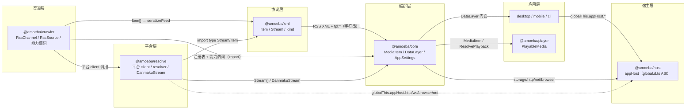
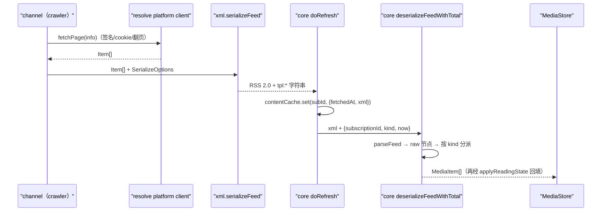
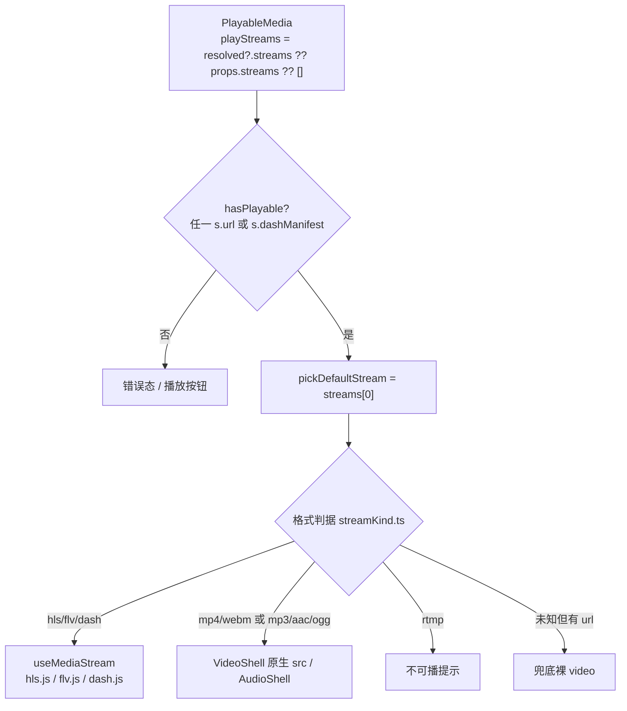
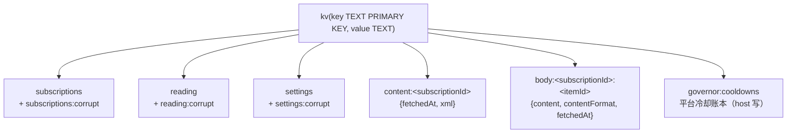

# 02 · 跨包数据结构与接口契约

> 基于 2026-10-23 master 快照（v0.6.5）。本文只回答「谁定义、谁生产、谁消费、失效会怎样」；包职责与依赖全貌见 `01-packages.md`，端到端时序见 `03-flows.md`，怎么扩展见 `04-extension.md`。
>
> 行号是阅读锚点，重构后会漂移；**文件与符号名优先**。文中所有断言均在本次会话打开过源码；契约守卫的实跑状态单独标注。
>
> **2026-10-26 数据服务增量（先读这条）**：desktop 默认不再直接持有 `createDataLayer()`，
> 而是 `RemoteDataLayer`（`@amoeba/service-client`，**与 `DataLayer` 同形**，读本地镜像、
> 写 HTTP RPC、事件走 WS）；`DataLayer` 新增 `hydrate()` / `diagnostics` / `store.clear` /
> `refresh(id,{signal})`。跨进程契约（RPC 方法表、快照 NDJSON、事件/`rev`/`epoch`）
> 唯一权威 = `@amoeba/service-protocol`，以 `06-data-service.md` 为准；本文的描述对这种
> 「同形替换」仍然成立，但「desktop 直连 SQLite/写 store」的字面表述按服务模式理解。

---

## 1. 契约总览

| 契约 | 定义处 | 生产方 | 消费方 | 通道 | 失效后果 |
| --- | --- | --- | --- | --- | --- |
| `Item` 判别联合（6 kind） | `packages/xml/src/types.ts:168` | crawler 各 channel、resolve discover 层 | `serializeFeed`、`ItemDetailSource`/`HotWordSource` 返回值 | TS import（同进程） | 编译期报错；运行期无保护 |
| RSS 2.0 + `tpl:*` XML | 写出 `packages/xml/src/serialize.ts:35`；读入 `packages/xml/src/xml-parser.ts:78` | crawler `fetch()`（`factory.ts:34`）、core 回灌（`data-layer.ts:678/732`） | core `deserializeFeed*`、CLI、任意 RSS 阅读器 | **字符串**（唯一跨包数据通道） | 字段静默退化（默认值 / undefined），无异常 |
| `RssChannel` / `RssSource` | `packages/crawler/src/index.ts:165` / `:35` | `register.ts` 92 个渠道、`makeApiChannel` | core `source/index.ts:17-19` 直接 `import type`/`export type` + `data-layer.ts` | TS import | 字段漂移在编译期报错；core 只共享渠道契约，不取 crawler 条目模型（见 §8） |
| 可选能力：`Pageable` / `HotWordSource` / `ItemDetailSource` / `Loginable` / `passive` / `readLoginCookie` | `crawler/src/index.ts:52-197` | 渠道自行实现 | core 的 `in` 谓词（`index.ts:135-151`） | 运行时属性探测 | 能力静默不可用（按钮消失 / 预览退化为原文） |
| `MediaItem` 判别联合 | `packages/core/src/types/media-item.ts:183` | `processing/deserialize.ts:26` | apps 全部视图、selectors、player 队列 | TS import | 编译期报错 |
| `DataLayer` 门面 | `packages/core/src/data-layer.ts:53` | `createDataLayer()`（`:171`） | desktop / mobile / CLI | TS import（apps 唯一数据 seam） | 编译期报错 |
| `Stream` → `MediaStream` | `xml/src/types.ts:23` / `core/types/media-item.ts:109` | resolve 各平台播放解析 | core 透传、player 选流 | TS import；**过 XML 走 `tpl:streamJson` 完整往返**（`enclosure` 仅兼容出口） | 仅当 `streamJson` 是坏 JSON 时回退 enclosure，才会丢 `headers/quality/rate/dashManifest`（§2.2/§2.5） |
| `ResolvePlayback` | `core/src/types/playback.ts:10` | core `resolvePlay` / `resolveLivePlay`（`data-layer.ts:581-663`） | `PlayableMedia.resolve()` | TS import | 编译期报错 |
| `ErrorKind` / `ResolveError` / `errorKindOf` / `ERROR_KIND_LABEL` | `packages/resolve/src/errors.ts`；resolve 以 `@amoeba/resolve/errors` 子路径导出，core `index.ts` 再透出 | resolve 平台 client、core `doRefresh`/`previewChannel`、player 错误态 | desktop store/诊断/添加订阅、player、CLI | TS import（`kind` 字段做跨模块兜底） | 无分类时退回 `unknown`；普通 `Error` 由 `errorKindOf` 启发式归类 |
| `RefreshResult` | `core/src/types/refresh-result.ts` | core `refresh` / `addSubscription` | desktop/mobile/CLI | TS import | `errorKind?` 缺失时调用方用 `errorKindOf(error)` 兜底；`error` 仍是给人看的字符串 |
| `AppHost` 及其 Backend | 根 `global.d.ts:27-317` | 三套 injector（§5） | 所有包直读 `globalThis.appHost` | **全局 ambient 类型 + 全局对象** | 未注入时访问抛错（http/js/storage）或降级（ws/browser） |
| KV `StorageBackend` + `StorageSchema` + DDL | `global.d.ts`（`StorageBackend` / `StorageSchema`）；`core/src/db/schema.ts:15` | host 的 SQLite/localStorage/内存、CLI 的 bun:sqlite | core 五个 repo、governor 冷却账本；schema 由 core 注入 | 方法调用（键值字符串）+ `setSchema?`（可选，SQL 后端实现） | 键或 DDL 漂移 = 读不到数据 / 建表失败；SQL 后端未收 schema 即读写会抛 |
| `HttpRequest`/`HttpResponse` | `global.d.ts:269-292` | 三个 HttpBackend | resolve `host.ts`、player loader、ui `MediaImage` | 方法调用 | `arraybuffer` 返回形状不一致 → 图片/分片静默损坏 |
| `BrowserBackend`/`BrowserTab` | `global.d.ts:167-252` | `host/src/browser/backend.ts` 的 `CdpBrowserBackend` + 载具 `BrowserDriver`（桌面 = Tauri WebView2） | resolve `browser/cdp.ts`、crawler xhs/weibo | 全局对象 + CDP 隧道 | 能力探测误判平台（见 §5 漂移） |
| `NetBackend` / `NetPolicy` | `global.d.ts:73-102`；`host/src/net/governor.ts:42-96` | host governor（恒可用） | core `syncNetPolicy`、resolve `reportRisk`、player 统计 | 方法调用 | 配额/冷却不生效或落到错误平台桶 |
| `ChannelInfo` 投影 | `core/src/types/channel-info.ts:10` | `data-layer.ts:806-816` | desktop 添加订阅/发现页/账号页 | TS import | 表单字段缺失；`loginable/passive` 误判 |
| `LoginResult` / `LoginCookieSnapshot` | `LoginResult` 三份平行声明（§8）；`LoginCookieSnapshot` 在 crawler/resolve 各一份，core 直接 re-export crawler 版 | channel `scanLogin` / `readLoginCookie` | core `scanLogin`、`syncBrowserCookies` | TS import / 结构兼容 | `refreshToken` 在边界被丢弃 |
| OPML 文档 | `packages/xml/src/opml.ts`（`OpmlDoc`/`OpmlFeed`） | desktop `lib/opml.ts` | 同包 `parseOpml` | 文件文本 | 导入导出丢分组/重复 URL 被去重 |
| `imageProxy`/`dataSaver` 旁路 | `global.d.ts` | desktop `store/lib.ts:88-92` 手写镜像 | ui `MediaImage.tsx` | 全局对象可写字段 | 开关不生效或已挂载图不重取 |
| `nativeMediaReferer` | `global.d.ts`（只读） | `setHostCaps`（Windows 桌面注入 true） | ui `MediaImage`、实况视频 | 门面 getter | 标志误报 → 直连 403；回退隧道兜底 |

**错误分类（本轮新增契约）**：`ErrorKind` 的权威在 resolve `errors.ts`（`auth / risk / rate-limit / network / timeout / unsupported / parse / no-data / unknown`）。新抛错点应优先 `throw new ResolveError(kind, msg)`；旧平台 client 仍是普通 `Error`，由 `errorKindOf` 做**启发式兜底**（先认显式 `kind`，再按消息匹配：429/冷却 → `rate-limit`，401/cookie/登录 → `auth`，403/412/418/风控 → `risk`，…）。因此 403 不再一律等同「需要登录」。UI 统一用 `ERROR_KIND_LABEL` 出标题，不再按字符串正则猜；`unknown` 留给调用方自己的默认文案。迁移完成前，普通 `Error` 的分类是**尽力而为**，平台 client 逐步改用 `ResolveError` 才算精确。

### 1.1 `DataLayer` 方法面（apps 唯一数据 seam）

`DataLayer`（`packages/core/src/data-layer.ts:53-117`）共 18 个成员，其中 `subscriptions` / `reading` / `settings` / `store` 是子门面。方法注释是语义权威；下表只补齐三件容易误判的事：**成功返回什么、失败是抛还是返回值、谁在调用**。端到端时序见 `03-flows.md`。

| 方法 | 签名要点 | 成功 / 失败语义 | 主要调用端 |
| --- | --- | --- | --- |
| `listChannels()` | 同步；crawler `RssChannel` → `ChannelInfo` 投影（`loginable/passive` 在此求值） | 返回数组；未知渠道不在结果中；本层无显式失败通道 | desktop 添加订阅 / 发现页 / 账号页 |
| `channelKind(key)` | 同步查注册表 | 返回 `MediaKind`；未知 key → `undefined`（不抛） | desktop rail / 节点元信息 / 自动分组 |
| `addSubscription(key,title,info,meta?)` | 拼 id → `repo.add` → **立即 `await refresh(id)`** | 成功返回 `{id, refresh}`——`refresh.error` 即首刷的真实结果，调用方据此提示「已订阅但首次抓取失败」；repo 写失败抛；仅 `refresh` 本身 reject（如存储读失败）时穿透 | desktop 添加 / OPML、mobile、CLI `hot`/`refresh` |
| `previewChannel(key,info)` | 临时抓取：不建订阅、不写缓存、不落 store；使用 `preview:<channelKey>` 作 subscriptionId | 返回 `{items,total?}`；未知 key → `NoChannelError`；抓取/解析错误原样抛 | desktop 发现页 / 添加对话框搜索 |
| `subscriptions` | repo 子门面：`list/listGroups/get/add/update/remove/addGroup/updateGroup/removeGroup` | 读缺失返回 `undefined`；存储失败 reject；`add` 缺 `channelKey` 抛。**本层 `add` 不刷新**（刷新归 `addSubscription`）；`remove` 被包装为级联清 store/content/body/reading，失败会撤墓碑并 rethrow | desktop 订阅管理 / OPML / seed、mobile、CLI |
| `reading` | repo 子门面：`getAll/get/markRead/setStarred/setPosition/setScrollRatio/markManyRead/deleteBySubscription` | 读缺失 `undefined`；写串行后 reject；`deleteBySubscription` 由退订级联调用（按 `subscriptionId\0` 前缀清理）。现有调用端多以 `void` 发出，失败不可见 | desktop 阅读动作、mobile 打开/续播 |
| `settings` | 子门面（非 repo 实例）：`get/set/setIfUnchanged/reset` | `set` = `applySettings`，同步 governor + `cookieSnapshot`；CAS 不匹配返回 `null`；存储失败 reject；`get` 不进 repo 串行链 | desktop 设置页 / 账号页 / 启动读取；core 内部登录与快照 |
| `store` | 子门面：只暴露 `all/query/patch/subscribe`；内部 `replace/append/clear` **不外露** | 同步、无失败通道；`query` 按 `publishedAt` 降序；`patch` 必须带 `subscriptionId`，无命中不 emit | desktop 镜像 store、mobile、CLI `refresh` |
| `refresh(id,{force?})` | 按订阅串行；TTL / 停用 / 被动 / 0 条守卫 / 退订墓碑均在内部（03 §3） | 返回 `RefreshResult`；抓取、渠道、解析失败写 `error` + `errorKind`（`errorKindOf(err)`；被动无数据固定 `no-data`）**不抛**；入口 `repo.get` 的存储失败才 reject；`itemCount:0` 可能无 error | desktop 单条/全量、mobile 首轮/手动、CLI |
| `resolvePlay(subId,itemId)` | `(subscriptionId,itemId)` → `item.url` → resolver；预览条目补 `preview:<key>` 凭据 | 返回 `{streams,danmaku?}`；无订阅/无 url → 抛「该条目不指向可解析的视频链接」；resolver 错误原样抛；弹幕同步失败静默 | desktop 播放页、mobile |
| `resolveLivePlay(subId,roomId)` | 同 `resolvePlay`，kind=live | 同上；⚠️ 参数名 `roomId`，实现按 `item.id` 查找（03 §6） | desktop 播放页、mobile |
| `resolveDetail(subId,itemId)` | 详情补全；article 正文走 body 缓存，social 不缓存 | `null` = 订阅或条目不存在；无渠道 / 无能力 / 渠道返回 null → 原样 item；渠道抛错记 warn 后 rethrow | desktop 阅读页 / 社交弹窗、mobile |
| `resolveHotWord(subId,word)` | 热搜词 → 渠道 `Item[]` → XML → `MediaItem[]`，不写 store | 返回数组；无订阅 / 无渠道 / 无能力 / 渠道错误均抛 | desktop 热搜、CLI `hot` |
| `canLoadMore(id)` | 探测 `Pageable` | 缺失订阅 / 渠道 / 非 pageable → `false`（不抛） | desktop 节点切换（显隐「加载更多」） |
| `loadMore(id)` | 与 `refresh` 共用 `sub:<id>` 串行链；游标内部维护 | 成功 `{addedCount,hasMore}`；缺失 / 停用 / 非 pageable → `{0,false}`；`fetchMore` 的网络错误 reject | desktop「加载更多」 |
| `totalOf(id)` | 同步读内存 `pageTotals` | `undefined` = 无总数或已被清空（刷新失败、渠道不再带 total） | desktop 刷新 / 翻页计数 |
| `scanLogin(key,emitQr,opts?)` | 校验 `Loginable` → 委托 channel → 成功按 `cookieFieldFor` 写 settings | 返回 `LoginResult`；未知/不支持/渠道失败抛；无字段映射时只返回不落盘；`refreshToken` 不透传（§8） | desktop 账号页 |
| `syncBrowserCookies()` | 启动后把浏览器 profile 快照 CAS 写回 settings | 返回实际更新的字段；无 `appHost.browser` → `[]`；单平台失败只记 warn；顶层 `repo.list`/`settings.get` 失败可 reject | desktop 启动后台 |

三条跨方法约定：**失败通道分三类**——`RefreshResult.error` + `errorKind`（刷新）、`null`（详情/查找）、throw（解析/登录/写失败；新代码抛 `ResolveError(kind)`），新增方法必须显式选一类；**`addSubscription` ≠ `subscriptions.add`**，前者含首刷，后者只落盘；`store.patch` 只改内存，持久化需另调 `reading.*`（03 §5 的双写模式）。另外 `createDataLayer()` 在 `appHost.storage` 未注入时创建即抛（`runtime.ts` getter 校验），因此创建前必须先完成宿主注入。

---

## 2. crawler → core 的 XML 通道

### 2.1 形状

crawler 的 `fetch()` 只承诺返回一个 XML 字符串（`packages/crawler/src/index.ts:35-45`）；core 侧用 `parseFeed` 读、用 `deserializeFeed*` 重建，**不 import crawler 的 `Item`**（`packages/core/src/processing/deserialize.ts:14-16`）。

标准字段与 `tpl:` 的分工写死在 `serialize.ts` 头注释：能装进标准 RSS 的一律不用 `tpl:`（`serialize.ts:9-10`）。显式例外是 `Stream` 的附加字段——标准 `enclosure` 装不下 `headers/quality/rate/dashManifest`，故另写 `tpl:streamJson`，enclosure 保留作兼容出口。

### 2.2 标准字段映射

| Item 字段 | XML 位置 | 写入 | 读取 | 备注 |
| --- | --- | --- | --- | --- |
| `title` | `<title>` | `serialize.ts:59` | `it.title`，缺省 `(untitled)`（`deserialize.ts:141`） | `parseTagValue:false` 保字符串 |
| `url` | `<link>` | `:60`（仅 truthy） | `it.link`（`:142`） | **缺失 → `""` 而非 undefined**（`xml-parser.ts:47-65`） |
| `summary` | `<description>` CDATA | `:61` | `stripHtml`（`:100-111`） | 纯 HTML 摘要会被剥成空串 |
| `content`（article/social） | `<content:encoded>` CDATA | `:62-64` | `it.content ?? it.description`（`:171`/`:182`） | 仅这两 kind 写 |
| `id` | `<guid isPermaLink="false">` | `:65` | `it.guid ?? it.link ?? hash-title`（`:139`） | 前导零/数字形保持字符串 |
| `publishedAt` | `<pubDate>` RFC 822 GMT | `:66`、`:210-219` | `tryEpoch`（`:378-383`） | 秒精度；`now+1d` 以上被丢弃 |
| `author.name` | `<author>` | `:70-71` | `it.author ?? dc:creator`（`:130`） | 空 name → 整个 author 丢（`:316-324`） |
| `author.avatar/handle` | `tpl:authorAvatar` / `tpl:authorHandle` | `:72-73` | `:132-133` | 标准 RSS 无处放 |
| `thumbnail`（poster 兜底） | `<media:thumbnail url>` | `:76-77` | `rsshubThumbnail`（`:418-438`） | 也接受 `media:content[image]`、`itunes:image` |
| `stream`（video/audio 直链） | `tpl:streamJson`（完整）+ `<enclosure url type>`（兼容） | `:85-87`、`:92-98` | `parseStreamFromEnclosure`（`:289-313`） | **优先 streamJson，回退 enclosure**；enclosure 只装 url+MIME，DASH 无 url 时不写 |
| article `media[]` / social `images[]` | `<media:content>`（+ 首个可播附件 `<enclosure>`） | `:80-83`、`:157-196` | `rsshubArticleMedia`（`:475-541`）/ `parseImagesFromMedia`（`:291-312`） | 附件按 URL 合并、media:content 优先；image/video/audio 与全部属性保真；社交图全保真 |
| channel 元信息 | `<title>/<link>/<description>` | `:44-46` | **不读**（只读 `tpl:total`） | 为外部阅读器服务 |
| 渠道总数 | `<tpl:total>`（channel 级） | `:47` | `totalFromRaw`（`:83-88`） | Atom 分支无 `channel.raw` → 恒 undefined |

### 2.3 `tpl:*` 键与语义（`serialize.ts:90-152` ↔ `deserialize.ts:127-280`）

| 分组 | 键 | 语义 | 读点 |
| --- | --- | --- | --- |
| 判别 | `kind` | 6 值判别键，必写 | `resolveKind`（`deserialize.ts:58-80`） |
| 公共 | `fetchedAt` | 抓取时刻，缺省会被 `ctx.now` 顶替 | `:147` |
| 公共 | `mimeType` `poster` `width` `height` `aspectRatio` `durationSec` `bitrate` `streamingFormat` `isLiveNow` `lang` | 渲染/播放提示 | `:152-161` |
| article | `contentFormat` | html/markdown/text | `:172` |
| live | `platform` `roomId` `liveStatus` `online` `isRecord` `introduction` `showTime` | 直播元数据 | `:232-238` |
| video | `duration` `channelName` `channelAvatar` `membersOnly` | 时长、频道、会员/付费专属 | `parseVideo` |
| video/audio | `streamJson` | 完整 `Stream` JSON（`url/format/headers/quality/rate/dashManifest`），读取优先于 enclosure | `parseStreamFromEnclosure`（`deserialize.ts:289-313`） |
| audio | `duration` `artist` `album` | 播客元信息 | `:216-218` |
| social | `likes` `reposts` `replies` `isLiked` `xsecToken` | 互动数 + 详情开关 | `:185-190` |
| social 图 | `media:content/@_tpl:liveVideo` | 实况图短视频直链 | `parseImagesFromMedia`（`:304`） |
| category | `categoryChannel` `categoryInfo`（JSON） | 二级订阅目标渠道 + 参数 | `:258-259` |
| channel | `total` | 翻页真实总数 | `totalFromRaw`（`:83-88`） |

布尔一律写 `"1"/"0"`（`serialize.ts:109/120/137`），读侧 `boolTpl` 只认 `"1"`（`deserialize.ts:357-361`）。空串不写：`setTplN` 跳过 `undefined/null/""`，但保留 `0` 与 `false`（`serialize.ts:203-207`）。

### 2.4 字段保真规则

1. **`tpl:kind` 是唯一判别键**，实际优先级为 `tpl:kind` → enclosure 的 `audio/*` MIME → `ctx.kind`（channel 声明）→ `article`（`deserialize.ts:58-79`）。文件头注释写的是 `ctx.kind` 先于 enclosure（`:10`），与代码相反，**以代码为准**。
2. **XML 必须良构**：builder 恒 `processEntities: true`（`serialize.ts:28-32`）；`description` / `content:encoded` 走 CDATA。改回 `false` 会让标题中的 `&`/`<` 原样输出并被下游吞掉。
3. **文本不自动转数值**：`parseTagValue:false`（`xml-parser.ts:9-17`），保证 `roomId:"007"` 与 `guid:"0123"` 不丢前导零；数值转换只在 core 的 `num()`（`deserialize.ts:348-355`）。
4. **app 语义不进 XML**：`subscriptionId` 由 `ctx` 注入，`isUnread:true` / `isStarred:false` 由 `deserialize` 默认（`:139-151`），阅读态只由 `applyReadingState` 回填（`data-layer.ts:342-360`）。
5. **`sourceId` / `raw` 是 crawler 内部字段，刻意不过 XML**：`serialize itemToTree` 不写，`MediaItemBase` 无字段；`xml/types.ts` 已注明用途（crawler 溯源 / 再解析），core 的 `guid` 用 `id`。
6. **`streams[]` 的顺序是契约**：`serialize` 不排序，resolve 负责「最高清晰度排最前」；player 取 `[0]`（§6）。
7. **channel 级 `tpl:total` 只对 RSS 分支有效**：Atom 归一不挂 `channel.raw`（`xml-parser.ts:96-104`）。

### 2.5 已知漏写 / 漏读（按现网影响排序）

| 缺口 | 现象 | 证据 | 现网影响 |
| --- | --- | --- | --- |
| `sourceId` / `raw` | 刻意不过界（crawler 内部字段，2026-10-23 已在类型注明） | `serialize.ts` 不写、`MediaItemBase` 无字段 | 不构成缺口；若将来要进 UI，先定义 `tpl:` 契约 |
| `Live.quality` / `Live.notice` | 已删除（无生产者，读写两端一并清掉） | `xml/types.ts`、`media-item.ts`、`serialize.ts`、`deserialize.ts` | 无 |
| 9 个公共渲染提示（不含 `poster`） | 写读都有、类型齐全，但本仓无 crawler/resolve 生产者；同区的 `poster` 有生产者（如 `youtube/live.ts:40`），不在此列 | `serialize.ts:98-110` ↔ `deserialize.ts:152-161`；除 poster 外全仓 grep 只命中 deserialize/player | 非 social 条目读 `aspectRatio/width/height` 恒走 fallback（`apps/desktop/src/lib/media.ts:103-115`）；`durationSec` 同理（`PlayerPage.tsx:222`） |
| `author.name` 为空 | `avatar/handle` 一并丢 | `deserialize.ts:316-324` | 空昵称账号头像退化 |
| 缺失 `url` | core 得 `""` 而非 undefined | `xml-parser.ts:47-65`、`:110` | 「字段存在但为空」与「不存在」不可区分 |
| 纯 HTML 摘要 | `stripHtml` 后为空串 | `deserialize.ts:100-111` | `bili:square` 的 `` 摘要类渠道摘要为空 |
| `publishedAt` 精度 | RFC 822 只到秒；未来时间被丢弃 | `serialize.ts:216-217`、`deserialize.ts:381` | 同秒条目排序不稳定；预约发布条目沉底 |

本轮已修：`Stream` 子字段经 `tpl:streamJson` 完整往返（覆盖 `headers/quality/rate/dashManifest` 与非 MIME 的 `format`）；`Article.media[]` 的 image/video/audio 三种附件与 `title/width/height/duration/poster/aspectRatio/bitrate/streamingFormat/isLiveNow/lang` 双向保真。两者有 roundtrip 回归（§2.6）。

### 2.6 契约守卫（本次实跑）

| 脚本 | 覆盖 | 状态 |
| --- | --- | --- |
| `packages/core/src/example/serialize-roundtrip.check.ts` | live/video/audio/social/图/category/article 的 tpl 往返 + `Stream` 全字段 + `Article.media[]` 全字段 + XML 转义 | **通过**（39 项，exit 0） |
| `packages/core/src/example/serialize-contract.check.ts` | 正则比对「serialize 写的 tpl 键」与「deserialize 读的 tpl 键」；两种写法都扫：`setTpl/setTplN` 与 `node["@_tpl:*"]` 属性直写 | **通过**（exit 0）：`tpl:liveVideo` 不再假红；未解释差异 0 |

两条脚本的定位差异：roundtrip 验「值能回来」，contract 验「键名两侧一致」。前者现已覆盖 `Stream` 全字段与 `Article.media[]`；`sourceId/raw` 仍不在这条边界上，无需回归。

---

## 3. 核心类型逐字段

### 3.1 `MediaItem`（`packages/core/src/types/media-item.ts`）

`MediaItemBase`（`:37-83`）——只列有语义的字段：

| 字段 | 类型 | 语义 | 谁来写 |
| --- | --- | --- | --- |
| `id` | `string` | **订阅内**唯一（guid / roomId / 哈希兜底） | deserialize `:139` |
| `subscriptionId` | `string` | 所属订阅；预览条目为 `preview:<channelKey>` | deserialize ctx（`data-layer.ts:977`） |
| `kind` | `MediaKind` | 6 值判别键 | deserialize 分派 |
| `title` | `string` | 必填，缺省 `(untitled)` | deserialize |
| `url` | `string?` | 平台详情页；缺失时可能是 `""` | deserialize |
| `summary` | `string?` | 去 HTML 的一行摘要 | deserialize |
| `thumbnail` / `poster` | `string?` | 封面；`poster` 走 `tpl:poster` | deserialize |
| `author` | `MediaAuthor?` | `name/avatar/handle` | deserialize |
| `publishedAt` | `number?` | epoch ms，可缺失 | deserialize（含上限守卫） |
| `fetchedAt` | `number` | 抓取时刻；loadMore 时被对齐到首屏时间 | deserialize + `data-layer.ts:784-787` |
| `isUnread` / `isStarred` | `boolean?` | 用户态；新条目 `true/false` | deserialize 给默认值；app 用户动作 `dl.store.patch` + reading repo 双写（desktop `store/actions/reading.ts:24-55`、mobile `store.ts:73-76`）；refresh/loadMore 整批重建后由 `applyReadingState` 回填 |
| `positionSec` / `scrollRatio` / `lastReadAt` | `number?` | 续播位置 / 阅读进度 / 最近阅读时间 | `positionSec`/`scrollRatio` 由播放/阅读动作 `patch` + reading repo 写入（`reading.ts:57-95`、`mobile/src/store.ts:127-143`），`applyReadingState` 只在重建后补；`lastReadAt` **只**由 `applyReadingState` 回填（写侧 `reading-repo.ts:75-88` 每次 patch 刷新） |
| `mimeType` … `lang` | 见 §2.3 | 渲染/播放提示 | deserialize（本仓无上游生产者） |

各 kind 专属：

| kind | 字段 | 备注 |
| --- | --- | --- |
| `article`（`:86-92`） | `content` `contentFormat` `media[]` | `media` 的 image/video/audio 与属性全量往返（§2.2） |
| `social`（`:95-106`） | `content` `images[]` `likes` `reposts` `replies` `isLiked` `xsecToken` | `xsecToken` 是小程序/匿名详情开关 |
| `video`（`:141-146`） | `duration` `stream?` `channel?` | 直链流来自 `tpl:streamJson`（回退 enclosure）；通常播放走 by-url |
| `audio`（`:149-155`） | `duration` `artist` `album` `stream?` | audio 且无 stream = 播客 feed（§6） |
| `live`（`:158-170`） | `platform` `roomId` `liveStatus` `online` `isRecord` `introduction` `showTime` | `platform` 缺省硬编码 `bilibili`（`deserialize.ts:232`），无枚举校验 |
| `category`（`:177-181`） | `categoryChannel` `categoryInfo` | 不可播；`deserialize` 强制 `isUnread:false`（`:257`） |

### 3.2 配置与查询类型

| 类型 | 定义 | 有语义的字段 |
| --- | --- | --- |
| `Subscription` | `core/src/types/subscription.ts:9-23` | `id`（`s-<base36ms>-<rand4>`，`data-layer.ts:940`）、`channelKey`、`title`、`groupId?`、`enabled`、`info: Record<string,string>`、`refreshIntervalSec?`、`createdAt/updatedAt` |
| `SubscriptionGroup` | `:26-32` | `id/title/icon?/parentId?`（扁平树） |
| `ChannelInfo` | `core/src/types/channel-info.ts:10-25` | `key/name/kind/sourceInfoTpl?/defaultInfo?/loginable/passive` |
| `RefreshResult` | `core/src/types/refresh-result.ts` | `subscriptionId/itemCount/error?/errorKind?/fetchedAt`；**失败不抛**，以 `error` 返回，`errorKind` 是机器可读分类（成功省略） |
| `AppSettings` | `core/src/types/settings.ts:24-104` | 功能型：`refreshIntervalMin`（同时是 TTL）、`netLevel/netLevels`、`autoRefresh`、`autoGroupOnAdd`、`markReadOnOpen`、`danmakuEnabled`、`autoPlayNext`、`imageProxy`、`dataSaver`、四个平台 `*Cookie`、`rsshubBaseUrl`、`autoplayVideo`。表现型 `theme/fontSize/density/viewMode/startMuted/defaultQuality` 存在但**无消费者**（`:25-37`、`:39-43`、`:66-71`） |
| `NetLevel` | `settings.ts:20` | `0|1|2|3`；`"lx"/9` 在 repo 归一为 1（`settings-repo.ts:42-56`） |
| `MediaQuery` | `core/src/types/query.ts:2-11` | `subscriptionId?`、`subscriptionIds?`（分组聚合）、`today/unreadOnly/starredOnly`。注释承诺「平局按 id」，`MediaStore.query` 实际只按 `publishedAt` 降序（`media-store.ts:67`） |
| `Pageable` | `crawler/src/index.ts:115-128` | `fetchMore(cursor?, {existing})` → `{xml, cursor?, hasMore?}`；**cursor 省略 = 没有更多** |
| `Paged` / `ChannelOptions` / `PlayMode` | — | **本仓不存在**。对应物分别是 `{items,total?}`（`factory.ts:22-26`）、渠道内部 `channelOptions()` 方法、`QualityMode`（`settings.ts:8`）与流上的 `rate/quality` |

### 3.3 阅读与播放状态

| 类型 | 定义 | 语义 |
| --- | --- | --- |
| `ReadRecord` | `core/src/types/reading.ts:5-17` | `read/starred?/positionSec?/scrollRatio?/lastReadAt`；每次 patch 都刷新 `lastReadAt`（`reading-repo.ts:75-88`） |
| `ReadingMap` | `:19` | `Record<readingKey, ReadRecord>`，整张表一个 KV blob |
| `readingKey` | `:32-34` | `${subscriptionId}\u0000${itemId}`；**分隔符必须是 `\u0000`**（itemId 常含 `:`） |
| `itemRefKey` | `:43-45` | `${subscriptionId}:${itemId}`；仅用于 React key / 队列元素 / 选中态，**不反解**，与 readingKey 分开 |
| `findItem` | `:52-58` | 按 `(subscriptionId, id)` 定位；裸 id 会命中别的订阅 |
| `positionDecision` | `core/src/reading-position.ts:31-35` | 近片尾（剩 <15s 或 >98%）→ `clear`；差 <5s → `wait`；否则 `save` |
| `ResolvePlayback` | `core/src/types/playback.ts:10-14` | `{streams, danmaku?}`；弹幕探测失败不阻塞播放 |

---

## 4. 能力接口

| 能力 | 签名 | 实现者 | core 调用点 | 探测方式 |
| --- | --- | --- | --- | --- |
| 基础 | `RssSource.fetch(): Promise<string>` | 全部渠道 | `doRefresh`（`data-layer.ts:483`） | 必备 |
| 被动采集 | `fetchPassive(): Promise<string|null>`（`crawler/index.ts:44`） | `xhs:explore` 等 | `data-layer.ts:463-480` | `channel.passive === true && appHost.browser` 存在；**绝不回退 `fetch()`** |
| 翻页 | `fetchMore(cursor?, {existing})`（`:115-128`） | `makeApiChannel` 的 pageable 渠道、weibo/xhs | `canLoadMore`（`:750-757`）、`loadMore`（`:761-803`） | `isPageable`（`:144-146`） |
| 热搜词 | `resolveHotWord(word): Promise<Item[]>`（`:52-55`） | `weibo:hot` | `data-layer.ts:665-680`（Item[] → XML → MediaItem） | `isHotWordSource`（`:135-137`） |
| 单条详情 | `resolveDetail(item, {passive?}): Promise<Item|null>`（`:58-67`） | RSS 原文补全、xhs | `data-layer.ts:685-747` | `isItemDetailSource`（`:140-142`） |
| 扫码登录 | `scanLogin(emitQr, {timeoutMs, signal})`（`:73-94`） | bili/weibo/xhs/douyin | `data-layer.ts:831-844` | `isLoginable`（`:149-151`），**channel 级** |
| 启动 cookie 快照 | `readLoginCookie(browser): Promise<LoginCookieSnapshot|null>`（`:192-197`） | xhs/weibo | `syncBrowserCookies`（`data-layer.ts:879-927`） | 方法存在性；`null` 表示「无登录标记」而非登出 |

两条与实现强相关的边界：

- `resolveDetail` 收到的是 core 的 `MediaItem`，但签名要求 crawler 的 `Item`；core 用 `item as never` 完全关闭类型检查（`data-layer.ts:717`）。运行时安全依赖各实现只读两侧同形的字段：通用 RSS 读 `kind/content/url/thumbnail` 并 spread 返回（`channels/rss/raw.ts:65-80`）；xhs 读 `url` 与 `xsecToken`（`channels/xhs/shared.ts:376-379`），随后由详情结果重建新 `Item`（`toDetail`，不 spread）。serialize 再只输出已知字段。`as never` 仍是零类型校验的边界——渠道新增读取字段时要人工核对两侧类型。
- `passive` 是**渠道属性**而不是风控等级。`previewChannel` 与 `refresh` 共用同一条被动门（`channel.passive && appHost.browser`）：有浏览器时只调 `fetchPassive()`，无数据抛 `ResolveError("no-data")`，**不回落 `fetch()`**；无浏览器时（CLI/mobile）才走主动抓取。见 `03-flows.md` §8。

---

## 5. 宿主 ABI（`global.d.ts` + `@amoeba/host`）

类型权威不在 `@amoeba/host` 包里，而在仓库根 `global.d.ts`；它经 `tsconfig.app.json` 的 `files` 传播给所有继承该配置的包（CLI 另在 `apps/cli/tsconfig.json` 单独 `files` 引用）。因此消费方**不 import host 的运行时**，直接读 `globalThis.appHost.*`。

### 5.1 必填 / 可选

| 能力 | 必填 | 缺失行为 |
| --- | --- | --- |
| `http` / `js` / `storage` | 是 | getter 抛带指引的错误（`runtime.ts:59-70`） |
| `now` | 否 | 回落 `Date.now`（`runtime.ts:71-76`）。日志**不走门面**：所有包用 `@amoeba/log`，服务用 `setLogSink` 接管输出 |
| `ws` / `browser` / `updater` | 否 | 返回 `undefined`，消费侧降级（`runtime.ts:79-91`） |
| `net` | 否（类型）/ **恒有（实现）** | `netBackend` 常量，与后端是否注入无关（`runtime.ts:35-41`） |
| `openExternal` | 是 | 协议白名单 `http/https/mailto`，fail-closed（`runtime.ts:109-115`） |

`setHostCaps` 会把任何 `HttpBackend` 包成 `governedHttp`（`runtime.ts:131-132`），所以经 `appHost.http` 的出站请求无法绕过 governor；原生 `/<video>` 与 CDP 流量不走这条管线，CDP 需显式 `appHost.net.browserGate(platform)`。

### 5.2 三种注入态

| 注入器 | 环境 | http | storage | js | ws | browser | updater |
| --- | --- | --- | --- | --- | --- | --- | --- |
| `injectTauriHost({updater?,browser?})`（`tauri/inject-tauri.ts:28-42`） | desktop / mobile | Rust `http_get` | `SqliteStorageBackend` | `new Function` | `TauriWsBackend` | `TauriBrowserBackend`（桌面默认；移动端 `browser:false` 不注入） | 桌面有、移动端 `updater:false` |
| `injectNodeHost()`（`node/inject-node.ts:12-20`） | example / 脚本 | Node fetch | 内存 Map | `new Function` | `node-ws` | 无 | 无 |
| `injectBrowserHost()`（`browser/inject-browser.ts:35-42`） | 纯前端 | 浏览器 fetch（CORS 受限） | `localStorage`（`browser-rss:` 前缀） | `new Function` | 无 | 无 | 无 |
| CLI 自组装（`apps/cli/src/host/node-host.ts`） | 调试探针 | Node fetch | `bun:sqlite`（执行 core 的 `MIGRATIONS`） | `new Function` | `node-ws` | 无 | 无 |

移动端显式传 `browser:false`（`apps/mobile/src/main.tsx:16`），`injectTauriHost` 因此不构造 `TauriBrowserBackend`（`inject-tauri.ts:35`）。`appHost.browser` 为 `undefined`，crawler/core 用真值判断能力时按「无浏览器」回落主动抓取，不再出现「注入了但命令全 `Err`」的误判。

### 5.3 关键接口签名

| 接口 | 形状（节选） |
| --- | --- |
| `HttpBackend`（`global.d.ts:295-297`） | `request(req: HttpRequest): Promise<HttpResponse>`；`HttpRequest.policy?: {platform?, metered?, dedupeKey?}`；`arraybuffer` 的 `body` 必须是整段 `Uint8Array` |
| `StorageBackend`（`global.d.ts`） | `get/set/delete/keys(prefix?)`，纯 KV 字符串；可选 `batch?(ops)`（bun:sqlite 用事务；tauri-plugin-sql 刻意不实现，core 回退逐个）与 `setSchema?(schema: StorageSchema)`（只有 SQL 型后端需实现） |
| `StorageSchema`（`global.d.ts`） | `{ table: string; ddl: string; migrations: ReadonlyArray<string> }`；由 core `createDataLayer()` 首行注入，后端只执行，不持有 DDL |
| `JsBackend`（`:306-309`） | `call(code, fn, args): unknown`（执行签名 blob） |
| `WsBackend`（`:156-158`） | `connect(opts): Promise<WsConnection>`；`WsConnection: {connectionId, readyState, send(Uint8Array), close()}` |
| `BrowserBackend`（`:197-252`） | `evaluate/getCookies` 必备；`clearCookies?/setMode?/send?/onEvent?/close/resetProfile?/abortPending?/tab?/abortTabs?` 可选 |
| `BrowserTab`（`:167-188`） | `key/evaluate/getCookies/send?/onEvent?/activate?/close/abortPending?`；同 key 复用同一 target |
| `NetBackend`（`:73-102`） | `configure({level?, levels?, globalMaxConcurrent?, platforms?})`、`reportRisk(platform, signal)`、`browserGate(platform)`、`governorStats()` |
| `UpdaterBackend`（`:122-131`） | `version/check/downloadAndInstall(onEvent)/relaunch`；事件 `started/progress/finished` |

**批量写（R10）**：`StorageBackend` 另有可选 `batch?(ops: StorageOp[])`（`StorageOp = {type:"set",key,value} | {type:"delete",key}`）。服务用 bun:sqlite 的 `db.transaction`、内存后端同步循环；`tauri-plugin-sql` 后端**刻意不实现**（sqlx 连接池无法保证同一连接，`BEGIN`/`COMMIT` 不可靠），core 见方法缺失自动回退逐个 set/delete。退订清理把 `content:` 与 `body:` 多键合成一次 batch。

`StorageBackend` 的 DDL 权威仍在 `core/src/db/schema.ts:15`（`kv(key TEXT PRIMARY KEY, value TEXT NOT NULL)`）。**注入路径**：`createDataLayer()` 首行调 `appHost.storage.setSchema?.({ table: KV_TABLE, ddl: KV_DDL, migrations: MIGRATIONS })`；`SqliteStorageBackend` 在首次连接前保存 schema，`ready()` 时执行 `schema.migrations`；未注入就读写会抛错，建连后只能重复注入同一份 schema（同表 + 同一 `migrations` 数组），换 schema 会被拒绝。KV/localStorage/内存后端不实现该方法，调用是 no-op。CLI 的 `sqliteStorage` 是 core 的直接消费者（app 层），仍在构造时 import 并执行 core 的 `MIGRATIONS`，尚未改走 `setSchema`；这不构成包依赖环。`version` 字段目前只是数据，没有版本表（见 §7.3）。

### 5.4 `imageProxy` / `dataSaver` 旁路

这两个开关不在 `AppSettings` → `DataLayer` 的常规读路径上，而是由 desktop 每次设置变化时**手写**到全局门面（`apps/desktop/src/store/lib.ts:88-92`），ui 的 `MediaImage` 在渲染时直读（`MediaImage.tsx:115-122`，无订阅）。这意味着：门面对象上它们只是普通自有属性，不是 `runtime.ts` 里定义的 getter；切换开关后已挂载的图片不会重新取图（effect 只依赖 `src`，`:141-162`）。

---

## 6. 播放契约

### 6.1 唯一入口

`PlayableMedia`（`packages/player/src/PlayableMedia.tsx:113-150`）是播放层唯一入口，props 即契约：

| prop | 方向 | 语义 |
| --- | --- | --- |
| `streams?: MediaStream[]` | 入 | 宿主已有的流（如播客 enclosure）；有可播流时跳过 `resolve` |
| `resolve?: () => Promise<ResolvePlayback>` | 入 | 懒解析；**空 `streams` 视为失败**（`:180`） |
| `autoResolve` | 入 | 默认 true；离播直播由宿主显式关掉（`PlayerPage.tsx:189`） |
| `showDanmaku` / `onToggleDanmaku` | 入 | 关闭时不把 `danmaku` 交给弹幕层（不建连接），按钮仍按能力保留 |
| `startAtSec` | 入 | 续播只跳一次，`<=3s` 视为从头；不随流变化重置（`:271-290`） |
| `onProgress(sec,dur)` / `onEnded` / `onError` | 出 | 进度 4Hz；直播 `duration=0` 不报；`onEnded` 直接听元素事件 |
| `className` | 入 | 仅容器类名 |

播放器**不接收 `kind`**，也不判断 live/vod：直播判定由 `useVideoElement` 从 `duration<=0` 推断，音频/视频由 `MediaStream.format/url` 判据决定。

### 6.2 解析入口

`resolvePlayByUrl(url, info)`（`packages/resolve/src/resolver/play.ts:35-43`）与 `resolveLivePlayByUrl`（`:46-62`）返回 `{id, streams}`；core 组装成 `{streams, danmaku?}`（`data-layer.ts:628-663`）。

| 环节 | 契约 |
| --- | --- |
| 输入 | `url` 必须是**平台详情页**（`ResolveInfo = SourceInfo & {cookie?}`） |
| 路由 | `resolveRoute` 只认 6 个平台；`(?:^|[./])` 锚定防伪造子串域（`router.ts:36-37`） |
| 输出 | `Stream[]`，最高清晰度排最前；DASH 流 `url` 为空串、内容在 `dashManifest` |
| 直播特判 | YouTube 直播与点播 URL 同形，严格判 `kind` 会 100% 不可播，故显式放行（`play.ts:48-55`） |
| 错误 | 无 URL → null（core 映射为「不指向可解析视频链接」）；resolver 错误原样抛出，新代码用 `ResolveError(kind)`（路由不支持 = `unsupported`），旧平台 client 的普通 `Error` 由玩家侧 `errorKindOf` 兜底（`data-layer.ts:581-588`；`packages/resolve/src/resolver/play.ts`） |
| 弹幕 | `getDanmakuByUrl` 失败被吞，不阻塞播放（`:640-644`） |
| 凭据 | `info.cookie` 显式优先；各平台 client 经 `resolveCookie` 回落到 settings 快照（`credentials.ts:41-44`） |

### 6.3 选流与可播判定

- `streams[0]` 是硬契约（`streamKind.ts:65-67`）；改为按格式族挑会静默降画质。
- 可播 = `url` **或** `dashManifest` 至少一个非空（`PlayableMedia.tsx:162`）；只判 `url` 会把 bili DASH 全判成不可播。
- 未知格式的裸 `<video>` 兜底也接 `onError`，失效直链会进入错误态而不是永久黑框（`PlayableMedia.tsx:469-475`）。
- `format:"dash"` 但缺 `dashManifest` 时按 `url` 分两种表现：`url` 也为空（标准 DASH 形态）→ `hasPlayable` 为 false，落在「正在解析…」或「准备播放」占位（`PlayableMedia.tsx:162`、`:345-366`）；`url` 非空 → 进入 `VideoShell`（`isStreaming=true`、无 `src`），而 `useMediaStream` 的 DASH 分支条件不成立、effect 直接返回（`useMediaStream.ts:239`、`:315`），表现为**永久黑屏且无错误**。
- 起播统一等 `canplay` 再带声 `play`，被策略拦（`NotAllowedError`）才降级静音；切换流保留用户静音态。
- 可播入口的**业务门控不在 player**：desktop 用 `isPlayableKind` 与 `isFeedItem` 收口（`apps/desktop/src/components/app/Cards.tsx:42-60`，`usePlayerNav.ts:99-127`）；mobile 的 `isPlayable` 也已排除同一形态（`apps/mobile/src/store.ts:150-152`）。`isFeedItem = kind==="audio" && !stream`，代表 Apple 榜单那种「url 是 feed 不是单集」的条目，主操作是列出单集而非播放。

---

## 7. 身份与键

### 7.1 `MediaItem.id` 的作用域

`id` **只在订阅内唯一**。实测同一 `bilibili:7734200` 会同时出现在 `bili:live` 与 `bili:live:hot`（`core/src/types/reading.ts:23-27` 的注释即案底）。因此 core 的持久化与写入口都带订阅维度：

| 使用点 | 是否带 `subscriptionId` | 证据 |
| --- | --- | --- |
| `readingKey` / `findRecord` / `findItem` | 是（`\u0000` 分隔） | `types/reading.ts:32-58` |
| `MediaStore.patch/replace/append/clear` | 是 | `store/media-store.ts:70-92` |
| `resolvePlay` / `resolveDetail` / `resolveHotWord` 查找 | 是 | `data-layer.ts:605-610, 685-690` |
| 内容缓存 / 正文缓存 | 是 | 见 7.2 |
| 播放队列持久元素 | 是（`subId:itemId` 拼接串，写作 `itemRefKey`） | `apps/desktop/src/store/lib.ts` + `lib/media.ts:69-77` |
| 视图选中态 `selectedArticleKey` | 是（`itemRefKey` 复合键） | `apps/desktop/src/store/types.ts:59-63`、`store/actions/view.ts:92-94` |
| 路由 `/play/:itemId` | 是（`?sub=<subscriptionId>`） | `apps/desktop/src/router.tsx:36-45`、`PlayerPage.tsx:52-62` |
| `PlayableMedia key` / 队列行 / 相关列表 | 是（`itemKey(item)` 复合键） | `PlayerPage.tsx:180`、`:277`、`:311` |

视图位置层已补齐：导航统一经 `usePlayNavigate(item)` 写入 `?sub=`（`router.tsx:60-64`），`PlayerPage` 按 `预览 → sub → from（兼容旧链接）→ 裸 id` 定位；有 `sub` 时**不再**退回裸 id，避免命中另一订阅的同 id 条目（`PlayerPage.tsx:55-64`）。播放器 key、队列行、相关列表与选中态都用复合键。裸 id 只剩「无 `sub` 的旧链接 / 订阅已删」兜底；正文会话缓存也按复合键（`ReaderMain.tsx:30-43`），社交详情异步补全的守卫带订阅维度（`view.ts:103-117`）。

### 7.2 存储键与表

| 数据 | Key | 值 | 生命周期 |
| --- | --- | --- | --- |
| 订阅 + 分组 | `subscriptions` | `{subscriptions[], groups[]}` | 单 blob；坏值留证后重建 |
| 阅读态 | `reading` | `ReadingMap` | 单 blob；退订时 `deleteBySubscription` 按 `subscriptionId\0` 前缀清理 |
| 设置 | `settings` | `AppSettings` | 单 blob；坏值留证 |
| 内容缓存 | `content:<subId>` | `{fetchedAt, xml}` | TTL 判定在 `data-layer.ts:440-455`；退订删除 |
| 正文缓存 | `body:<subId>:<itemId>` | `{content,contentFormat,fetchedAt}` | 无 TTL；退订按 `body:<subId>:` 前缀扫描删除 |
| 播放队列 | localStorage `ui-queue` | `string[]`（`subId:itemId`） | 进程/设备本地 |
| 界面偏好 | localStorage `ui-prefs` | 表现型设置 | 首帧脚本同步读 |
| 浏览器宿主 | localStorage 前缀 `browser-rss:` | 任意 KV | 仅 `injectBrowserHost` |

### 7.3 键与原子性约束

1. **复合键编码有两套**：reading 用 `\u0000`（`readingKey`），视图/队列/正文缓存用 `:`（`itemRefKey` 与缓存 key），且 `:` 未转义。`itemRefKey` 只用于 React key/队列/选中态、不反解；reading 键可逆，所以两者不能合并。当前靠「订阅 id 恒以 `s-` 开头」这个巧合避免撞键；`preview:<channelKey>` 形式的 subscriptionId 已含冒号。
2. **没有事务/多键原子**：四个 backend 都只有单键原语；退订级联（store/游标/content/body）仍是多次独立 await。正文缓存已取消索引，是单键写入 + 前缀扫描清理。
3. **迁移只有幂等 SQL**：`MIGRATIONS` 是 `readonly string[]`，两端每次启动按序全量执行（`sqlite-storage-backend.ts:42-43`、`apps/cli/src/store/sqlite-storage.ts:26`）。当前唯一 DDL 带 `IF NOT EXISTS`，重跑无副作用；引入非幂等迁移前必须先补 `_migrations` 版本表。
4. **repo 读-改-写必须串行**：`subscriptions/settings/reading` 都是单 blob，各自用一条 promise 链（`subscription-repo.ts:37-45`、`settings-repo.ts:26-34`、`reading-repo.ts:34-42`）。`get()` 不进链，因此「先 get 再 set」防不住覆盖，需要 CAS 时用 `setIfUnchanged`（`settings-repo.ts:87-97`）。
5. **损坏留证**：三个 blob repo 解析失败时先写 `<key>:corrupt` 再降级为空，避免下一次写把用户数据永久覆盖。

---

## 8. 类型所有权与漂移

| 类型 | 权威定义 | 复制/镜像 | 差异与风险 |
| --- | --- | --- | --- |
| `Item` / `Kind` | `packages/xml/src/types.ts:168` / `:13` | 无复制；core 另建 `MediaItem` | `Kind` 与 core 的 `MediaKind` 是同值独立联合，无编译期联动 |
| `MediaItem` 全家 | `core/src/types/media-item.ts` | 无复制 | apps 全部从 `@amoeba/core` import |
| `Stream` ↔ `MediaStream` | xml `:23` / core `:109` | 双声明，字段一致 | 过 XML 经 `tpl:streamJson` 完整往返；enclosure 仅兼容出口（§2.2） |
| `Attachment` ↔ `MediaAttachment` | xml `:44` / core `:124` | 双声明，字段一致 | 过 XML 全字段往返（§2.2） |
| `AttachmentKind` ↔ `MediaAttachmentKind` | xml `:42` / core `:122` | 双声明，同值四元组 | 加 kind 要改两处，无编译期联动 |
| `SocialImage` | xml `:93` / core `:18` | **双声明**，同形（两份都在各自包导出；apps 消费 core 版） | core 版非镜像生成，`liveVideo` 注释两边各自维护；改一侧不会波及另一侧 |
| `Author` ↔ `MediaAuthor` | xml `:15` / core `:27` | 双声明，字段一致 | core 侧仅改名规避重名，字段增删靠手工同步 |
| `StreamingFormat` | xml `:21` / core `:34` | 双声明，同值三联合 | 增格式要改两处，无编译期联动 |
| `LivePlatformId` / `LiveStatus` | xml `:135`、core `types/live.ts:5-6` | 双声明 | 加平台要改两处；`deserialize` 无枚举校验 |
| `RssChannel` / `RssSource` / `SourceInfoField` / `LoginCookieSnapshot` | crawler `index.ts:165/35/154/108` | core `source/index.ts:17-19` 直接 `import type`/`export type`，无镜像 | 字段漂移在编译期报错；能力仍是 `in` 谓词运行时探测，需人工核对 |
| `ChannelInfo` | core `types/channel-info.ts:10` | 投影 | `:7` 直接 `import type { SourceInfoField } from "@amoeba/crawler"`，与 `source/index.ts` 同向：core 只共享渠道契约、不依赖条目模型 |
| `LoginResult` | 三份：resolve `index.ts:17-23`、crawler `index.ts:97-102`、core `data-layer.ts:46-51` | 平行声明 | 只有 resolve 版有 `refreshToken`；bili 扫码结果经 core 只取 `cookie`（`data-layer.ts:839-842`），续期凭证**从不落盘** |
| `DanmakuItem` / `DanmakuStream` | resolve `danmaku/types.ts:10-29` | 无复制 | core/player 直接 import，全仓最干净的消费关系 |
| `ErrorKind` / `ResolveError` | resolve `errors.ts`（`./errors` 子路径） | core `index.ts` 原样 re-export，无副本 | 跨模块副本按结构认 `kind`（`VALID_KINDS` 白名单）；新增 kind 要同时改 `ERROR_KIND_LABEL` 与 `errorKindOf` 的启发式顺序 |
| `SourceInfo` | crawler `:28` / resolve `index.ts:14`；core `source/index.ts:19` 直接 re-export crawler 版 | 两处同形 `Record<string,string>` | 无结构约束，键名靠约定 |
| `NetLevel` / 平台名 | core `settings.ts:20` / host `governor.ts:32` / `global.d.ts:74-82` | 三份同形 | core→host 走字符串协议；RSSHub 已由请求级 `policy.platform="rsshub"` 归桶（2026-10-23），但平台名仍需三处人工同步 |
| `Density` / `ThemeMode` | core `settings.ts:5-6` | desktop `prefs.ts` 另有一套取值域 | 同名不同义；core 的字段无消费者，`index.ts:29-35` 刻意不导出这两个类型，但 `AppSettings` 仍内嵌它们 |

依赖声明的真实状态（按 `package.json` 与源码复核）：

- `player` 对 `@amoeba/core` / `@amoeba/resolve` 只有 `import type`，却声明在 `dependencies`（`player/package.json:12-14`）。
- `resolve` 同理：`@amoeba/xml` 全是 `import type`，声明在 `dependencies`。
- `ui` 声明了 `@amoeba/core` / `@amoeba/player` 但源码零 import；实际只 import react 与 `@amoeba/resolve/media-referrer`（`MediaImage.tsx:23`）。
- `mobile` 声明 `crawler/resolve/xml` 与 `@tauri-apps/api`，源码零 import（`mobile/package.json:12-19`）。
- 运行时依赖环 `resolve → host → core → crawler → resolve` **已拆净**（2026-10-23）：host 不再 import core（DDL 改由 `createDataLayer()` 经 `storage.setSchema?()` 注入）；resolve 不再 import host（Referer 规则下沉到 `resolve/media-referrer.ts`）；host 根入口不再在 import 时建门面，并拆出 `./runtime|governor|node|tauri|browser` 子路径。`resolve` 的 `./errors` 与 `./media-referrer` 子路径都是为让消费方只取单文件、不加载整包。
- `tsconfig.app.json` 把全部 `@amoeba/*` 指向源码，tsc 因此无法发现「未声明依赖 / 深层引用」；实际靠 bun 的隔离安装兜底。

---

## 9. 版本与演进 checklist

### 9.1 新增一个 `Item` 字段（最常见的跨包改动）

1. `packages/xml/src/types.ts`：加字段（注明是否过 XML；只给播放解析用的字段不要加在这里）。
2. `packages/xml/src/serialize.ts`：能进标准 RSS 的走标准标签；否则 `setTpl/setTplN` 写出。
3. `packages/core/src/processing/deserialize.ts`：对应位置读取，并决定缺省值。
4. `packages/core/src/types/media-item.ts`：加到对应 kind。
5. UI 消费点（desktop/mobile）。
6. 回归：`bun packages/core/src/example/serialize-roundtrip.check.ts`（加一条样本）+ `bun packages/core/src/example/serialize-contract.check.ts`。两者当前均为绿（contract 已覆盖 `@_tpl:*` 属性直写，`tpl:liveVideo` 不再假红）；新增字段后重新跑到 exit 0。
7. 文档：本文 §2.2/§2.3 与 `../data-and-storage.md` 的字段清单。

### 9.2 新增一种 kind

除 9.1 外还要：`resolveKind` 白名单（`deserialize.ts:60-68`）、`MediaItem` 联合、`player` 是否可播（`isPlayableKind`）、`MediaStore` 无需改、`MediaImage` 的封面来源（`mediaUrl`）。漏改白名单时 item 的 `tpl:kind` 不被识别，会退回 channel 声明的 `kind`（`deserialize.ts:79`，core 生产路径都传 `kind: channel.kind`）——单 kind 渠道通常仍是新 kind；只有 channel 默认 kind 不是新 kind 的混合渠道才回落 `article`。

### 9.3 新增一个渠道能力

1. `crawler/src/index.ts`：加接口 + 谓词。
2. 渠道实现（优先 `makeApiChannel`；被动/详情能力目前只能类实现）。
3. `core/src/data-layer.ts`：加调用点，并明确失败语义（抛错 / 返回 null / 返回空）。
4. 若需要进入 `ChannelInfo`（UI 要按能力显隐），同步 `types/channel-info.ts` 与 `listChannels` 投影。
5. 若涉及渠道契约字段，`core/src/source/index.ts:17-19` 直接 re-export crawler 类型，由 tsc 校验；无需维护镜像。

### 9.4 新增平台

改动面：`resolve/platform/
/`（client/播放/弹幕）、`resolver/router.ts` 路由、`xml/types.ts` 的 `LivePlatformId`、`core/types/live.ts`、`core/data-layer.ts` 的 `cookieFieldFor` + `platformOfChannel`、`host/src/net/governor.ts` 的 `DEFAULT_NET_POLICY` 与 `platformOf`、settings 的平台行文案、`crawler/register.ts` 登记。其中「平台名字符串」在 core 与 host 各有一份表，漏一处表现为配额/凭据静默失效。

### 9.5 新增/修改存储键或 DDL

1. 键名与值形只在 core 的 repo 里定义；`content:/body:` 前缀变化要同步退订清理与诊断页。
2. DDL 只改 `core/src/db/schema.ts`；注入路径是 `createDataLayer()` → `storage.setSchema?()`（`StorageSchema` 见 `global.d.ts`），SQL 后端只执行，不要在后端里另写建表语句。
3. 新增 SQL 后端时实现 `setSchema`：必须在首次连接前保存 schema，未注入就读写要抛错；建连后再调 `setSchema` 只接受同一份 schema，换 schema 要拒绝（防止漂移）。非 SQL 后端不用实现。
4. CLI 的 `sqliteStorage` 是 app 层直接 import core 并执行 `MIGRATIONS`，尚未接 `setSchema`；改它时保持「同一份 DDL」，不要复制 SQL。
5. 迁移项必须幂等（`IF NOT EXISTS` / 可重复执行）；非幂等迁移前先补 `_migrations` 版本表，否则每次启动重复执行。
6. 回归：`data-layer.check.ts`、`repo-concurrency.check.ts`、`body-cache.check.ts`。

### 9.6 修改 `AppHost` 能力

1. 根 `global.d.ts` 加字段（标明必填/可选与缺失语义）。
2. 三个 injector 与 CLI 自组装决定是否提供。
3. 消费侧按「缺失即降级」还是「缺失即抛错」写清楚；`runtime.ts` 门面的 getter 是唯一校验点。
4. 新增**可选方法**（如 `storage.setSchema?`）时，必须允许后端不实现：调用方用 `?.`，非适用后端保持 no-op；不要在门面里把它变成必填。
5. 回归：`packages/host/src/example/host-check.ts`（门面契约）、`governor.check.ts`（治理行为）；browser/CDP 无自动化回归，只能走 `docs/ops/smoke-check.md` 的实机清单。

### 9.7 新增/修改失败分类

1. `packages/resolve/src/errors.ts`：加 `ErrorKind` 联合值、`ERROR_KIND_LABEL` 文案、`errorKindOf` 的匹配顺序（顺序决定归因，如 429 先于 auth、401 先于 403）。
2. 平台 client / resolver 的新抛错点用 `new ResolveError(kind, msg)`，不要只靠 message；旧普通 `Error` 不必一次性改完，`errorKindOf` 会启发式兜底。
3. 消费端统一 `errorKindOf(err)` + `ERROR_KIND_LABEL[kind]`；`unknown` 由调用方给默认文案（如「刷新失败」「解析失败」）。
4. 回归：`passive-mode.check.ts` 的 `no-data` 断言；断网 / 403 / 未登录三种场景应得到不同标题。

---

## 延伸阅读

- 同目录：`README.md` · `00-overview.md` · `01-packages.md` · `03-flows.md` · `04-extension.md` · `05-risks.md`
- 宿主 ABI 与注入生命周期：`../host-abi.md`
- XML 通道史故、存储语义与 repo 设计：`../data-and-storage.md`
- crawler/core 拓扑与桌面爬虫服务化：`../crawler-topology.md`
- 播放与弹幕细节：`../../playback/playback.md`、`../../playback/danmaku.md`
- 风控等级、lane 与 governor：`../../risk/crawler-risk-control.md`
- 改动 → 该跑什么：`../../ops/smoke-check.md`
