# 03 · 核心业务流程与状态流转

> 基于 2026-10-23 代码快照。每条流程按同一结构给出：**触发 → 时序 → 状态变化 → 成功路径 → 失败/降级 → 代码锚点**。
> 只描述数据、状态、接口与协议；视觉/布局不在此文。包职责见 [01-packages.md](01-packages.md)，跨包类型契约见 [02-contracts.md](02-contracts.md)。
>
> **2026-10-26 数据服务增量**：desktop 的「启动 → 拉数据 → 刷新」已改为
> `service_endpoint` → `RemoteDataLayer`（快照 NDJSON 建镜像 + WS 事件增量），
> 写操作走 RPC/job；文中的 desktop `createDataLayer()` 直连路径仅剩
> `VITE_DATA_SERVICE=0` 调试回退。`abortTabs` 已从 desktop 移除（服务取消改走
> `/v1/jobs/:id/cancel`）；§3/§5 的「超时 → 全局中止 lane」按此理解。详见 `06-data-service.md`。

阅读前先记住三条贯穿全部流程的分工（它们决定了下面每一步写谁、读谁）：

| 权威 | 载体 | 谁写 | 谁读 |
| --- | --- | --- | --- |
| 数据 | core `DataLayer`（`MediaStore` + 5 个 repo + 缓存） | core 编排、app 动作 | 全部 app 层 |
| 视图位置 | URL（`/v/:nodeId`、`/play/:itemId?from=&sub=`） | router loader / 导航桥 | `App`、`PlayerPage` |
| 宿主能力 | `globalThis.appHost`（http/js/storage/ws/browser/net） | 入口 inject 函数 | 所有包直读 |

---

## 1. 启动与依赖注入

**触发**：应用入口模块求值 → React 挂载 → `init()` effect。

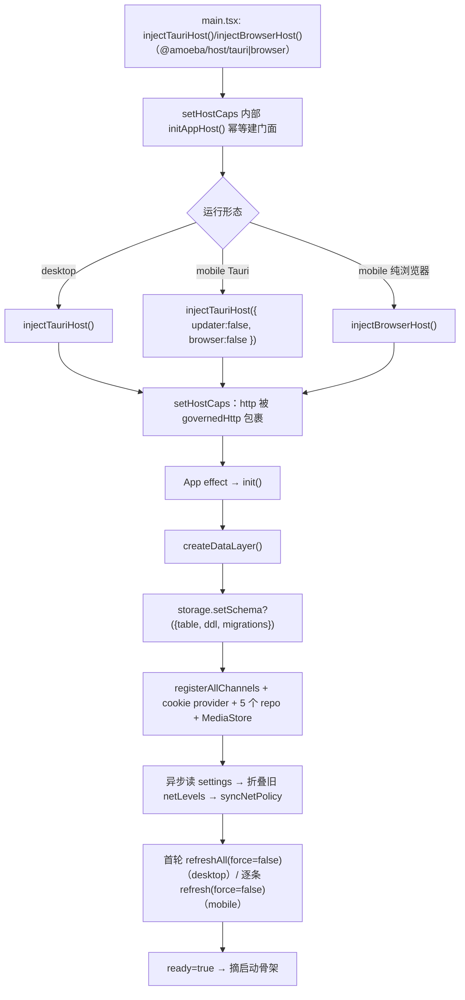

**状态变化**
- 门面：`initAppHost()` 幂等创建，由 `setHostCaps` / 各 `inject*Host` 调用（根入口 import 不再有副作用）；`setHostCaps` 覆盖闭包值，`_http = governedHttp(caps.http)`（`packages/host/src/runtime.ts`）。
- core：`createDataLayer()` **首行**调 `appHost.storage.setSchema?.({ table: KV_TABLE, ddl: KV_DDL, migrations: MIGRATIONS })`，把 DDL 注入 SQL 后端；随后 `registerAllChannels()`、注册进程级 cookie provider、按 `appHost.storage` 建 repo（`packages/core/src/data-layer.ts`）。
- 设置投影：读一次 settings 后同步 `cookieSnapshot`（仅当尚未被更晚写入覆盖）、折叠旧 channelKey 级 `netLevels`、`syncNetPolicy`（`data-layer.ts:195-209`、`:251-261`）。
- desktop：`init()` 把订阅/分组/设置写入 zustand、`dl.store.subscribe(refreshView)`、首轮 `refreshAll(false)` 结束才 `ready=true`；1.5s 后后台 `syncBrowserCookies()`（`apps/desktop/src/store/actions/data.ts:20-71`）。
- mobile：`init()` 写 `dl/items/subs`，订阅 store，逐条串行 `refresh(s.id,{force:false})`（`apps/mobile/src/store.ts:44-64`）。

**成功路径**：门面可读 → `createDataLayer` 返回 → 首轮刷新命中 TTL 缓存则零网络 → store 有内容 → 骨架收一次（`apps/desktop/src/main.tsx:44-70`、`selectors.ts:47-55`）。

**失败/降级**
- 未注入 `http/js/storage`：访问 getter 立即抛带指引错误（`runtime.ts:59-70`）。
- `createDataLayer` 抛错：desktop 置 `initError` 且 `ready=true`，渲染整页错误 + 重试（`data.ts:54-60`、`apps/desktop/src/App.tsx:90-105`）。
- 后台 cookie 同步失败只 `console.warn`，不阻塞启动（`data.ts:61-68`、`:73-85`）。
- 移动端显式 `browser:false`（`apps/mobile/src/main.tsx:16`），`appHost.browser` 为 `undefined`；core 的 passive 判定按「无浏览器」回落主动抓取（见流程 8）。
- `SqliteStorageBackend` 首次访问**不搬迁** localStorage（无该逻辑）；schema 由 `createDataLayer()` 注入，`ready()` 只执行 `schema.migrations`（`packages/host/src/tauri/sqlite-storage-backend.ts` 的 `setSchema` / `requireSchema`）。未注入或在首次读写后再调 `setSchema` 都抛错；KV/内存后端不实现 `setSchema`，调用是 no-op。

**代码锚点**：`apps/desktop/src/main.tsx:4-12`、`apps/mobile/src/main.tsx:16-17`、`packages/host/src/index.ts:24-26`、`packages/core/src/data-layer.ts:171-210`。

---

## 2. 添加订阅

**触发**：desktop 添加订阅对话框 / mobile「粘贴 RSS 直链」；也可来自 OPML 导入或「订阅该节目/分区」。

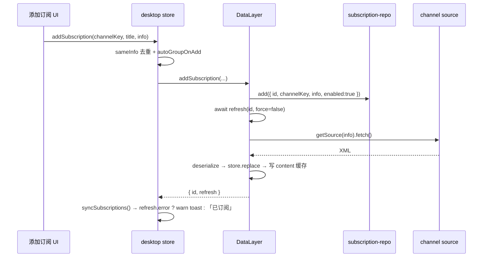

**状态变化**
- 订阅 id = `s-<base36(ms)>-<4 随机>`，创建前清同名退订墓碑（`data-layer.ts:940-943`）。
- `addSubscription` 内部**已刷新一次**并返回 `{id, refresh}`，调用方不应再补一次 `force:true`；需要提示首刷结果时读 `refresh.error`（`data-layer.ts:939-963`、`apps/mobile/src/store.ts:98-103`）。
- desktop 额外：重复订阅按 `sameInfo`（键序无关）拦截；`autoGroupOnAdd` 时按 kind 建/复用分组；成功后 `syncSubscriptions()`（`apps/desktop/src/store/actions/subs.ts:48-74`）。
- mobile 只允许 `rss:url`，重复按 `channelKey==="rss:url" && info.url` 精确匹配并静默返回（`apps/mobile/src/store.ts:85-104`）。

**成功路径**：repo 落盘 → `doRefresh` 抓取 → `store.replace` → copy 进 zustand → rail/列表出现新节点与内容。

**失败/降级**
- 首次抓取失败：`addSubscription` 返回 `{id, refresh}`，`refresh.error` 即首刷结果 → desktop 读它弹 warn「已订阅 ${title}，但${ERROR_KIND_LABEL[kind]}」并附错误详情（无 kind 时用「首次抓取失败」），不再用成功 toast 掩盖空列表（`subs.ts`）；CLI `refresh` 直接复用该结果，避免二次抓取并输出 kind 标签（`refresh.ts`）；mobile 仍刻意只刷新列表、不展示失败徽标（`store.ts`）。
- `autoRefresh=false`：新订阅刷新直接走缓存语义，无缓存时返回 0 条且无 error（`data-layer.ts:424-432`）。
- OPML 批量导入不经 `store.addSubscription`，只 `dl.addSubscription` 并在末尾统一 `syncSubscriptions`（`subs.ts:231-267`）。

**代码锚点**：`apps/desktop/src/store/actions/subs.ts:48-76`、`packages/core/src/data-layer.ts:939-963`、`apps/mobile/src/store.ts:85-104`、`apps/cli/src/commands/refresh.ts:48-57`。

---

## 3. 刷新编排

**触发**：启动首轮、手动「刷新」、定时/全量刷新、`loadMore` 翻页。

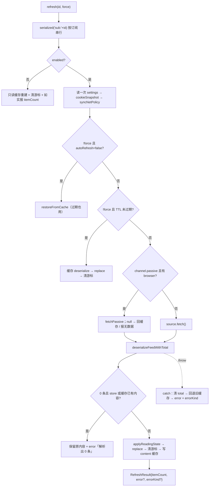

**状态变化**
- 并发模型：不同订阅可并发；**同一订阅的 refresh 与 loadMore 共用一条链**，防止 `fetchMore` 的 await 期间首页被替换、游标错位（`data-layer.ts:541-566`、`:761-762`）。
- app 层全量刷新：`Promise.allSettled` + 每条 `withTimeout(45s)` + `finally` 落 `loading/busy`（`apps/desktop/src/store/actions/data.ts:154-228`、`apps/desktop/src/store/lib.ts:53-79`）。
- TTL：订阅级 `refreshIntervalSec` 优先，否则 `settings.refreshIntervalMin`（默认 30 分钟）（`data-layer.ts:440-443`、`packages/core/src/types/settings.ts:114`）。
- 分页：`loadMore` 把本页 `fetchedAt` 对齐到该订阅已有内容的最小值，保证无 `publishedAt` 的源按 append 顺序稳定排序（`data-layer.ts:779-787`）。
- 分页到底：`cursorMoved && addedCount===0 && channelHasMore!==true`（`data-layer.ts:799-801`）。

**成功路径**：新 XML → 反序列化 → 回填阅读态 → `store.replace`（或 `append`）→ 清/更新游标与总数 → 写 content 缓存 → 返回 `{subscriptionId,itemCount,fetchedAt}`。

**失败/降级**
- 抓取 throw：记 `log.error`、清 `pageTotals`、回退**即使过期**的旧缓存并清游标，返回 `error: err.message` + `errorKind: errorKindOf(err)`（`data-layer.ts` 的 `doRefresh` catch）。
- 缓存写失败只 warn，不把成功刷新降级为失败（`data-layer.ts`）。
- 被动采集无数据（且无缓存）返回固定 `errorKind: "no-data"`，与普通抓取失败区分。
- desktop 单条：失败写 `refreshErrors[id]` 与 `refreshErrorKinds[id]`，toast 标题取 `ERROR_KIND_LABEL[kind]`（`unknown` 用「刷新失败」），成功清两表并按 `itemCount` 抬本地窗口（`apps/desktop/src/store/actions/data.ts`）。
- desktop 全量：`kinds` 与 `errors` 同键写入，toast 额外汇总「其中 N 条需要登录」（`auth` 计数）。任一超时对 `^(weibo|xhs):` 订阅调用 `abortTabs(...,{keepLogin:true})`，但该调用会中止**所有非登录 lane**（`data.ts`、`packages/host/src/browser/backend.ts` 的 `abortTabs`），因此错误可能被归因到别的订阅。
- `refreshAll` 的 `finally` 无条件 `set({busy:{}})`，会清掉并行单条刷新的 busy（`data.ts:215`）。

**代码锚点**：`packages/core/src/data-layer.ts:372-566`、`:761-803`、`apps/desktop/src/store/actions/data.ts:87-257`。

---

## 4. XML 落库与展示

**触发**：任一 `source.fetch()` 成功返回 XML 后。

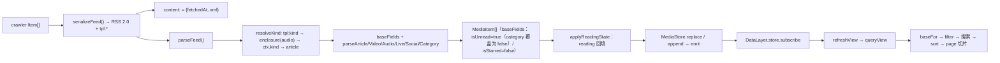

**状态变化**
- 序列化是 crawler→core 唯一通道：标准字段 + `tpl:kind`、`tpl:fetchedAt`、`tpl:streamJson`、各 kind 扩展（`packages/xml/src/serialize.ts:35-53`、`:57-155`）。
- 缓存是「每订阅一份 XML」的 KV（`packages/core/src/repo/content-cache-repo.ts:30-53`）；反序列化在命中缓存时复用同一路径，不新增 MediaItem 序列化面。
- 反序列化注入 app 语义：`subscriptionId` 来自上下文，`baseFields` 给 `isUnread:true / isStarred:false` 默认值，`tpl:fetchedAt` 缺失才用 `now`（`packages/core/src/processing/deserialize.ts:127-163`）。**例外**：`parseCategory` 覆盖为 `isUnread:false` —— 目录条目不是内容、点开也没有 markRead 路径，否则目录订阅会把未读数凭空抬高且消不掉（`:248-259`）。
- `MediaStore`：`replace` 整订阅替换、`append` 按 id 去重并返回新增数、`patch` 必须带 `subscriptionId`（`packages/core/src/store/media-store.ts:70-92`）。
- desktop 重读：`dl.store.subscribe(() => refreshView())` → `queryView` 的 5 段管线（`apps/desktop/src/store/actions/data.ts:44`、`apps/desktop/src/store/ctx.ts:14-31`、`selectors.ts:161-183`）。

**成功路径**：XML 写入 KV → 反序列化 6 类 kind → 阅读态回填 → store emit → 视图列表更新。

**失败/降级**
- 缓存解析失败视为无缓存（`content-cache-repo.ts:40-45`）。
- `tpl:kind` 非法/缺失时退回 channel kind 或 `article`；`live` 的 `platform/roomId` 缺失时给 `"bilibili"/""` 静态默认（`deserialize.ts:58-80`、`:232-234`）。
- XML 保真：`stream` 走 `tpl:streamJson` 完整往返（`url/format/headers/quality/rate/dashManifest`），`enclosure` 仅作标准兼容出口；`Article.media[]` 的 image/video/audio 与全部属性双向保真（`serialize.ts:92-98`、`:157-196`；`deserialize.ts:285-313`、`:469-542`）。`sourceId/raw` 是 crawler 内部字段、刻意不过 XML。

**代码锚点**：`packages/xml/src/serialize.ts:90-155`、`packages/core/src/processing/deserialize.ts:31-80`、`packages/core/src/data-layer.ts:486-509`。

---

## 5. 阅读状态与定位

**触发**：打开条目（标已读）、点星标、播放进度、文章滚动。

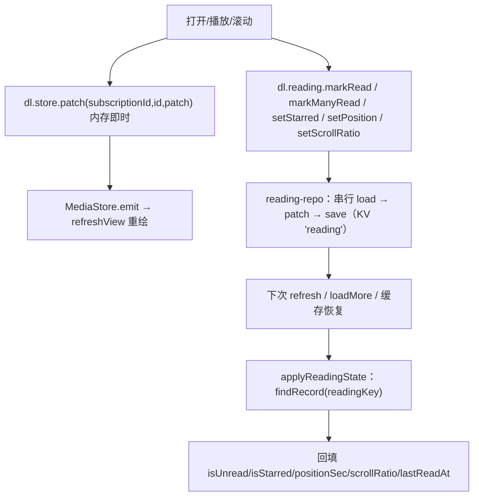

**状态变化**
- 身份键：reading 用 `${subscriptionId}\u0000${itemId}`，刻意不用 `:`（itemId 常含冒号）；视图/队列用 `itemRefKey` 的 `${subscriptionId}:${itemId}`，只作 React key / 选中态、不反解（`packages/core/src/types/reading.ts:32-45`）。
- 双写：先 patch 内存让 UI 立即变，再 `void` 落库；批量标已读必须 `markManyRead` 一次落盘，逐条并发会互相覆盖（`apps/desktop/src/store/actions/reading.ts:36-45`、`packages/core/src/repo/reading-repo.ts:34-42`、`:75-88`）。
- 续播判据：近片尾（余 <15s 或 >98%）清除、变化 <5s 不写（`packages/core/src/reading-position.ts:31-35`）；文章滚动 ≥0.95 清除、<0.05 不写（`reading.ts:79-95`）。
- 刷新回填：`applyReadingState` 按复合键回填，`lastReadAt` 无条件覆盖（`data-layer.ts:342-360`）。
- 视图定位：选中态 `selectedArticleKey` 存复合键，`ReaderMain` 按 `itemKey` 查找，正文会话缓存也按复合键（`apps/desktop/src/store/types.ts:59-63`、`apps/desktop/src/views/library/ReaderMain.tsx:29-43`）。跨订阅同 id（实测 `bilibili:7734200`）不再串条目。
- 退订清理：`deleteBySubscription` 按 `subscriptionId\0` 前缀删除 reading（`reading-repo.ts:115-127`、`data-layer.ts:1020`），不再残留孤儿记录。

**成功路径**：内存即时反馈 → 持久层串行写 → 下次整批重建时回填，不会因刷新/重启丢已读、星标、续播。

**失败/降级**
- 持久化全部 `void ...` 且不接 catch：写失败无 toast/日志，内存与磁盘分歧直到下次刷新才收敛（`reading.ts:33-34` 等）。

**代码锚点**：`packages/core/src/types/reading.ts:21-58`、`packages/core/src/data-layer.ts:342-360`、`apps/desktop/src/store/actions/reading.ts:24-95`。

---

## 6. 播放

**触发**：列表卡片 / 队列 / 播放页的「播放」入口。

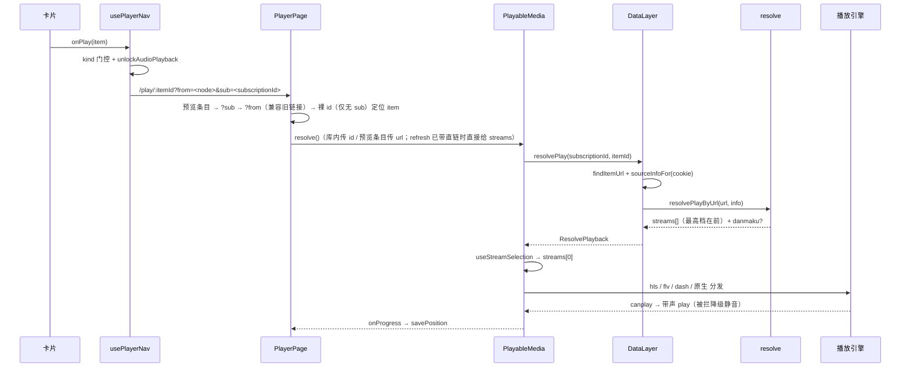

**状态变化**
- 入口收口：social→详情、article→阅读、feed（audio 无 stream）→二级预览、category→分区预览，其余才进播放页；`unlockAudioPlayback()` 必须在手势同步栈内（`apps/desktop/src/views/player/usePlayerNav.ts:99-127`、`:123-124`）。
- 导航收口：`usePlayNavigate` 收条目而非裸 id，`playPath(item.id, from, item.subscriptionId)` 写入 `?sub=`（`apps/desktop/src/router.tsx:36-45`、`:60-64`）。
- 定位（代码顺序）：预览条目（`preview:*`）→ `?sub=<subscriptionId>` 精确匹配 → `?from=` 若恰为真实订阅 id（旧链接兼容）→ 裸 id 兜底，且**有 `sub` 时不走裸 id**（`apps/desktop/src/views/player/PlayerPage.tsx:55-64`）。
- 复合键：播放器 `key`、队列行、相关列表与队列选中态一律 `itemKey(item)`；队列/相关条目点击也传整条 item（`PlayerPage.tsx:180`、`:277`、`:311`）。
- 解析与入参：`findItemUrl` 先按 `(subscriptionId,id)` 在 store 内查 `item.url`；**入参本身含 `://` 时直接当 URL 用**——预览条目（`preview:*`）不在库里，`PlayerPage` 因此传 `item.url` 而非 `item.id`（只要在库内或 `url` 为空则传 id）。凭证侧：订阅条目走 `sourceInfoFor`，预览条目走 `previewInfoFor` 补 cookie/baseUrl（`data-layer.ts:605-609`、`:620-626`；`apps/desktop/src/views/player/PlayerPage.tsx:184-185`）。
- 选流：`streams[0]`，player 不排序（`packages/player/src/hooks/useStreamSelection.ts:57`、`packages/player/src/hooks/streamKind.ts:65-67`）。
- 引擎：HLS 锁最高档 + 隧道 loader；FLV 仅 http-flv；DASH 用 `dashManifest` 造 blob MPD 并关 ABR；原生 mp4 由 `VideoShell` 写 `src`（`packages/player/src/hooks/useMediaStream.ts:104-108`、`:118-139`、`:204-233`、`:239-313`、`PlayableMedia.tsx:412-459`）。
- 续播/进度：`startAtSec` 只跳一次且 ≤3s 视为从头；`timeupdate` → `onProgress` → `positionDecision`（`PlayableMedia.tsx:271-306`、`reading.ts:57-77`）。

**成功路径**：解析得流 → 选首档 → 引擎 canplay → 带声起播（被政策拦则静音）→ 进度/播完回调 → 自动下一条。

**失败/降级**
- 解析失败与播放失败分两个错误态；解析态用 `errorKindOf(error)` 选标题（`auth` → 「需要登录」，`unknown` → 「解析失败」，其余取 `ERROR_KIND_LABEL`；`rate-limit` 额外附「稍后重试」）。403 归 `risk`，不再误判成登录（`PlayableMedia.tsx`）。
- 播放失败只 `retryKey++` 重建引擎；**原生分支**没有 re-render `src` 的逻辑，点重试实际上不重载媒体（`PlayableMedia.tsx:384-405`、`VideoShell.tsx:69-73`）。
- FLV 的 ERROR 原样上报 info 对象，`String(error)` 得到 `[object Object]`（`useMediaStream.ts:215-218`）。
- 未知格式兜底裸 `<video>` 现在有 `onError` 上报（`PlayableMedia.tsx:469-475`），不再表现为永久黑框无提示。
- `resolveLivePlay` 的参数名叫 `roomId`，实现却比较 `item.id`；按参数名传 `LiveItem.roomId` 会误报「不指向可解析的直播链接」（`data-layer.ts:590-595`、`:605-610`）。
- 弹幕失败不阻塞播放：core 只 catch 同步路由错误，异步失败进各平台日志（`data-layer.ts:639-645`）。

**代码锚点**：`packages/core/src/data-layer.ts:581-663`、`packages/resolve/src/resolver/play.ts:35-62`、`packages/player/src/PlayableMedia.tsx:158-306`。

---

## 7. 登录与 cookie

**触发**：账号页扫码/手动粘贴 cookie；启动后的浏览器快照对齐。

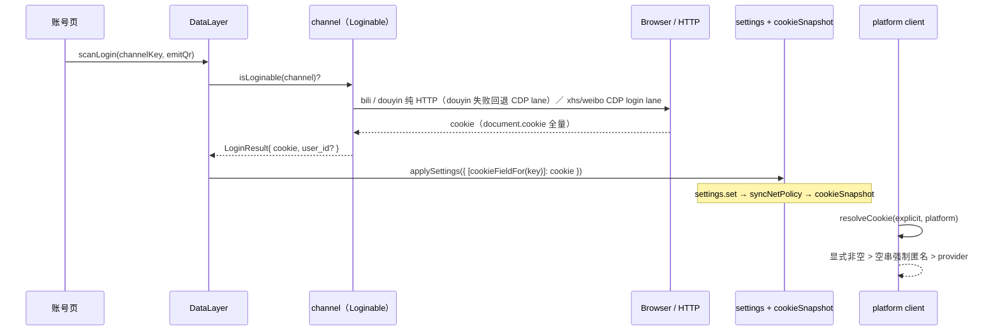

**状态变化**
- 能力探测在 channel 级（`"scanLogin" in channel`），结果 cookie 由 core 按前缀映射到 settings 字段（`packages/crawler/src/index.ts:73-94`、`data-layer.ts:134-141`、`:831-844`）。
- `applySettings` 是唯一合法写入点：写 repo + 立即 `syncNetPolicy` + 更新 `cookieSnapshot`（`data-layer.ts:823-828`）。
- cookie 三级语义：显式非空 > 显式空串（强制匿名）> provider；provider 是进程级单钩子，后注册覆盖先注册（`packages/resolve/src/platform/credentials.ts:25-44`）。
- 抓取侧注入：`sourceInfoFor` 按 `cookieFieldFor` 补 cookie；rsshub 只补 `baseUrl`，不把平台 cookie 发给公网实例（`data-layer.ts:320-333`）。
- 启动对齐：只处理「有启用订阅」的平台；`weiboCookie` 优先（桌面 HTTP 消费方），其余只在浏览器已被拉起时顺带；`withBrowserOpSlot` 与清凭证互斥；`setIfUnchanged` 原子写（`data-layer.ts:879-927`）。

**成功路径**：扫码得到 cookie → 落 settings + 快照 → 后续 `sourceInfoFor`/provider 双通道生效 → 登录档位/私有资源可用。

**失败/降级**
- channel 不支持 `Loginable` → `NoChannelError` 或「does not support scan login」（`data-layer.ts:836-838`）。
- 无 `appHost.browser` 时 xhs/weibo 登录不可用，douyin 仅剩纯 HTTP 路径（被 TLS 风控拦即失败，`packages/resolve/src/platform/douyin/login.ts:280-294`）；xhs 的 HTTP 路径必须拿到 cookie，否则抛可操作中文错误（`packages/crawler/src/channels/xhs/shared.ts:84-91`）。
- 登录流程**刻意不过 `browserGate`**，冷却期仍允许重新扫码自救（`packages/resolve/src/browser/cdp.ts:110-124`）。
- 浏览器无登录标记时 `syncBrowserCookies` 保留旧快照、不清空（`data-layer.ts:873-877`、`:906-913`）。
- CLI 使用独立的 settings 读取与静态快照，不经 `SettingsRepository` 的归一化/损坏留证（`apps/cli/src/info.ts:38-46`、`apps/cli/src/main.ts:41-48`）。

**代码锚点**：`packages/core/src/data-layer.ts:134-141`、`:831-927`、`packages/resolve/src/platform/credentials.ts:41-44`。

---

## 8. 被动采集（以 `xhs:explore` 为例）

**触发**：刷新一个 `passive: true` 的渠道，且宿主有 `browser`。

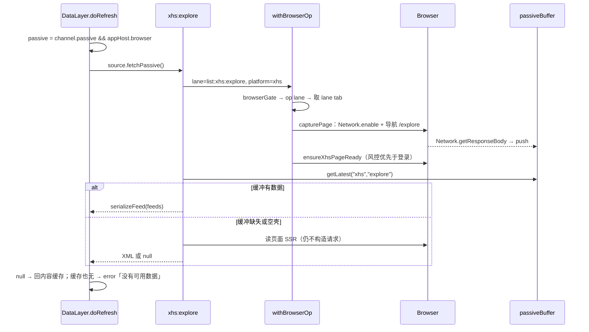

**状态变化**
- 渠道属性 `passive` 只声明「正常路径是被动」，不是网络等级（`packages/crawler/src/index.ts:180-191`）。
- 被动缓冲是进程内单例：按 `(platform,endpoint,canonicalUrl)` 归并，默认 TTL 30min、单条 4MB、总量 32MB（`packages/crawler/src/passive/buffer.ts:71-84`、`:169-170`）。
- `capturePage` 只观察 `Network` 事件、只收文本 MIME，`getResponseBody` 失败静默跳过（`packages/crawler/src/passive/capture.ts:46-142`）。
- `fetchXhsPassivePage` 在缓冲为空/空壳时回退读页面 SSR，仍不构造请求（`packages/crawler/src/channels/xhs/shared.ts:328-353`）。
- 登录/风控判定在被动路径同样执行：风控框先判，再判登录（`shared.ts:70-76`、`:342`）。

**成功路径**：导航产生页面自身响应 → 缓冲命中 → 解析 `__INITIAL_STATE__.feed.feeds` → 序列化 → 正常落库。

**失败/降级**
- 缓冲无数据 → core 回退内容缓存（即使过期），**绝不回退 `fetch()`**（`data-layer.ts:463-479`）。
- 连缓存都没有 → `error: "被动采集：没有可用的数据，且无缓存可回退"`（`data-layer.ts:471-478`）。
- 无浏览器门面 → 若走主动 `fetch()`，xhs 直接抛「发现页需要桌面抓取浏览器」（`xhs/explore.ts:39-40`、`:60-64`）。
- 移动端显式 `browser:false` 后 `passiveMode` 为假，被动渠道按主动 `fetch()` 走；移动端不做 CDP 的设计边界由此成立（`inject-tauri.ts:35`、`data-layer.ts:463`）。
- 预览路径与刷新遵守**同一条被动门**：`previewChannel` 在 `channel.passive && appHost.browser` 时只调 `fetchPassive()`；无数据直接抛 `ResolveError("no-data")`（预览没有订阅缓存可回退），**不回落 `fetch()`**；无浏览器时（CLI/mobile）才走主动抓取（`data-layer.ts` 的 `previewChannel`；`passive-mode.check.ts` 有预览用例）。

**代码锚点**：`packages/crawler/src/channels/xhs/explore.ts:174-199`、`packages/crawler/src/passive/capture.ts:46-142`、`packages/core/src/data-layer.ts:459-480`。

---

## 9. 网络治理（governor）

**触发**：任何经 `appHost.http` 的请求；CDP 操作另经 `browserGate`。

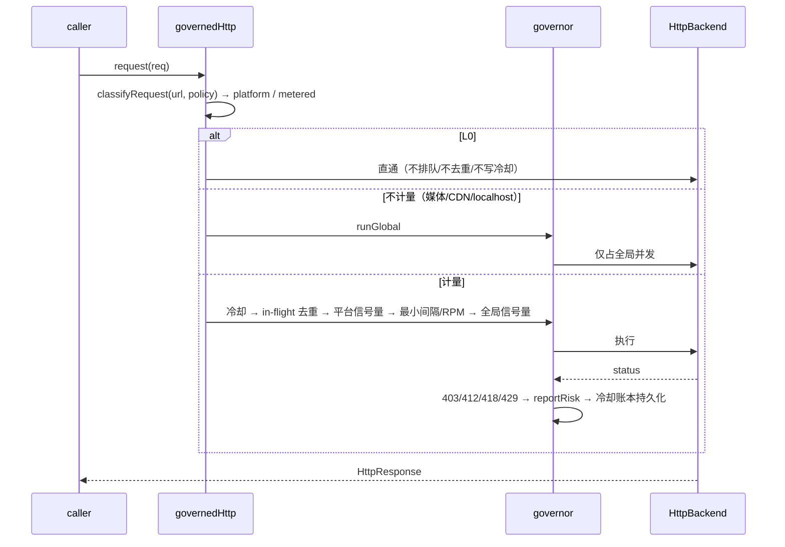

**状态变化**
- 注入即包裹：`setHostCaps` 里 `_http = governedHttp(caps.http)`，调用方无法绕过（`packages/host/src/runtime.ts:131-132`）。
- 分类：URL host → 平台名（未知 host 去 `www.` 后原样成桶）；扩展名/已知媒体 CDN/localhost → 不计量（`packages/host/src/net/governor.ts:249-299`）。
- 等级：精确平台 → `"*"` → 全局；L1 ×1、L2 ×0.5、L3 ×0.25；冷却基准不随等级变（`governor.ts:136-160`）。
- 流水线顺序：冷却检查 → 去重 → 平台并发 → `reservePlatformSlot`（最小间隔 + RPM 滑动窗口）→ 全局并发 → 执行（`governor.ts:598-673`）。
- 冷却：只由显式 `reportRisk` 与计量请求的 403/412/418/429 写入；冷却期内重复信号只刷新原因不延长；账本 best-effort 落 `governor:cooldowns`（`governor.ts:410-431`、`:503-550`、`:645-650`）。
- CDP：`browserGate(platform)` 做冷却 + `max(600ms, minInterval×12)+抖动`；登录不调用（`governor.ts:450-472`、`packages/resolve/src/browser/cdp.ts:61-87`）。

**成功路径**：请求在配额内依次获得平台/全局名额 → 执行 → 统计 `lastLatency/requests/bytes` 供播放器诊断（`governor.ts:475-499`、`packages/player/src/PlayerStatsOverlay.tsx`）。

**失败/降级**
- 冷却未到期直接 reject，错误串含平台名、剩余时间、signal（`governor.ts:607-619`）——该串会一路成为 UI 的刷新错误文案。
- `configureNetwork` 的 `levels` 是**整表替换**，删除覆盖必须整表（`governor.ts:111-130`）。
- 不计量只豁免 RPM/冷却，仍占全局并发；播放分片 `policy:{metered:false}`（`packages/player/src/engines/hlsHostLoader.ts:53-61`）。
- 原生 ``/原生 mp4/部分 HLS 不经 `appHost.http`，governor 管不到（`governor.ts:17-18`）。
- CDP 控制面的 `/json/*` 探测走 `appHost.http` 的 localhost 分支，仍占全局并发，媒体洪峰可能拖慢浏览器操作。

**代码锚点**：`packages/host/src/net/governor.ts:293-299`、`:598-722`、`packages/resolve/src/host.ts:15-41`。

---

## 10. 错误传播

**触发**：渠道/平台 client/resolver/播放引擎任一层失败。

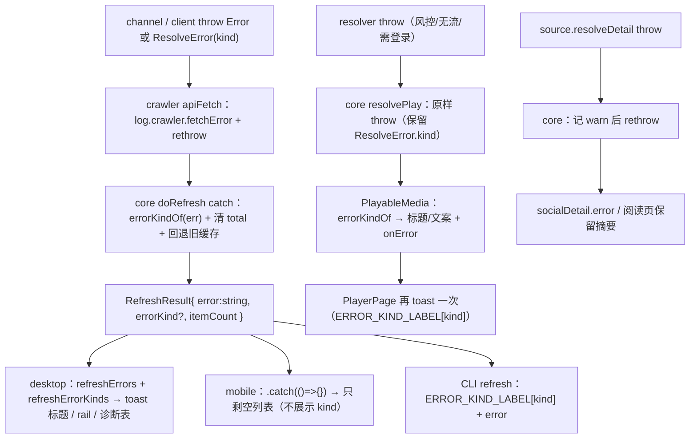

**状态变化**
- 刷新失败是**结果字段**而非异常：`RefreshResult{ error?: string; errorKind?: ErrorKind }`，具名错误只有 `NoChannelError`；被动无数据固定 `no-data`（`packages/core/src/types/refresh-result.ts`、`packages/core/src/errors.ts`、`data-layer.ts` 的 `doRefresh` catch）。
- desktop 聚合：单条写 `refreshErrors[id]` 与 `refreshErrorKinds[id]`；全量在 `finally` 统一写两张表，toast 用 kind 选标题并汇总 `auth` 条数（`apps/desktop/src/store/actions/data.ts`）。
- 首刷：`addSubscription` 返回 `{id, refresh}`，desktop 用 `refresh.errorKind` 取 `ERROR_KIND_LABEL` 弹 warn（无 kind 时「首次抓取失败」）；CLI 直接复用该结果（见流程 2）。
- 诊断表（存储与诊断）在同一条错误旁显示 `ERROR_KIND_LABEL[refreshErrorKinds[id] ?? "unknown"]`（`Diagnostics.tsx`）。
- 详情失败不吞：core 记 warn 后 rethrow，让社交弹窗进入失败态；article 调用方自行 catch 保留摘要（`data-layer.ts`）。
- 热搜/预览失败落各自状态对象的 `error`，与 `loading` 分离防永久转圈（`apps/desktop/src/store/actions/view.ts`）。

**成功路径**：不适用（本流程只描述失败）。

**失败/降级**
- **分类通道**：新抛错点用 `ResolveError(kind)`；旧平台 client 仍是普通 `Error`，`errorKindOf` 按消息启发式归类（429 → `rate-limit`、401/cookie → `auth`、403/412/418/风控 → `risk`、超时/网络/解析各自成类），无法识别时 `unknown`。所以分类是**逐步迁移 + 兜底**，不是全量精确。
- 文案与事实脱节：refresh 失败 toast 仍无条件说「旧缓存已保留」，首次抓取失败时并无缓存（`data.ts`）。
- 超时只丢弃不取消（**HTTP/非浏览器路径**）：底层抓取完成后仍会 `replace` 并写缓存，UI 却保留失败标记；`^(weibo|xhs):` 的浏览器路径则经 `abortTabs` reject 在途 CDP 命令，刷新直接走失败分支、保留旧缓存（底层 invoke 仍跑完，只是不再等待）。中止粒度是全部非登录 lane，见流程 3（`data.ts`、`packages/host/src/browser/channel.ts` 的 `abortPending`、`packages/host/src/browser/backend.ts` 的 `abortTabs`）。
- 错误重复呈现：播放器舞台 + `PlayerPage` toast 各一份，标题一致但详情格式不同（`PlayerPage.tsx`、`PlayableMedia.tsx`）。
- 日志覆盖不全：core 走注入的 console，无日志域；被动无数据、loadMore 失败、preview/热搜/弹幕失败均无日志（`runtime.ts:43-53`、`data-layer.ts`）。

**代码锚点**：`packages/crawler/src/channels/factory.ts:34-48`、`packages/core/src/data-layer.ts:511-538`、`apps/desktop/src/store/actions/data.ts:154-228`。

---

## 11. CLI 与移动端最小闭环

**触发**：命令行执行；移动端启动/点条目。

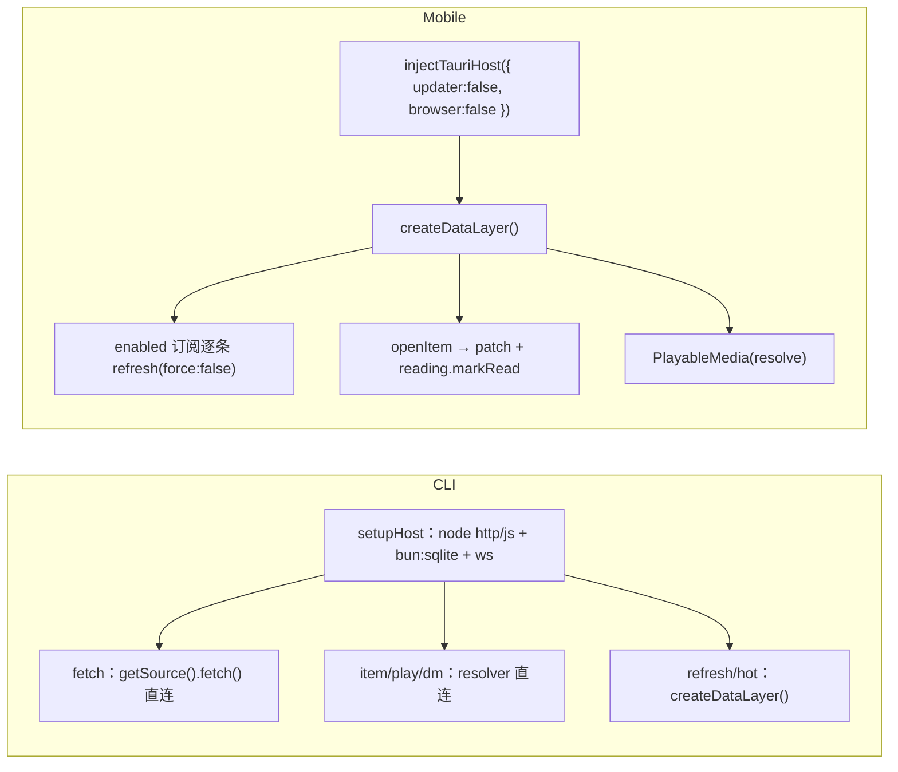

**状态变化（CLI）**
- 宿主自组装：不复用 `injectNodeHost`（它绑死内存存储），而是 `setHostCaps({http:nodeBackend, storage:sqliteStorage, ws:nodeWsBackend})`；**不注入 browser/updater/openExternal**（`apps/cli/src/host/node-host.ts:17-25`）。
- 入口注册静态 cookie provider，读 CLI 自己的 `settings`（与桌面 DB 分离）（`apps/cli/src/main.ts:41-48`、`apps/cli/src/store/sqlite-storage.ts`）。
- `fetch` 直调 `channel.getSource(info).fetch()`，不经 DataLayer，也不应用 settings 的网络等级（`apps/cli/src/commands/fetch.ts:19-31`）。
- `item/play/dm` 直调 resolver；`dm` 在 `finally` 必须 `unsub()`，否则直播 WS 泄漏（`apps/cli/src/commands/item.ts:35-41`、`apps/cli/src/commands/dm.ts:21-40`）。
- `refresh` 才走 `createDataLayer()`：同 channelKey 复用订阅 → `subscriptions.update(info)` 或 `addSubscription`（新建时直接复用其返回的首刷结果，避免二次抓取）→ 复用订阅时 `refresh(force)`；失败行输出 `ERROR_KIND_LABEL[kind] — error`（`apps/cli/src/commands/refresh.ts`）。

**状态变化（mobile）**
- 未读优先列表，全已读回退展示全部；手动刷新逐条 `force:true` 串行（`apps/mobile/src/App.tsx:42-45`、`store.ts:112-122`）。
- `openItem`：`patch` 内存 + `void reading.markRead`（`store.ts:66-77`）。
- 可播判定与 desktop 的 `isFeedItem` 对齐：kind 门控且排除「audio 无 stream」的播客 feed（`store.ts:150-152`）；列表 React key 用 `subscriptionId:id` 复合键（`App.tsx:65`）。
- 只加 `rss:url`；`addSubscription` 的首刷结果被忽略（极简端不展示失败徽标），只重读订阅列表；无设置同步、无登录链路、无分页、无 toast（`store.ts:85-110`、`App.tsx:84-150`）。

**成功路径**：CLI 输出结构化耗时/条数/样本；mobile 完成「列表 → 播放/阅读 → 添加/移除 RSS」。

**失败/降级**
- CLI：`guard` 统一捕获同步/异步错误，打印一行消息 + 堆栈并 `exit 1`（`apps/cli/src/main.ts:50-69`）。新建订阅直接复用 `addSubscription` 返回的首刷结果，不再丢弃错误、也不再二次抓取（`refresh.ts:48-57`）。直连探针按 governor 默认 L1 出站，与 `refresh` 按 settings 的行为不一致。
- mobile：刷新错误被 `.catch(()=>{})` 完全吞掉，失败只剩空列表（`store.ts:55-57`、`:118-121`）；`PlayableMedia` 未传 `streams`，feed enclosure 直链不可用（`App.tsx:213-218`）。可播判定已排除播客 feed、列表 key 已改复合键，不再有这两处缺口。

**代码锚点**：`apps/cli/src/main.ts:36-69`、`apps/cli/src/host/node-host.ts:17-25`、`apps/mobile/src/store.ts:44-152`。

---

## 12. 状态变化总表

| 动作 | 读取 | 写入（内存） | 写入（持久） | 重绘/重读入口 |
| --- | --- | --- | --- | --- |
| 启动 `init()` | settings、subscriptions、groups | `dl/subscriptions/groups/settings/allItems/view/ready` | — | `refreshView()`；`ready` 翻转收骨架 |
| 首轮/手动刷新 | subscription、settings、content 缓存 | `busy/loading/refreshErrors/refreshErrorKinds/page/loadMoreEnded/totals`、`allItems/view` | `content:<subId>` | `refreshView()` |
| 添加订阅 | 现有 subscriptions（去重）、settings | 新订阅入 zustand；首刷结果 `{id, refresh}` 决定成功/警告 toast（`refresh.errorKind` 选文案） | `subscriptions` blob | `syncSubscriptions()` |
| 删除订阅 | 当前 selectedNodeId | `selectedNodeId→tab:all`、清 items | 删 `subscriptions`、`content:*`、`body:*`、`reading`（按订阅前缀） | `navTo` 改 URL → `syncSubscriptions()` |
| 启用/停用 | 当前 sub | 仅 `subscriptions` 数组 | `subscriptions` blob | 不调 `syncSubscriptions`（不改内容集） |
| 切换节点 | URL `nodeId` | `selectedNodeId`、清 `selectedArticleKey/hotWord/query` | — | `refreshView()`；必要时 `queryCanLoadMore` |
| 选中文章 | item | `selectedArticleKey = itemRefKey(subscriptionId,id)` | — | `refreshView()` |
| 筛选/排序/搜索/翻页窗口 | 当前 `filter/sort/query/page` | 对应字段 | — | `refreshView()` |
| 翻页 `loadMore` | subscription、游标、store 条数 | `page[id]+=addedCount`、`loadMoreEnded`、`refreshErrors` | 追加内容由 core 内存维护（缓存不更新） | `refreshView()` |
| 标已读/星标 | item 当前值 | `store.patch` | `reading` blob | `MediaStore.emit → refreshView` |
| 续播/滚动 | `findItem` 当前值 + `positionDecision` | `positionSec/scrollRatio` | `reading` blob | 同上 |
| 刷新后回填 | `reading.getAll()` | 重建的 items 带阅读态 | — | `store.replace → emit` |
| 扫码登录 | channel 能力、settings 基线 | `settings`、`cookieSnapshot` | `settings` blob | 设置页重读 settings |
| 启动 cookie 对齐 | 启用订阅、浏览器 profile | `settings`（仅变化字段） | `settings` blob（CAS） | `set({settings})` |
| 播放解析 | `(subscriptionId,itemId)` → item.url（入参本身是 URL 时直用，预览条目走此路）；settings cookie | 无（返回 `ResolvePlayback`） | — | 播放器内部状态 |
| 打开社交详情 | store 条目 | `socialDetail` | `body` 缓存（仅 article） | 组件局部渲染 |
| 二级预览 `?open=` | URL query、previewDetail TTL | `previewDetail` | — | `MediaMain` 读 `previewDetail.items` |
| 加入/移出队列 | item（按 `itemRefKey` 复合键） | `queue` | `localStorage ui-queue`（`subId:itemId`） | 队列组件重渲染 |
| 切换弹幕 | settings、播放页临时开关 | `danmakuVisible` | — | 播放器 props |
| 离线开关 | — | `offline` | — | 刷新入口提前返回 |
| 改设置 | 当前 settings | `settings`、`cookieSnapshot` | `settings` blob；`syncNetPolicy` 推 governor | `set({settings})` + `applyRuntimeSettings` |
| 网络策略 | settings.netLevel/netLevels | governor 内部 `_policy` | `governor:cooldowns`（冷却） | 下一次请求生效 |

---

## 延伸阅读

- 同目录：[README.md](README.md) · [00-overview.md](00-overview.md) · [01-packages.md](01-packages.md) · [02-contracts.md](02-contracts.md) · [04-extension.md](04-extension.md) · [05-risks.md](05-risks.md)
- 现有细节：[宿主 ABI](../host-abi.md) · [数据与存储](../data-and-storage.md) · [爬虫拓扑](../crawler-topology.md)
- 播放与弹幕：[playback.md](../../playback/playback.md) · [danmaku.md](../../playback/danmaku.md)
- 风控：[crawler-risk-control.md](../../risk/crawler-risk-control.md)
- 运维：[commands.md](../../ops/commands.md) · [smoke-check.md](../../ops/smoke-check.md)
