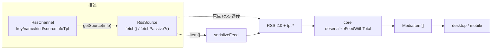
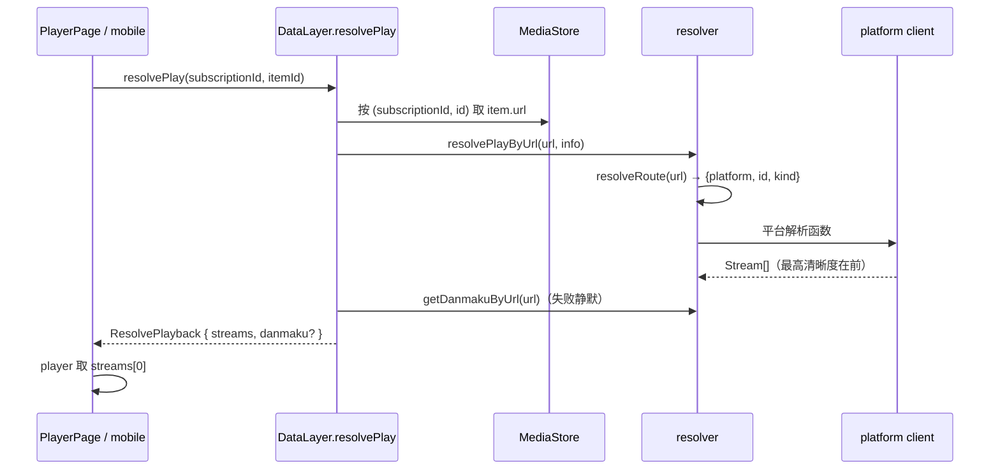

# 04 · 新开发者指南：理解、调试与扩展

> 基于 2026-10-26 的 master 快照（v0.7.0）。本文回答「动手时改哪里、必须同步什么、跑什么验证」；
> 数据结构与契约的完整定义在 `02-contracts.md`，端到端时序在 `03-flows.md`，这里不复述。
> 所有 `path:line` 是阅读锚点，重构后行号会漂移，**以文件与符号名为准**。

## 1. 三个心智模型

### 1.1 一切皆 RssChannel：渠道只描述「取什么」



- `RssChannel` 是纯描述（`packages/crawler/src/index.ts:165`）；`getSource(info)` 每次返回新 source
  （`packages/crawler/src/index.ts:35`），source 的最小契约只有 `fetch(): Promise<string>`——直接吐 XML，
  **不返回类型化条目**。crawler 内部产出 `Item` 只是写出侧的中间形态（`packages/xml/src/types.ts:174`）。
- 可选能力用「方法是否存在」探测，不用继承或注册标记：`Pageable`（`:115`）、`HotWordSource`（`:52`）、
  `ItemDetailSource`（`:58`）、`Loginable`（`:73`）、渠道属性 `passive`（`:191`）、`readLoginCookie`（`:197`）。
  判据函数集中在 `:135-151`，core 只依赖这些谓词。
- 判断代码该落在哪一层，看它操作的是什么：

| 你在写的东西 | 落点 | 理由 |
| --- | --- | --- |
| 调哪个平台 API、翻页参数、字段映射 | `packages/crawler/src/channels/**` | 渠道只负责产出订阅条目 |
| 签名、cookie、取流、弹幕、CDP | `packages/resolve/src/**` | 平台能力层，crawler 只消费其函数 |
| 订阅/刷新/缓存/阅读态/设置 | `packages/core/src/**` | 编排与持久化所有者 |
| 怎么渲染、怎么解码、怎么起播 | `packages/player/src/**` | 播放层，平台无感 |
| 宿主能力（http/ws/存储/浏览器） | `packages/host/src/**` + `apps/src-tauri` | 唯一与环境相关的层 |

**工厂不是万能的**：`makeApiChannel`（`packages/crawler/src/channels/factory.ts:96`）支持单页
`fetchPage`（含 `{items, hasMore}` 过滤空页）、数值翻页、`scanLogin` 与 `readLoginCookie`；
`ApiChannelSpec`（`:67`）里**没有** `total`、`passive`、`fetchPassive`、`resolveDetail`。需要
`tpl:total` 时手写 `getSource` 并调 `apiFetch`（`:34`，返回 `FetchResult`）；被动渠道只能类实现
（`xhs/explore.ts`）；游标语义特殊的渠道手写 `fetchMore`。

### 1.2 三条跨包边界：内容走 XML、宿主能力走 appHost、控制面走注册表

| 边界 | 方向 | 载体 | 定义处 | 谁读 | 违规的后果 |
| --- | --- | --- | --- | --- | --- |
| 内容边界 | crawler → core | RSS 2.0 + `tpl:*` 字符串 | 写出 `packages/xml/src/serialize.ts:35`，读入 `packages/core/src/processing/deserialize.ts:31` | core 的 `deserializeFeed` | 字段静默退化（历史：174 条 live 全 `unknown`） |
| 宿主边界 | 任意包 → 宿主 | `globalThis.appHost.*` | `global.d.ts:27-348`（**不是模块导出**） | crawler/core/resolve/ui/player | 运行时才暴露「未注入」或能力误判 |
| 控制面边界 | core → crawler | 注册表 / 能力谓词 / 工厂函数（`registerAllChannels`、`listChannels`、`isPageable`、`httpText`） | `packages/crawler/src/index.ts:135-151`（谓词）、`:209`（惰性注册） | core 的 `data-layer.ts:11`、`source/index.ts:13-17`、`source/rsshub.ts:18` | 不属违规：`core → crawler` 是依赖矩阵允许的前向依赖；漏注册/漏挂谓词只在运行时暴露（渠道静默消失） |

- XML 只承载**列表快照 + 元数据**；resolver 产出的播放流、弹幕、被动缓冲都不进 XML（`serialize.ts:4-11`）。
  例外是 feed 自带的直链 `item.stream`：它随条目经 `tpl:streamJson` 过界（标准 enclosure 仍保留一份）。
  应用语义（`isUnread`/`isStarred`/`positionSec`/`scrollRatio`）也不进 XML，由 core 的 reading repo 回填
  （`deserialize.ts:148-151`）。哪些字段能过界、哪些是有损的，见 `02-contracts.md` 的保真矩阵。
- host 根入口**没有** import 副作用：`setHostCaps` / `injectTauriHost` / `injectNodeHost` /
  `injectBrowserHost` 内部幂等调用 `initAppHost()` 建门面，然后只填闭包（`runtime.ts`）。
  应用按环境走 `@amoeba/host/{tauri,browser,node}` 子路径，避免把三套后端拉进模块图。
  `http/js/storage` 必填，`ws/browser/updater` 可选，`net` 恒有。
- 类型多数已改为直接引用，不再镜像：`RssChannel`/`SourceInfo`/`LoginCookieSnapshot` 由 core `import type`
  crawler 并 re-export（`packages/core/src/source/index.ts:17,19`）。仍未收口的是 `LoginResult`
  （crawler/core/resolve 三份平行声明）与 `LivePlatformId`（xml/core 各一份），改一侧不会触发编译错误。
- 写新代码时先问：这是「内容」「宿主能力」还是「渠道装配」？内容走 XML，能力走 appHost，渠道装配走
  crawler 注册表/谓词（`core → crawler` 是依赖矩阵允许的前向依赖，见 `01-packages.md` §1.1 与 §2.6）。
  除此之外**不要**为了省事跨包 import 实现；core 对 crawler 的条目模型仍然零依赖。
- **错误分类也是一条跨包契约**：新抛错点优先 `new ResolveError(kind, msg)`（`@amoeba/resolve/errors`，
  `kind` 见 `ErrorKind`）；core 原样 re-export，UI 用 `ERROR_KIND_LABEL` 出文案、`errorKindOf` 兜底。
  旧普通 `Error` 仍按消息启发式归类（403 → `risk`，401/cookie → `auth`，429 → `rate-limit`），逐步迁移即可，
  不要为了分类在 UI 里重新写正则。

### 1.3 播放按 URL 懒解析：列表里没有流



- refresh 只产元数据；`item.url` 指向平台详情页，可播流在用户点播放时才解析（`packages/core/src/data-layer.ts:659-673`）。
  `Stream` 现在由 `tpl:streamJson` 全字段承载（headers/quality/rate/dashManifest，`packages/xml/src/serialize.ts:92-98`），
  但列表仍只该装快照：**不要**在 refresh 里顺手塞播放解析结果，流仍应在点播时由 resolver 产出。
- 唯一例外是播客/音频 feed：`rss:podcast` 在 item 上带 enclosure 直链（`packages/crawler/src/channels/rss/podcast.ts:63`），
  这类 `item.url` 是网页、by-url 必失败，所以宿主必须把 `stream` 作为 `streams` prop 直给播放器
  （`apps/desktop/src/views/player/PlayerPage.tsx:179-185`）。移动端只传 `resolve`，是已知缺口；mobile 已冻结（2026-10-26），不再为它补 `streams`。
- 选流契约是 `streams[0]`，由 resolve 侧排序保证，player 不二次挑拣（`packages/player/src/hooks/streamKind.ts:65`）。
  DASH 流的 `url` 恒为空、内容在 `dashManifest`，判「可播」时必须同时看两者（`PlayableMedia.tsx:162`）。
- 因此新增平台**不需要**动 crawler 渠道；反过来新增 crawler 渠道也不应该关心播放。

**三模型的关系**：渠道决定 `item.url` 长什么样；resolver 决定这个 URL 能不能播；core 决定快照、状态与持久化；
player 只决定怎么把 `streams[0]` 放出来。

## 2. 「改什么 → 去哪改」矩阵

| 需求 | 主改动 | 必须同步 | 最小回归 |
| --- | --- | --- | --- |
| 加一个 crawler 渠道 | `packages/crawler/src/channels/<平台>/` + `register.ts:73` | 参数表单、`channelOptions`、cookie 取值、文档 | `bun run rss channels` / `rss fetch <key> --json` |
| 加平台解析 / 播放路由 | `packages/resolve/src/platform/<p>/` + `resolver/router.ts` | `resolver/play.ts`、`resolver/danmaku.ts`、`resolve/src/index.ts`、日志域 | `router.check.ts`、`rss item/play/dm` |
| 跨包加字段 | `packages/xml/src/types.ts` + `serialize.ts` | `core/types/media-item.ts` + `deserialize.ts` + UI 消费 | `serialize-roundtrip.check.ts` + `serialize-contract.check.ts` |
| 加播放引擎/格式 | `packages/player/src/hooks/streamKind.ts` + `useMediaStream.ts` | `stats.ts` 的 `EngineKind`、`play` 分发、依赖安装 | `useStreamSelection.check.ts` + `ui-play-check.ts` |
| 加视图 | `apps/desktop/src/store/nodes.ts` + `apps/desktop/src/App.tsx:133-147` | `apps/desktop/src/store/selectors.ts:67` 的 `baseFor`、store 字段、路由、侧栏入口、播放入口走 `usePlayerNav`（可播判定 `isPlayable`/`isFeedItem`） | `tsc -p apps/desktop` + `ui-probe.ts goto <node>` |
| 加设置项 | `packages/core/src/types/settings.ts` + `DEFAULT_SETTINGS` | 设置页、写入路径、运行时镜像（若渲染直读） | `tsc -p packages/core` + 真机改一次 |
| 加存储后端 | 实现 `StorageBackend`（`global.d.ts`）；SQL 后端再实现 `setSchema` | 注入点；DDL 仍取 core `db/schema.ts`（由 `createDataLayer` 经 `setSchema` 注入） | `host-check.ts` + `repo-concurrency.check.ts` |
| 改错误分类 | `packages/resolve/src/errors.ts`（`ErrorKind` / `ERROR_KIND_LABEL` / `errorKindOf`） | 平台 client 新抛错点用 `ResolveError`；消费端统一 `errorKindOf` + `ERROR_KIND_LABEL` | `passive-mode.check.ts` + 断网/403/未登录三种文案 |
| 加 CLI 命令 | `apps/cli/src/commands/<x>.ts` + `main.ts` | 参数解析、输出约定、`docs/ops/commands.md` | `bun run rss <x>` + `rss env --probe` |
| 加登录 | 渠道 `Loginable` + resolve 平台登录实现 | `cookieFieldFor`、账号页、cookie 同步 | `credentials.check.ts` + 真机扫码 |

## 3. 六个 step-by-step recipe

### 3.a 新增 crawler 渠道

**文件清单**

1. `packages/crawler/src/channels/<平台>/<name>.ts`：渠道定义。单页 API 用 `makeApiChannel`：
   ```ts
   export const XChannel = makeApiChannel({
     key: "x:list", name: "X 列表", kind: "video",
     sourceInfoTpl: [{ key: "uid", label: "用户 ID", required: true }],
     channelTitle: () => "X 列表",
     channelLink: "https://example.com/",
     fetchPage: async (info, page) => mapItems(await client.list(info.uid, page)),
     pageable: { first: 2, step: 1 }, // 有下一页才写
   })
   ```
2. `packages/crawler/src/channels/<平台>/index.ts`：导出；有纯映射函数就单独导出，便于自检。
3. `packages/crawler/src/register.ts:73`：在 `registerBuiltinChannels()` 里 `registerChannel(...)`。
   **漏登记没有任何报错**，`listChannels()` 只会看不到它。

**能力选择**

| 需求 | 写法 | core 侧消费 |
| --- | --- | --- |
| 翻页（页码/偏移） | `pageable: { first, step }` 或手写 `fetchMore` | `isPageable` → `loadMore`（`data-layer.ts:839`） |
| 上游真实总数 | 手写 `getSource` + `apiFetch` 返回 `{ items, total }` | `tpl:total` → `totalOf` |
| 热搜词 | source 上实现 `resolveHotWord(word)` | `isHotWordSource` → `resolveHotWord`（`:743`） |
| 单条详情 | source 上实现 `resolveDetail(item, { passive })` | `isItemDetailSource` → `resolveDetail`（`:763`） |
| 扫码登录 | channel 上实现 `scanLogin(emitQr, opts)` | `isLoginable` → `scanLogin`（`:919`） |
| 被动采集 | `readonly passive = true` + source 上 `fetchPassive()` | `data-layer.ts:513-541` 只调 `fetchPassive`，**绝不回退 `fetch`** |
| 启动 cookie 快照 | channel 上 `readLoginCookie(browser)` | `syncBrowserCookies`（`:967`） |

**cookie 与参数**

- 渠道只从 `info` 取参：`defaultInfo` < 调用方覆盖（UI 表单 / CLI `--kv`）。cookie 在 `fetchPage` 闭包里读一次
  `info.cookie`，显式传给平台 client；**不要**在渠道里写 channelKey→cookie 前缀表。
- 三级语义由 `resolveCookie` 统一：显式非空 > 显式空串（强制匿名）> credentials provider
  （`packages/resolve/src/platform/credentials.ts:41-44`）。provider 由 core 构造时注册（`data-layer.ts:201-205`），
  CLI 在入口注册（`apps/cli/src/main.ts:50-57`）。
- `defaultInfo` 要么不写、要么写**真实默认值**；空对象是 truthy，会让发现页把它列成「可一键订阅」
  （`docs/ops/smoke-check.md` 有案底）。

**必须遵守**

- 失败必须 `throw`，不得静默返回空数组；多房间渠道「全部失败 ≠ 成功 0 条」。新抛错点优先
  `new ResolveError(kind, msg)`（如登录失效 `auth`、风控码 `risk`、冷却 `rate-limit`），普通 `Error`
  只作为旧代码的过渡。
- `item.id` 必须在渠道内稳定且唯一，不能用榜位/数组下标。
- 新平台只需在 `packages/platform/src/index.ts` 的 `PLATFORMS` 加一条（`id`/`label`/`hosts`/`prefixes`/`cookieField`/`browserCookieHosts`）：core 的 `cookieFieldFor`/`platformOfChannel`、governor 的 `platformOf`、账号页展示名全部转发它，**不要再手抄第二张表**（R9，`platform.check.ts` 守四组映射）。再补 `AppSettings` 的 cookie 字段与 UI 的筛选/图标表。

**回归**：`bun run rss channels --kind <kind>`、`bun run rss fetch <key> --json`；有纯映射则加
`packages/crawler/src/example/*.check.ts`。浏览器渠道在 CLI 需 `--browser` 且先
`cargo build -p amoeba-browser`（xhs 还需登录态）。

### 3.b 新增平台 client / by-url 播放解析

1. `packages/resolve/src/platform/<p>/`：`client.ts`（请求/签名/cookie）、`play.ts`（取流）、`danmaku.ts`（可选）、
   `index.ts`（门面）。cookie 一律经 `resolveCookie(explicit, "<platform>")`。
2. `packages/resolve/src/resolver/router.ts:29`：在 `ROUTES` 加规则。host 必须用 `(?:^|[./])` 锚定
   （防 `notyoutube.com` 子串伪造），`extractId` 返回 null 表示跳过。`kind` 只能 `video` / `live`。
3. `packages/resolve/src/resolver/play.ts`：把新平台加进 `VideoPlatform` / `LivePlatform` 联合与
   `resolveVideoStreams` / `resolveLiveStreams` 的 switch。返回的 `Stream[]` **必须最高清晰度在前**。
4. `packages/resolve/src/resolver/danmaku.ts`：`getDanmakuById` 的联合类型与 switch；无弹幕能力就落到
   `default` 抛错（core 会静默，见 `03-flows.md`）。
5. `packages/resolve/src/index.ts`：`export *` 门面；`packages/resolve/src/log.ts` 加日志域。
6. 风控：命中平台风控码时调 `appHost.net.reportRisk(platform, signal)`，并在
   `host/net/governor.ts:394-401` 的 `SIGNAL_COOLDOWNS` 登记信号；新平台还要进 `DEFAULT_NET_POLICY.platforms`。
7. 错误分类：平台 client / 播放函数的新失败点用 `throw new ResolveError(kind, msg)`（`packages/resolve/src/errors.ts`，
   经 `@amoeba/resolve/errors` 子路径或包门面导出）。路由不支持已是 `unsupported`；登录/风控/限流/超时
   分别用 `auth/risk/rate-limit/timeout`。不要新增「靠 message 文本让 UI 猜」的错误。
8. 平台枚举：所有新平台都要加 `resolver/router.ts:17` 的 `ResolvePlatform`，并按可播类型加进
   `play.ts` 的 `VideoPlatform` / `LivePlatform` 联合（`:65` / `:78`）；**只有支持直播的平台**才同时改
   `packages/xml/src/types.ts:135` 与 `packages/core/src/types/live.ts` 的两份 `LivePlatformId`。

**已知边界**：YouTube 直播与点播 URL 同形，路由只能判 `video`，`play.ts:46-55` 有特判；新平台不要复制这种
「靠注释维持」的例外。若平台需要登录 cookie，还要在 `cookieFieldForPlatform` 与 `AppSettings` 里加字段。

**回归**：`router.check.ts`、`credentials.check.ts`、`bun run rss item <url>`（看全档位）、
`bun run rss dm <url> -s 5`；播放器侧再跑 `scripts/ui-play-check.ts`。

### 3.c 跨包新增字段（crawler → xml → core → UI）

| 层 | 改哪 | 要点 |
| --- | --- | --- |
| 协议类型 | `packages/xml/src/types.ts` | 字段属于哪个 `Kind`；写注释说明语义 |
| 写出 | `packages/xml/src/serialize.ts` | 能装进标准 RSS 就不用 `tpl:`；`tpl:` 用 `setTpl`/`setTplN`，`media:content`/`enclosure` 的属性直写（`@_tpl:*`）也在守卫扫描面内 |
| 内容模型 | `packages/core/src/types/media-item.ts` | 与 xml 侧同名同义；不要带 app 语义 |
| 读入 | `packages/core/src/processing/deserialize.ts` | 对应 `parse<Kind>` 里读回；缺省值要显式 |
| 消费 | desktop/mobile/player | 先确认字段真的能到这一层（见保真矩阵） |
| 回归 | 两个 check + 文档 | 往返用例必须覆盖新字段 |

**规则**

- 「能装进标准 RSS 的字段一律不用 `tpl:`」：缩略图 → `media:thumbnail`、附件/图 → `enclosure` + `media:content`、
  摘要 → `description`、正文 → `content:encoded`（`serialize.ts:2-11`）。
- 应用语义（已读/星标/进度）不进 XML：它们属于 reading repo，刷新后由 core 回填。
- UI 需要的字段如果只有 crawler 有、core 类型没有，先补 core 类型再谈 UI。
- 新增 `kind` 是跨 4 处的改动：xml `Kind`、core `MediaKind`、`deserialize.ts:58` 的白名单、
  UI 的 `KIND_META`/`TABS`/`nodeMeta` 分支；漏一处会静默回落 `article`。
- `Stream` 由 `tpl:streamJson` 整体透传，`Article.media[]` 逐字段往返（kind/url/mime/title/width/height/duration/
  poster/aspectRatio/bitrate/streamingFormat/isLiveNow/lang）；两者都必须 serialize/deserialize 两侧同改。
  `sourceId/raw` 仍不过界（R18）。
- 改 `Stream` 形状时只写 `tpl:streamJson`（仅 video/audio，`serialize.ts:95-98`），不要逐字段加 `tpl:`：
  读取侧整段 JSON 解析、坏 JSON 回退 enclosure；enclosure 继续保留作为标准 RSS 兼容出口。

**回归**：`bun packages/core/src/example/serialize-roundtrip.check.ts`（必须覆盖新字段）+
`serialize-contract.check.ts`。后者同时扫 `setTpl(...)/setTplN(...)` 单行调用与
`node["@_tpl:key"]` 属性直写（如 `serialize.ts` 的 `@_tpl:liveVideo`）。
用 helper 动态拼 key 的写法仍不在扫描面，新增这类写法时要先扩展守卫。

### 3.d 新增播放引擎 / 格式

1. `packages/player/src/hooks/streamKind.ts`：加**纯函数**判据（只读 `format`/`url`），并决定是否纳入
   `isStreamingStream`（`streamKind.ts:49`）。**不要**把判据放进 `useMediaStream.ts`——它顶层 import
   三个引擎，node 侧自检会崩。
2. `packages/player/src/hooks/useMediaStream.ts`：在 effect 里加分支。每个分支必须：
   建实例 → `reportStats({ engine })` → 订阅错误并 `onError` → 在 `canplay` 上
   `attemptPlayWithMuteFallback` → return 清理函数（销毁实例 + 移除监听）。末尾的 `return cleanup`
   是「未匹配」兜底，新分支必须写在它之前。
3. `packages/player/src/stats.ts:8`：把新引擎加进 `EngineKind` 与 `engineLabel`。
4. 若请求需要绕过 CORS/Origin：写 `packages/player/src/engines/<x>HostLoader.ts`，走
   `appHost.http` 并带 `policy: { metered: false }`（播放分片不参与平台 RPM/冷却）。
5. `packages/player/package.json` 加依赖后必须 `bun install` 并重启 Vite（预打包只在启动时做）。
6. `PlayableMedia` 的分发依赖 `needsStreamPlayer = isStreamingStream(stream)`（`PlayableMedia.tsx:217`）；
   判据没纳入 `isStreamingStream` 时，新格式会落到原生 `<video>` 分支。原生分支由 `VideoShell` 写 `src`，
   不经过 `useMediaStream`。

**回归**：`bun packages/player/src/hooks/useStreamSelection.check.ts`、`player-stats.check.ts`；
真实起播必须跑 `bun scripts/ui-play-check.ts`（tsc 查不出引擎生命周期错误）。

### 3.e 新增视图 / 设置项（只讲数据接线）

**视图**（`nodeMeta.type` 驱动的七种外壳：home / reader / media / hot / page / player / shortvideo；
其中 home 由根路径 `/` 承载，其余由 `/v/:nodeId`、`/play/:itemId` 承载）：

1. `apps/desktop/src/store/nodes.ts`：确定 `nodeId` 语法，扩展 `NodeType` 与 `nodeMeta()`（`:144`）。
2. `apps/desktop/src/App.tsx:133-147`：按 `meta.type` 挂新主区。注意 `main` 以 `nodeId` 为 key 重挂，
   避免虚拟列表保留旧 `scrollTop`。
3. `apps/desktop/src/store/selectors.ts:67` 的 `baseFor`：定义这个节点取哪些条目。只在 selectors 里派生，
   不要把过滤逻辑写进组件。
4. `apps/desktop/src/router.tsx`：只有需要独立 URL 时才加路由；`/v/:nodeId` 的 loader 必须在渲染前
   `select(nodeId)`，`/play/:itemId` 不要改 `selectedNodeId`。
5. 状态字段：`store/types.ts` 加形状、`store/index.ts` 初始化、动作放 `store/actions/`。
6. 侧栏入口：`nodes.ts` 的 `TABS`/`SMART`/`SHORT_MODES`/`PAGES`；树的键盘行为改完跑 `rail-nav.check.ts`。
7. 播放入口：视图里渲染条目卡片的播放动作一律用 `views/player/usePlayerNav.ts` 的 `onPlay`，不要自己
   `navigate("/play/...")`——它负责手势内 `unlockAudioPlayback`，以及 social/article/播客 feed/分区目录的
   可播判定兜底（`isPlayable`/`isFeedItem`）。

**设置项**，先分清两类：

| 类型 | 存哪 | 怎么写 | 何时生效 |
| --- | --- | --- | --- |
| 功能型（刷新/风控/cookie/播放行为） | core `AppSettings`（`appHost.storage` 的单 KV blob） | `dl.settings.set`（= `applySettings`，`data-layer.ts:911`） | 立即同步 governor 与 cookie 快照 |
| 表现型（主题/密度/字号/行宽） | desktop `usePrefs`（localStorage `ui-prefs`） | `usePrefs.set` | 同步写 `<html data-*>`，首帧脚本共用 key |

功能型设置步骤：`core/types/settings.ts` 加字段 + `DEFAULT_SETTINGS` → 设置页 tab（`SettingsPage.tsx` 的
`TABS` 与分支）→ 用 `setSetting` 写。**不要**直接写 settings repo：`applySettings` 还负责 `syncNetPolicy` 与
`cookieSnapshot`，绕过会让 HTTP 回落路径继续用旧 cookie。若渲染管线要直读（如 `imageProxy`/`dataSaver`），
在 `store/lib.ts` 的 `applyRuntimeSettings` 里镜像到 `appHost`，不要走 props 透传。

**回归**：`tsc -p apps/desktop` + `ui-probe.ts goto <node>` / `page:settings`；改偏好首帧还要对照
`index.html` 的首帧脚本（与 `prefs.ts` 共用同一 key 与形状，不要改结构）。

### 3.f 新增 storage 后端或 CLI 命令

**Storage 后端**

1. 在 `packages/host/src/<环境>/` 实现 `StorageBackend`（`global.d.ts`）：`get/set/delete/keys(prefix?)`，
   纯字符串 KV，无事务/批量语义。
2. DDL **唯一权威**是 `packages/core/src/db/schema.ts` 的 `KV_TABLE`/`KV_DDL`/`SCHEMA_MIGRATIONS`
   （`STORAGE_SCHEMA` 是注入体）；后端只执行，不新增建表语句。**不要再 import `@amoeba/core`**：
   core 在 `createDataLayer()` 首行调 `appHost.storage.setSchema?.(STORAGE_SCHEMA)`。
3. SQL 后端实现 `setSchema(schema)`：只保存，不执行；在首次建连/读写时执行 `schema.migrations`；
   未注入就抛「schema 未注入」；建连后只接受同一份 schema，换 schema 要拒绝（防止漂移）。
   **必须维护 `_migrations(version, name, applied_at, checksum)`**：checksum = FNV-1a(DDL)，
   已应用条目 checksum 不符要拒绝启动。KV/localStorage/内存后端不实现该方法，调用方用 `?.`，保持 no-op。
   参考 `SqliteStorageBackend` / CLI `sqliteStorage` 的 `applySchema`。
4. 注入：加进对应 `injectXxxHost` 的 `setHostCaps` 调用。`http`/`js`/`storage` 三者必填
   （`runtime.ts:116-118`），自定义装配也必须同时给（如 `setHostCaps({ http, js, storage })`）；
   HTTP 会被自动包 governor（`runtime.ts:128`），不要自己再包一层。
   ⚠️ desktop 服务模式下 `injectTauriHost({storage:false})` 注入的是**拒绝后端**（读写即抛），
   这是有意为之：新代码不要绕过它直连 SQLite。
5. CLI 的 `sqliteStorage` 是 app 层、直接 import core 并执行同一份 schema（`setSchema` + checksum 校验）。
6. 验证：`bun packages/host/src/example/host-check.ts`、`bun packages/core/src/example/repo-concurrency.check.ts`、
   `data-layer.check.ts`。

**CLI 命令**

1. `apps/cli/src/commands/<name>.ts` 导出 `runX(opts)`；输出用 `ui/render.ts` 的 `fmtMs`/`row`/`printJson`。
2. `apps/cli/src/main.ts` 用 `.command(...).action(guard(...))` 注册（`guard` 在 `:60`，统一错误出口 + exit 1）。
3. 参数装配用 `info.ts` 的 `buildInfo`（`defaultInfo` < 示例 < `--kv`）与 `parseKvPairs`；需要 DataLayer 时
   `createDataLayer()`，但记住 CLI 的 DB 是独立的 `apps/cli/.data/rss.db`，不读桌面登录态。
   要复用桌面服务的 cookie/被动/配额，用 `--via-service`（`probe.fetch/resolve/danmaku`），
   **不要**再建第二个 DataLayer 去写桌面库（第二写者 = 静默丢数据）。
4. CLI 默认不注入 `appHost.browser`；`--browser` / `AMOEBA_BROWSER=1` 时才注入
   `amoeba-browser` sidecar。浏览器驱动渠道的登录态取自 profile，不靠 `--kv cookie` 注入；但显式空串仍强制匿名（xhs 直接报「需要登录」），不传 cookie 键时才用 profile 登录态，帮助里要写清。
5. 同步 `docs/ops/commands.md` 与 `docs/ops/smoke-check.md`。

**新增/修改 DataLayer 方法（必须同步数据服务）**

desktop 默认不直连 DataLayer，而是同形的 `RemoteDataLayer`。改接口要一次改全四处，漏一处
就是「桌面调到了、服务端没有」的运行时 500：

1. `packages/core/src/data-layer.ts`：接口 + 本地实现。
2. `@amoeba/service-protocol` 的 `RpcMethodMap`：加方法名与 params/result 类型（快照/事件类型同改）。
3. `apps/cli/src/service/server.ts` 的 dispatch 加 `case`：读镜像的同步读；长任务用
   `runJob(jobId, fn)`；改变状态的必须 `commit(...)` 产出事件（一次提交可多条事件、共享同一 `rev`）。
4. `@amoeba/service-client` 的 `RemoteDataLayer`：读走本地镜像、写走 RPC，别在 desktop 里直连。
5. 回归：`bun scripts/service-data-check.ts`（服务端）+ `bun scripts/remote-data-layer-check.ts`（客户端）；
   改快照投影字段再看 `bun scripts/service-snapshot-size.ts`（gzip 体积与 boot）。

### 3.g 新增宿主能力 / Tauri command

1. 根 `global.d.ts`：在 `AppHost` 上加字段，标明必填/可选与缺失语义（可选能力返回 `undefined`，消费侧降级）。
2. `packages/host/src/<环境>/`：实现 backend。Tauri 侧在 `apps/src-tauri/src/commands/` 加 `#[tauri::command]`，并在 `lib.rs:27-38` 的 `generate_handler!` 注册；capability 只授权需要的窗口（`apps/src-tauri/capabilities/`）。
3. `packages/host/src/runtime.ts`：门面 getter（必填抛错 / 可选返回 `undefined`）+ `setHostCaps` 参数；所有 `http` 会被自动包 governor，不要重复包。
4. tauri/node/browser 三个 injector 与 CLI 自组装分别决定是否提供。跨语言契约：命令名是字符串、参数 `camelCase`、二进制走 base64、`http_get` 对 4xx/5xx 也返回成功（调用方自查 `status`）。
5. 回归：`bun packages/host/src/example/host-check.ts`、`governor.check.ts`；CDP/窗口类无自动化，只能走 `docs/ops/smoke-check.md` 的实机清单。

## 4. 调试工具箱

### 4.1 日志

| 日志系统 | 谁在用 | 开关 | 备注 |
| --- | --- | --- | --- |
| `@amoeba/log` 域 | **所有包**（host / resolve+crawler / player / core / cli） | localStorage `log` / `log:<域名>` 为 `"0"` 关闭；CLI 由 `RSS_LOG=1` 放开 | 域在 emit 时读开关；`warn/error` 永不被屏蔽 |
| `setLogSink` | 服务进程 | — | 全部级别（含 info/debug）改走 stderr，保证 stdout 只有 `READY <port>`；测试也用它收集输出 |

日志只有一条通道：`@amoeba/log`（`appHost.log` 已删除——两套通道会让开关/前缀只覆盖一半）。core 的域在 `packages/core/src/log.ts`（含 loadMore 失败、被动无数据等事件）。

新增日志域时用 `createLogDomain("子系统:名字", ...)`；resolve 的平台域集中在 `packages/resolve/src/log.ts`，
player 的五个域在 `packages/player/src/log/index.ts`。域是全局平面命名空间，重名会复用同一引用，务必带前缀。

三条调用规范（2026-10-26 审计后）：

1. **同形事件用模板**：登录生命周期 spread `LOGIN_EVENTS`（`loginNavigate`/`qrReady`/`loginOk`/
   `loginReused`/`loginTimeout`/`loginFallback`/`qrMissing`），弹幕初始化失败 spread
   `DANMAKU_EVENTS`。同一句话在三个平台各写一遍 → 措辞必然漂移，grep 也搜不全。
   回归 `packages/resolve/src/example/login-events.check.ts`。
2. **异常参数一律 `formatError(e)`**，不要 `(e as Error)?.message`：非 `Error` reject（字符串、
   hls/dash 错误对象）会输出空串或 `[object Object]`。crawler 从 `@amoeba/resolve` 取同一个函数。
3. **正常回退路径用 `debug`，`warn` 留给「用户会感知到的失败」**：逐 CDN/逐档位失败、单次轮询
   抖动都是 debug；`warn/error` 不受开关控制，误用就会在服务端 stderr 里刷屏。

### 4.2 命令速查

| 目的 | 命令 |
| --- | --- |
| 看注册表 / 单渠道抓取 | `bun run rss channels`、`bun run rss fetch <key> --json` |
| 看 URL 路由与全档位 | `bun run rss item <url>`、`bun run rss play <url>` |
| 弹幕连通性 | `bun run rss dm <url> -s 5` |
| 宿主自检 | `bun run rss env --probe` |
| core 编排冒烟 | `bun run rss refresh <key>`（带 SQLite 持久化） |
| 类型检查 | `./node_modules/.bin/tsc -p <包或 app> --noEmit`（不要 `npx tsc`） |
| 最小断言 | 见 `docs/ops/commands.md`「自检脚本」；改什么跑什么见 `docs/ops/smoke-check.md` |

### 4.3 三个调试入口

| 入口 | 端口 | 只在何时存在 | 用途 |
| --- | --- | --- | --- |
| 桌面 dev 实例 CDP | 9222 | `bun run tauri`（叠 `tauri.conf.dev.json`） | `scripts/ui-probe.ts`、`ui-play-check.ts`、`__store` |
| 抓取浏览器 CDP | 动态（sidecar 打印 `READY <port>`） | 数据服务启动时 spawn `amoeba-browser.exe`（profile 归服务） | 看 xhs/weibo 页面状态；`rss browser-reset --target desktop` 清服务侧 profile |
| CLI 浏览器 sidecar CDP | 动态（`READY <port>`） | `rss ... --browser` 期间（`amoeba-browser.exe`） | CLI 的 weibo/xhs 浏览器路径；`rss browser-reset`（默认 cli）清 profile |
| Vite dev server | 1420 / 1422 | `bun run dev` / `tauri` | 纯前端调试；mobile 走 1422 |

`__store` 只在 `import.meta.env.DEV` 暴露（`apps/desktop/src/main.tsx`、`apps/mobile/src/main.tsx`），
用 `ui-probe.ts eval "__store.getState()"` 读权威状态，比看 DOM 可靠。

### 4.4 release-only 分支

`bun run tauri:release` = `tauri dev --release`：Rust 以 release 编译、保留热重载，**不叠** `tauri.conf.dev.json`
（即没有 9222），Vite 注入 `VITE_AMOEBA_PROFILE=release-debug` 使用独立 DB。用于验证
`!cfg!(debug_assertions)` 才走的分支（隐藏窗口、WebView2 生命周期）。release 下要看页面只能读服务 spawn 的 `amoeba-browser` 端口（sidecar 启动时打印 `READY <port>`），
或临时设 `WEBVIEW2_ADDITIONAL_BROWSER_ARGUMENTS=--remote-debugging-port=9222` 直接跑 `target/release/amoeba.exe`
（另起静态服务喂 `dist/desktop`，否则停在 `chrome-error://`）。

## 5. 常见坑（先看契约，再改代码）

| 症状 | 根因 | 权威位置 |
| --- | --- | --- |
| 两个订阅的同 id 条目串内容/串已读 | `MediaItem.id` 只在订阅内唯一；列表 key、队列、reading 键都必须带 `subscriptionId` | `CLAUDE.md` 硬契约；`02-contracts.md` |
| 字段在列表里是默认值/undefined | 只改了 `serialize` 或只改了 `deserialize` | 两个 check + §3.c |
| 画质莫名降档 | 选流不是 `streams[0]`，或产流侧没排序 | `streamKind.ts:65` |
| 登录了仍匿名 / 空串不生效 | 漏传 `info.cookie`，或渠道自建了 cookie 前缀表 | `credentials.ts:41`；§3.a |
| 被动渠道发起了主动请求 | `passive` 渠道内部仍调了 `fetch()`，或 `fetchPassive` 之外又补了主动请求；刷新与 `previewChannel` 已共用「有浏览器只调 `fetchPassive`、无数据报 `no-data`」的门 | `data-layer.ts` 的 `doRefresh` / `previewChannel` |
| 所有失败都显示「需要登录」/ 403 归错类 | 不要用正则猜。用 `errorKindOf(err)` + `ERROR_KIND_LABEL`；新抛错点 `ResolveError(kind)`。403 现归 `risk`，401/cookie 才是 `auth` | `packages/resolve/src/errors.ts` |
| 移动端「需要登录」却无入口 | 移动端没有 CDP/扫码能力（注入侧已 `browser:false`，`Loginable` 无可用的移动端实现），需 UI 明示「请在桌面登录」；mobile 已冻结（2026-10-26），不再补交互 | `apps/mobile/src/main.tsx:16` |
| 契约守卫对某个 `tpl:` 报红 | 该键确实只在一侧（属性写法已纳入扫描），先查 deserialize 是否读过、`READ_ONLY_OK` 是否需要解释 | `serialize-contract.check.ts:41-47`；§3.c |
| 加了 rsshub 订阅却报 unknown channel | 该进程没 `import "@amoeba/core/source/rsshub"`（模块副作用注册）。注册点是**数据服务入口**与 CLI 入口（2026-10-27 已补，`service-data-check` 钉住） | `core/source/rsshub.ts:97`、`apps/cli/src/service/server.ts` |
| 第二个实例拿不到数据/浏览器 | 数据服务按 `dataDir/instance.lock` 单实例（`instanceKey` 只作日志标识）+ sidecar profile mutex | `apps/cli/src/service/server.ts`（instance.lock）、`packages/host/src/node/browser-sidecar.ts:11-13` |
| 测试/脚本里 `appHost.*` 报「not set」 | 先调 `injectNodeHost()`（或 `setHostCaps(...)`）——两者内部都幂等 `initAppHost()`；`@amoeba/host` 根入口**没有 import 副作用**，只 import 不建门面 | `packages/host/src/runtime.ts:45-47`、`:111-126` |
| 改了样式却没生效/死区 | CSS 类名跨文件叠加、合成 WheelEvent 不滚动 | `docs/ops/smoke-check.md`（本节不在本文范围） |

## 6. 第一周路线与第一个 PR

| 天 | 做什么 | 产出/验收 |
| --- | --- | --- |
| 1 | 跑 `bun run tauri` + `bun run rss channels` + `rss fetch bili:popular --json`；读 `README.md`、`00-overview.md`、`01-packages.md` | 能说清 11 个包（core/crawler/host/log/platform/player/resolve/service-client/service-protocol/ui/xml）各自「不知道什么」 |
| 2 | 追一条渠道到 UI：`bili:popular` → `fetchPage` → XML → `deserialize` → `MediaItem` → `__store.getState()` | 能指出每个字段在哪一步被赋值 |
| 3 | 追一次播放：`rss item <url>` → `resolveRoute` → 平台函数 → `PlayableMedia`；跑 `ui-play-check.ts` | 能解释 `streams[0]` 与 `dashManifest` |
| 4 | 挑一个 §5 的小坑或文档漂移，按 §3 的 checklist 改 | 相关 check + tsc 全绿 |
| 5 | 提第一个 PR：改动面 ≤ 3 个文件，附复现命令与验证输出 | 评审只需看数据和契约 |

不建议的第一个 PR：跨包加字段（要同时懂 XML 两侧与 UI）、新增播放引擎（真机验证成本高）、改动 lane/风控
（需要 release 实例与多轮真机）。

## 延伸阅读

- 同目录：`README.md` · `00-overview.md` · `01-packages.md` · `02-contracts.md` · `03-flows.md` · `05-risks.md`
- 契约细节：`../data-and-storage.md`（XML 通道与存储）、`../host-abi.md`（appHost ABI）、`../crawler-topology.md`
- 平台与渠道：`../platforms/channels.md`、`../platforms/platform-notes.md`、`../platforms/login.md`
- 播放与弹幕：`../../playback/playback.md`、`../../playback/danmaku.md`
- 风控与浏览器：`../../risk/crawler-risk-control.md`
- 运维：`../../ops/commands.md`、`../../ops/smoke-check.md`
