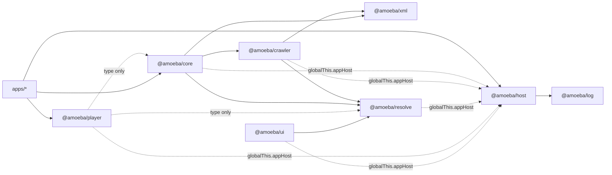
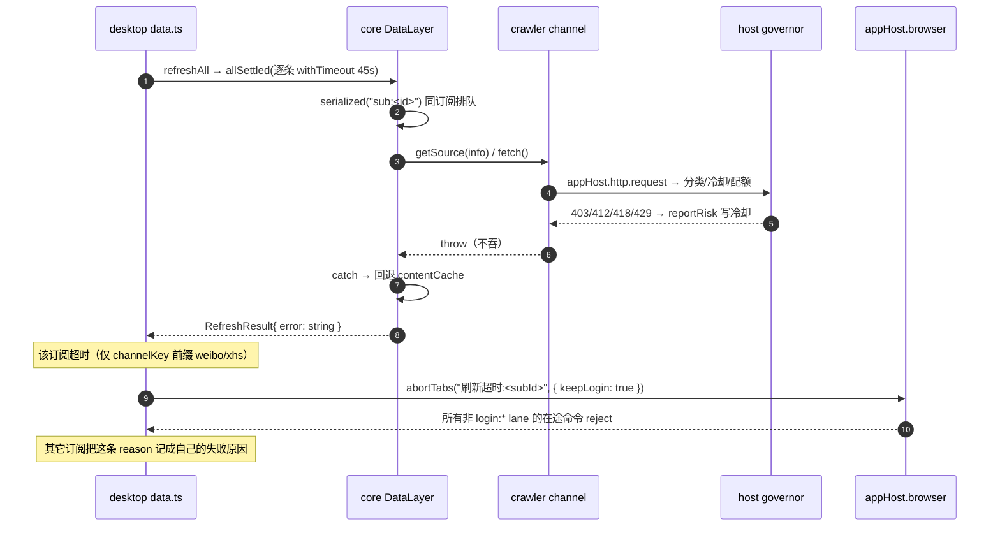

# 05 · 架构约束、耦合与演进风险

> 代码快照：2026-10-23（`master` @ 58b0d77 + 本轮工作区修复）。只覆盖会影响数据、契约、状态与工程可维护性的问题；UI 视觉/布局不在范围。
> 判定口径：**严重度** = 触发后对正确性与可恢复性的影响；**可能性** = 当前代码与默认使用方式下的触发概率。
> 状态口径：**未标「已修 / 部分修复」的条目 = 本轮未处理**（R13–R17 均属此列，不是漏标）。
> 本次实跑守卫：`serialize-roundtrip.check.ts`、`serialize-contract.check.ts`、`passive-mode.check.ts`（含预览 `no-data` 用例）与 `error-kind.check.ts` 均通过（exit 0）；本轮共跑 19 个自检（含 mobile `html.check.ts`）、core/host/resolve/desktop/mobile/cli 的 tsc 与两端 Vite build。
> 行号均为本次复核读到的位置；只写文件名的条目表示未逐行复核到该断言。同目录：README.md · 00-overview.md · 01-packages.md · 02-contracts.md · 03-flows.md · 04-extension.md。

## 0. 风险总表

| # | 风险 | 严重度 | 可能性 | 关键证据 | 最小建议 |
| --- | --- | --- | --- | --- | --- |
| R1 | XML 契约守卫曾常红，Stream/Attachment 边界曾有损（sourceId 另见 R18）**已修（2026-10-23）** | — | — | 两个 check 实跑 exit 0；Stream 走 `tpl:streamJson`（`packages/xml/src/serialize.ts:92-98`）；附件全字段往返（`deserialize.ts:289-320,475-541`） | 保持两侧对称；新增附件字段两边同改 |
| R2 | 包级运行时环 / 隐式宿主加载 **已修（2026-10-23）** | — | — | host 不再 import core（schema 注入）；`resolve/media-referrer.ts` 取代 `resolve → host` 值导入；host `./runtime|governor|node|tauri|browser` 子路径 + 根入口无 import 副作用；`setHostCaps` 自建门面 | 新跨包值导入先查 `01-packages.md` 矩阵；应用走 host 子路径 |
| R3 | 视图层裸 id 寻址，跨订阅同 id 串条目 **已修（2026-10-23）** | — | — | `router.tsx:36,60,67` 写 `?sub=`；`store/types.ts:59-63` 的 `selectedArticleKey`；队列存复合键（`store/actions/ui.ts:45-51`）；正文缓存带订阅（`ReaderMain.tsx:79-120`） | 新增「按 id 记/改/查」入口先过 `itemRefKey`/`readingKey` |
| R4 | 新建订阅的首抓失败被丢弃，成功提示 + 空视图 **已修（2026-10-23）** | — | — | `data-layer.ts:64,939-962` 返回 `{ id, refresh }`；desktop 失败弹 warn（`subs.ts:70-76`）；CLI 复用首刷结果（`refresh.ts:47-57`） | 调用方不要只取 `id` 忽略 `refresh.error` |
| R5 | `refreshAll` 超时中止所有非登录 lane，并把超时归因给其它订阅 **已消解（2026-10-26）** | — | — | desktop 不再持有抓取浏览器（`injectTauriHost({browser:false})`，全局 `abortTabs` 退场）；超时改走 job 取消：`/v1/jobs/:id/cancel` → `AbortSignal` → core `refresh(…,{signal})`（`apps/desktop/src/store/actions/data.ts` 的 `withTimeout(..., onTimeout)`） | 新增长任务沿用 jobId + `cancel(jobId)`，不要在客户端只 abort 本地 fetch |
| R6 | 失败只有字符串，登录/风控/403 不可区分 **已修（2026-10-23，启发式兜底）** | — | — | `RefreshResult.errorKind?`（`packages/core/src/types/refresh-result.ts`）；`packages/resolve/src/errors.ts`；desktop `refreshErrorKinds` / 诊断表 / 首刷 toast；player `errorKindOf` | 平台 client 逐步从普通 `Error` 换成 `ResolveError(kind)`，启发式兜底随之退场 |
| R7 | mobile 能力模型不一致（注入 browser、可播缺 `isFeedItem`） **已修（2026-10-23）** | — | — | `inject-tauri.ts:31` 新增 `browser?: boolean`；mobile 显式 `browser:false`（`apps/mobile/src/main.tsx:16`）；`isPlayable` 排除无 stream 的 audio（`apps/mobile/src/store.ts:146-152`） | 新增可选宿主能力时同步两端的注入开关 |
| R8 | `previewChannel` 绕过被动采集承诺 **已修（2026-10-23）** | — | — | `previewChannel` 与刷新共用被动门：`channel.passive && appHost.browser` 时只调 `fetchPassive`，无数据抛 `ResolveError("no-data")`（`packages/core/src/data-layer.ts`）；`passive-mode.check.ts` 新增预览用例 | 无 |
| R9 | 平台名是字符串协议、多份映射（RSSHub 已独立归桶）**（部分修复 2026-10-23）** | 中 | 高 | core `source/rsshub.ts` 显式 `policy.platform="rsshub"`；`governor.ts` 的 `rsshub` 配额 + `rsshub.app` 兜底；设置页新增 RSSHub 行；平台名仍分散在 core/host/global.d.ts | 共享平台表；`platformOfChannel` 与 `platformOf` 同源 |
| R10 | 存储无事务/多键原子（正文索引已取消）**（部分修复 2026-10-23）** | 中 | 中 | body 清理改前缀扫描 `body-cache-repo.ts`；退订清理 `data-layer.ts:1016-1020`、`reading-repo.ts:115-127`；仍无 `batch`/事务 | 补 `batch`/事务 |
| R11 | `MIGRATIONS.version` 是死数据，非幂等迁移会每次重跑 **已修（2026-10-23）** | — | — | `MIGRATIONS` 改为 `readonly string[]`，注释明确「只放幂等 SQL，非幂等前先加版本表」（`packages/core/src/db/schema.ts`）；host/CLI 两个后端按序全量执行 | 加非幂等迁移时先补 `_migrations` 版本表 |
| R12 | `bun run tauri:build` 曾实际启动 dev **已修（2026-10-23）** | — | — | `scripts/tauri.ts:125-136` 新增 `build` 意图，`:246-250` 映射到 `build-release`；`package.json:30` 不再落进 dev | 回归：`bun run tauri:build` 应产出安装包 |
| R13 | release-only 分支无法被同一套巡检覆盖 | 中 | 高 | `scripts/tauri.ts:54-61`；`apps/desktop/src/main.tsx`（`__store` 仅 DEV） | release 下开受控 CDP 或加核对钩子 |
| R14 | 进程级单例：provider 后注册覆盖、门面 last-writer-wins、`cookieSnapshot` 无版本 | 中 | 低 | `packages/resolve/src/platform/credentials.ts:25-30`；`packages/core/src/data-layer.ts:177-183,417,823-828`；`packages/host/src/runtime.ts:120-141` | per-instance 化或显式 dispose |
| R15 | CLI 旁路 settings（绕过归一化/损坏留证）；CLI 有自己的 settings 快照 provider，桌面库登录态不会自动进入 CLI | 中 | 中 | `apps/cli/src/info.ts:38-46,53-58`；`apps/cli/src/main.ts:41-48`；`packages/resolve/src/platform/credentials.ts:25-30`；`apps/cli/src/store/sqlite-storage.ts:14` | 复用 core 导出的纯函数/仓库 |
| R16 | 抓取浏览器空闲回收与“长时人工等待”的边界未建模 | 中 | 中 | `packages/host/src/tauri/browser-backend.ts`（`IDLE_CLOSE_MS`）、`packages/host/src/browser/backend.ts`（`closeIfIdle`） | 登录/长轮询显式续期或豁免 |
| R17 | 播放器兜底链静默（FLV 无 headers）**（部分修复 2026-10-23）** | 中 | 中 | 未知格式裸 `<video>` 已挂 onError（`PlayableMedia.tsx:472-475`）；FLV 仍不带 headers（`useMediaStream.ts:209-212`） | FLV 走隧道或显式提示 |
| R18 | 死字段与无生产者字段面 **已修（2026-10-23）** | — | — | `Live.quality`/`Live.notice` 无生产者，已从类型与 serialize 删除；`Base.sourceId`/`raw` 注明「crawler 内部字段，不过 XML」 | 新增字段前先 grep 生产者；不可达字段直接删 |
| R19 | 文档/注释与代码相反，误导后续修改 **（部分修复 2026-10-23）** | 低 | 高 | 见 §7.3；kind 顺序、inject-tauri storage、query/index/settings/credentials 注释已修 | 新注释与代码同改；漂移按 §7.3 登记 |

## 1. 契约漂移风险

系统用「双模型 + XML 边界」刻意解耦 crawler 与 core：crawler 产出 `Item`，`serializeFeed` 变成 RSS 2.0，core 用 `parseFeed` 自建 `MediaItem`（`packages/core/src/processing/deserialize.ts:26-55`）。代价是**没有共享类型兜底**，漂移有四条固定路径。

### 1.1 写出/读入不对称（XML 边界）

**字段级缺口表的唯一来源是 [02-contracts.md](02-contracts.md) §2.5**；本节只做风险分级，不复制字段行，避免 serialize/deserialize 一改就要同步两处。

- **已修（2026-10-23）** —— `Stream.headers/quality/rate/dashManifest` 与非 MIME 的 `format` 现在经 `tpl:streamJson` 整体过界（`packages/xml/src/serialize.ts:92-98`；读取侧优先 streamJson、坏 JSON 回退 enclosure，`deserialize.ts:289-320`）。`Article.media[]` 的 image/video/audio 与 title/width/height/duration/poster/aspectRatio/bitrate/streamingFormat/isLiveNow/lang 全部往返；enclosure 与 `media:content` 按 URL 合并、优先 `media:content`（`:475-541`）。两个 check 已覆盖对应样本并 exit 0。
- **低** —— 剩余有损只损保真度、不改变可读/可播：`sourceId/raw` 是 crawler 内部字段、刻意不过 XML（2026-10-23 已注明）、`publishedAt` 秒精度且未来时间被丢弃、`author.name` 为空时头像/句柄一起丢。

判读原则：**先分清字段属于「列表快照（必须过 XML）」还是「播放解析结果（不该过 XML）」**。Stream 已按「整体 JSON 透传」补齐边界；剩余有损若要收口，先把 `sourceId/raw` 定义为契约字段（R18），不要零散加 `tpl:`。

### 1.2 tpl 契约守卫的扫描面（已覆盖属性写法）

`serialize-contract.check.ts` 用静态正则比对两侧源码，扫描面现在覆盖两种写法（`packages/core/src/example/serialize-contract.check.ts:11-15,40-43`）：

1. `setTpl(tree,"key")` / `setTplN(tree,"key")` 单行调用；
2. XML 属性直写 `node["@_tpl:key"] = …`（如社交图的 `liveVideo`）。

本快照两个 check 均 exit 0，`tpl:liveVideo` 不再被误报。剩余局限：守卫只认这两种字面量写法，若未来用 helper 动态拼 key（如遍历字段批量写）会重新失去覆盖，届时先扩展扫描面或统一走 `setTpl`。`READ_ONLY_OK` 里的旧 `image/images` 已随属性扫描修正删除，当前为空集。

### 1.3 类型复制清单

| 类型 | 权威 | 副本 | 同步手段 |
| --- | --- | --- | --- |
| `Item / Stream / Attachment / SocialImage / LivePlatformId / Kind` | `packages/xml/src/types.ts` | `packages/core/src/types/media-item.ts`、`live.ts` | 人工 + roundtrip 样本 |
| `LoginResult` | `packages/crawler/src/index.ts` | `packages/core/src/data-layer.ts:46-51`；`packages/resolve/src/index.ts:17-23` | 三份平行声明。resolve 版多 `refreshToken`，core 版没有，且 `scanLogin` 只把 `result.cookie` 写 settings（`packages/core/src/data-layer.ts:839-842`）→ bili 续期凭证在边界丢弃 |
| `NetLevel` | `packages/core/src/types/settings.ts:20` | `packages/host/src/net/governor.ts`、`global.d.ts` 内联 | 三份同形字面量，无 type import 关系 |
| `ErrorKind` / `ResolveError` | `packages/resolve/src/errors.ts`（`./errors` 子路径） | core `index.ts` 原样 re-export（无复制） | 跨模块副本按结构认 `kind`；新增值要同步 `ERROR_KIND_LABEL` 与 `errorKindOf` 的匹配顺序 |
| 平台名（`bili/weibo/...`） | host `platformOf`（`packages/host/src/net/governor.ts:249-280`，按 URL host） | core `platformOfChannel`（`packages/core/src/data-layer.ts:289-300`，按 channelKey 前缀） | 纯字符串约定；新增平台要改两处 + 设置页文案 |

`RssChannel / SourceInfo / LoginCookieSnapshot` 已改为 core 直接 `import type` crawler 并 re-export（`packages/core/src/source/index.ts:17,19`），字段漂移现在由 `tsc` 兜底；mirror + `satisfies` 的旧建议只适用于仍未收口的 `LoginResult` / `LivePlatformId`。

### 1.4 id 作用域：写路径与视图定位均已收口

`MediaItem.id` 只在订阅内唯一是实测事实（`packages/core/src/types/reading.ts:22-30` 记了 `bilibili:7734200` 同时出现在 `bili:live` 与 `bili:live:hot`）。写路径一直带订阅维度：reading 持久键、`findItem`/`findRecord`、`store.patch`、`resolvePlay`/`resolveDetail` 与 desktop 的标读/星标/续播/批量标读（`packages/core/src/types/reading.ts:32-68`；`packages/core/src/data-layer.ts:610-615`）。本轮把**视图定位**也收口了（R3 已修）：

- **选中态**：`selectedArticleKey` = `itemKey(subscriptionId, id)`，`selectArticle(item)` 收条目而非裸 id（`apps/desktop/src/store/types.ts:59-63`；`store/actions/view.ts:93`）；`itemsById` 已删，避免裸 id 查全表。
- **播放路由**：`playPath(itemId, from, sub)` 写 `?sub=`（`apps/desktop/src/router.tsx:36`），`usePlayNavigate` 收 `{ id, subscriptionId }`（`:60`）；`PlayerPage` 先按 `sub` 精确匹配，再兼容 `from` 恰好是订阅 id 的旧链接，最后才裸 id 兜底（`PlayerPage.tsx:53-63`）。
- **队列**：只存复合键（`apps/desktop/src/store/actions/ui.ts:45-51`），下一条与当前行判断按 `itemKey`（`PlayerPage.tsx:108-115,274-308`）。
- **正文**：会话缓存键与补全结果对位都用复合键（`ReaderMain.tsx:79-120`）；社交详情的异步补全守卫也带订阅维度（`store/actions/view.ts:101-118`）。
- **其余**：短视流 `<PlayableMedia key>`、命令面板条目 id、`ArticlePane`/快捷键、mobile 列表 key 均已带订阅维度。

关键点：`?from=` 只承担「返回位置」，`?sub=` 才是条目身份；聚合节点（`tab:all`）下 `from` 是节点 id，不能当订阅 id 用（`apps/desktop/src/router.tsx:30-35` 的注释）。剩余约束：`MediaItem.id` 模型本身没变，新增「按 id 记/改/查」的入口仍必须过 `itemRefKey` / `readingKey`（`packages/core/src/types/reading.ts:22-45`），否则会重新引入同类断带。逐调用点清单见 [02-contracts.md](02-contracts.md) §7.1。

### 1.5 默认值与空值语义

| 位置 | 默认 | 风险 |
| --- | --- | --- |
| live 的 `platform/roomId` | `"bilibili"` / `""`（`packages/core/src/processing/deserialize.ts:233-235`） | 外部 feed 缺 `tpl:` 会被静默标成 B 站，错误最终表现为「链接不对」 |
| kind 判别 | `tpl:kind` → enclosure(audio MIME) → `ctx.kind` → `article`（`deserialize.ts:10-11,57-80`） | 顺序以代码为准；`ctx.kind` 在 enclosure 之后，头注释已对齐 |
| `fetchedAt` | 缺 `tpl:fetchedAt` → `ctx.now`（`deserialize.ts:148`） | 边界丢字段会伪装成「刚抓取」，排序与相对时间一起错 |
| `url` | 取 `it.link`（`deserialize.ts:143`） | 「字段缺失」与「空值」在下游不可区分，调用方各自兜底易漂移 |

## 2. 分层与依赖风险

实线是真实运行边，虚线是运行时全局依赖或纯类型依赖。**依赖图已恢复 DAG**（2026-10-23）：host 不再 import core（schema 注入）、resolve 不再 import host（Referer 规则下沉）、host 根入口不再有 import 副作用并拆出环境子路径。剩余的只有**隐式全局契约** `globalThis.appHost`（虚线）：它不参与打包器模块图，但约束初始化顺序。xhs 基类的拆文件注释（`packages/crawler/src/channels/xhs/base.ts:4-7`）是旧环遗留，保留但不再是必需。

| 耦合点 | 事实 | 风险 |
| --- | --- | --- |
| `globalThis.appHost` | 类型在仓库根 `global.d.ts`，经 `tsconfig.app.json:33` 的 `files` 传给所有包；host 只实现不拥有 | 包不自包含：单独 type-check/发布时类型不存在；player 完全不声明 host 依赖却读 `appHost.http`；漏注入只在运行时炸 |
| host 根入口仍是聚合 barrel | `packages/host/src/index.ts` 静态 re-export 全部 node/browser/tauri 后端；根入口已无 import 副作用，环境入口拆到 `./node|tauri|browser` | 应用/CLI 已走子路径；新代码若仍 import 根入口，会把三套后端拉进模块图（可发现、非静默错误） |
| host ↔ core | `packages/host/package.json` 已删 `@amoeba/core`；core 把 `host` 放 `devDependencies`，并在运行时经 `appHost.storage.setSchema?()` 注入 `StorageSchema` | 反向依赖已消除；剩余风险是**初始化顺序**：SQL 后端在 `setSchema` 前读写会抛，`createDataLayer` 必须早于任何 storage 访问。CLI 的 `sqliteStorage` 仍是 app 层直接 import core（不构成环） |
| resolve 边界 | `packages/resolve/src/index.ts:10-11` 声明「类型自持、不依赖 crawler」——成立；运行时只依赖 log/ramda，另有 xml 的类型依赖 | 「不依赖上游」**不等于**「无跨包依赖」；改包前先看矩阵，不要只读文件头 |
| workspace | 根 `workspaces` 收 3 apps + 8 packages；`apps/new_desktop` 无 `package.json` 也不在列表、不被 `scripts/tauri.ts` 引用 | 仓库里存在第二套不可构建的桌面 UI，依赖审计容易漏它 |

## 3. 错误与降级风险

| 失败类型 | 分类手段 | 传播 | 用户可见 |
| --- | --- | --- | --- |
| 抓取失败 | `errorKindOf(err)`：显式 `ResolveError.kind` 优先，普通 `Error` 按消息启发式归类 | `doRefresh` catch → 回退旧缓存 → `RefreshResult{error, errorKind}`（`packages/core/src/data-layer.ts`） | desktop `refreshErrors` + `refreshErrorKinds`，toast 标题取 `ERROR_KIND_LABEL`；mobile `.catch(() => {})` 丢弃（`apps/mobile/src/store.ts`） |
| 新建订阅首抓失败 | 同上（经 `refresh.errorKind`） | `addSubscription` 返回 `{ id, refresh: RefreshResult }`（`data-layer.ts`） | desktop 首刷失败弹 warn「已订阅，但${label}」（`apps/desktop/src/store/actions/subs.ts`）；CLI 复用首刷结果并打印 label（`apps/cli/src/commands/refresh.ts`）；mobile 刻意不展示失败徽标（`apps/mobile/src/store.ts`） |
| 播放解析失败 | `ResolveError(kind)`（新代码）或普通 `Error` 的启发式归类 | `PlayableMedia` 错误态 + `PlayerPage` 再 toast 一次（标题均为 `ERROR_KIND_LABEL[kind]`，`unknown` 用「解析失败」/「播放失败」） | 舞台与 toast 仍是两份，但分类一致；`auth` 才提示「需要登录」，403 归 `risk`（`PlayableMedia.tsx`） |
| 被动无数据 | 固定 `no-data` | `doRefresh` 无缓存可回退时写 `RefreshResult.errorKind`；`previewChannel` 无数据直接抛 `ResolveError("no-data")` | 刷新 toast「暂无可用数据」；预览由发现页落错误态 |
| 平台冷却 | 字符串 `平台冷却中(平台, 剩余, 信号)`（`packages/host/src/net/governor.ts:450-461`）；`errorKindOf` 会把它归到 `rate-limit` | `browserGate` 在 CDP op 之前抛 | 冷却期仍可能遮蔽真实原因（可能只是掉登录），且文案含内部平台名/信号 |
| 未知流格式 | 无 | 落入裸 `<video>` 分支；已挂 `onError`（`PlayableMedia.tsx:472-475`），但 FLV 分支仍不透传 headers（`useMediaStream.ts:209-212`） | 未知格式/失效直链现在能看到错误文案；FLV 防盗链仍可能失败 |
| 日志 | core 用 `appHost.log`，实际是 `console`（`packages/host/src/runtime.ts:43-53,71-73`），无日志域/开关 | 只有少量手写点：`refresh failed`（`data-layer.ts:512`）、缓存写失败（`:508`）、详情补全失败（`:719`） | 被动采集无数据、loadMore 失败等路径无日志；core 日志不受 `log:<域>` 开关控制 |

两条结构性结论：

- **错误分类已进契约，但仍是「启发式 + 逐步迁移」**：`errorKindOf` 先认显式 `ResolveError.kind`，再按消息归类。`auth`/`risk`/`rate-limit`/`network`/`timeout`/`unsupported`/`parse`/`no-data` 已能区分，403 不再等同「需要登录」而归 `risk`。残余：旧平台 client（如 `weibo:user` 只透平台 msg，`packages/crawler/src/channels/weibo/user.ts`）仍抛普通 `Error`，消息不匹配时落 `unknown`；平台 client 逐步改用 `ResolveError(kind)` 后精确度才完全成立。
- **release-only 分支无法互证**：`--release` 刻意不叠 `tauri.conf.dev.json`（`scripts/tauri.ts:54-61`），而桌面调试锚点 `__store` 仅 DEV 构建存在（`apps/desktop/src/main.tsx`）。Twitch 的 `Origin` 403、隐藏窗口等只在 release 走的分支，只能靠真机观察，不能复用 UI 巡检脚本。

CORS/referrer 隧道是另一条降级链：HLS 只对 `googlevideo.com` 全隧道、`playlist.ttvnw.net` 换 pLoader，其余走 `xhrSetup` 且跳过 forbidden header（`packages/player/src/hooks/useMediaStream.ts:109-139`）；隧道 loader 固定 YouTube UA/Referer（`packages/player/src/engines/hlsHostLoader.ts:43-48`）；FLV 分支明确不带 header（`useMediaStream.ts:209-212`）。规则表 `mediaReferrerFor` 用 host 子串匹配（`packages/resolve/src/media-referrer.ts`），比同仓库 cookie 清理的标签边界匹配更松。

## 4. 状态与并发风险

| 不变量 | 机制 | 失效模式 |
| --- | --- | --- |
| 订阅集变更后「重读 + 重绘」 | `syncSubscriptions`：先 `set` 再 `refreshView`（`apps/desktop/src/store/ctx.ts:42-49`） | 删除当前节点必须先修 `selectedNodeId`；8 处调用全部满足（`subs.ts:71,80,102,133,150,211,219,265`），`toggleSubEnabled` 刻意不走（`subs.ts:106-116`） |
| 请求世代 | `useLatestOnly` 只丢弃不取消（`apps/desktop/src/lib/useLatestOnly.ts:25-27,44-56`） | store 内另有请求键比对（`hotWord.word` / `previewDetail.key`）；未接入的路径仍会串结果 |
| 刷新与翻页共享游标 | 按订阅串行链（`packages/core/src/data-layer.ts:541-566,761-762`） | 不同订阅并发；超时/取消由 app 层负责 |
| TTL | 命中缓存跳过网络（`data-layer.ts:437-455`） | 语义是「复用缓存」而不是「定时刷新」；桌面无 `setInterval`（grep 无命中），UI 文案「每 N 分钟刷新」会误导 |
| 0 条保护 | 空抓取不清空已有内容（`data-layer.ts:487-495`） | 首次抓取（无缓存、store 空）不受保护，失败即空视图 |
| 退订竞态 | `removedSubs` 墓碑 + 先立后删（`data-layer.ts:215-222,997-1020`） | 现在清 store/游标/内容/正文/reading（`reading.deleteBySubscription`）；但仍是多次独立写，任一失败会留下部分残留 |
| 刷新状态 | `refreshAll` finally 无条件 `busy:{}`（`apps/desktop/src/store/actions/data.ts:215`） | 并行单条 `refresh` 的 busy 被一起清掉，health 状态短暂失真 |

图里的两处错位值得单独记：`abortTabs` 的粒度是**全局非登录 lane**（`browser/backend.ts`），不是「该订阅持有的 lane」；而 `data.ts:184-185` 的守卫是 channelKey 前缀而不是「是否走浏览器」。于是一个 xhs 订阅卡住，会让其它 xhs/weibo 订阅收到同一句 reason，诊断表里的「失败原因」指向另一个订阅。

两处生命周期风险：

- **WebView2 空闲回收**：零在途满 3 分钟关闭（`tauri/browser-backend.ts` 的 `IDLE_CLOSE_MS`），计时只在 CDP 操作 `begin()/end()` 时重置（`browser/backend.ts` 的 `touch()`）。**当前扫码登录不会踩到**——xhs 每 1s（`packages/resolve/src/platform/xhs/login.ts:181-193`）、weibo 每 0.5/1s（`packages/resolve/src/platform/weibo/login.ts:117-138`）持续产生 CDP 命令，等于隐式续期；真正的缺口是「任何不产生 CDP 命令的长等待没有显式 lease」，这个边界没有写进契约。
- **cookie 快照无版本**：`doRefresh` 每次用 `settings.get()` 覆盖 `cookieSnapshot`（`data-layer.ts:417`），`applySettings` 也写同一个闭包变量（`:823-828`）。二者交错时后写者胜，provider 可能回退到旧 cookie（风控与登录相关请求静默退回匿名）。同一模式还有进程级单钩子（`credentials.ts:25-30`）与门面 last-writer-wins（`runtime.ts:120-141`）。

RSSHub 已独立归桶（2026-10-23）：core 的 rsshub source 在请求上显式声明 `policy.platform="rsshub"`，自建实例（任意自定义域名）也归同一桶；governor 另保留 `rsshub.app` 的 host 兜底，设置页新增 RSSHub 行。剩余问题是平台名字符串仍分散在 core（`platformOfChannel`）、host（`platformOf`）与 `global.d.ts` 三处，新增平台要人工同步；RSSHub 只是不再依赖 host 推导。详见 [../../risk/crawler-risk-control.md](../../risk/crawler-risk-control.md)。

## 5. 平台与运维风险

| 面 | 现状约束 | 影响 | 细节 |
| --- | --- | --- | --- |
| xhs | 全渠道要求登录、匿名态移除；CDP 走 `browserGate` | 未登录直接失败；mobile 无任何登录/凭证入口（`apps/mobile/src` 无 `scanLogin` 命中） | [../../platforms/platform-notes.md](../../platforms/platform-notes.md) |
| bili | `refreshToken` 在 resolve 产出（`packages/resolve/src/index.ts:22`），core 的 `LoginResult` 无该字段（`packages/core/src/data-layer.ts:46-51`），且只落 cookie | 「已有 refresh_token、可做自动保活」的前提不成立（§1.3） | [../../platforms/login.md](../../platforms/login.md) |
| douyin | cookie 已由 provider 消费；登录解锁原画待真机验证 | 登录收益未证实 | [../../platforms/platform-notes.md](../../platforms/platform-notes.md) |
| YouTube | 主力 client `VISIONOS`；机房 IP 风控与 client 无关 | 换 client 救不了 IP 风控 | [../../platforms/youtube.md](../../platforms/youtube.md) |
| mobile | 无 CDP、无扫码、`imageProxy/dataSaver` 从未写入门面 | 只能 RSS 直链 + 未读流；被动渠道恒走缓存 | 见 04-extension.md / 01-packages.md |
| 构建 | 三份 tauri.conf + `scripts/tauri.ts`；9222 只在 dev | release 分支验收成本高（R13） | [../../ops/commands.md](../../ops/commands.md) |

## 6. 工程与构建风险

| 项 | 事实 | 风险 |
| --- | --- | --- |
| 构建入口 | 根脚本 `tauri:build` → `scripts/tauri.ts tauri desktop build`；`parseArgs` 新增 `build` 意图（`scripts/tauri.ts:125-136`），`main` 把 `tauri + build` 映射到 `build-release`（`:246-250`） | 已修（2026-10-23）：发布构建跑 Vite build + Tauri build；`build` 单独出现仍只构建前端。建议实跑一次确认产出安装包 |
| TS paths | `tsconfig.app.json:11-21` 把全部 `@amoeba/*` 指到源码 | 未声明依赖/深层引用 tsc 全绿；`apps/cli/src/commands/align.ts:12` 就直引 `packages/core/src/processing/deserialize.ts` |
| 根 tsc | 根 `tsconfig.json` 只有 references（`:2-6`），目标配置无 `composite` | `tsc -b` 不是有效入口；仓库实际按 per-project `tsc -p` 使用 |
| 全局 ABI | `global.d.ts` 经开 `files`（`tsconfig.app.json:33`）传播 | 独立编译/发布的包必须自己再声明一次；CLI/scripts 是同类漏配的高发区 |
| 依赖声明 | `packages/ui/package.json:11,13` 声明 core/player 但源码未 import；`apps/mobile/package.json:12,17-19` 声明 `@tauri-apps/api`、crawler/resolve/xml 但源码未 import | 安装体积与依赖审计失真；读者误判真实边界 |
| 锁文件/安装 | 唯一 `bun.lock`；各 workspace 的 `node_modules/@amoeba/*` 是指向源码目录的符号链接 | 未声明的依赖在隔离安装下会解析失败，但 `tsconfig paths` 会掩盖；CI 不能用 npm/pnpm 重装 |
| 双 dist | `apps/src-tauri/tauri.conf.json:10` → `../../dist/desktop` | 桌面/移动产物同根不同目录，清理与 CI 缓存要分开指定 |
| 无构建产物 | 所有包 `exports` 直指 `src/*.ts` | 改依赖/包入口后必须重启 Vite（预打包只在启动时做），否则解析到旧图 |

## 7. 有意决策（勿改）vs 待还债

### 7.1 有意决策（勿改，但要防误修）

| 决策 | 代价 | 为什么保留 | 验证方式 |
| --- | --- | --- | --- |
| XML 是 crawler→core 唯一通道 | 30+ 个 tpl 字段两侧硬编码 | core 不依赖 crawler 条目模型，外部 RSSHub 可同管 | 两个 check 脚本 + [../data-and-storage.md](../data-and-storage.md) |
| `streams[0]` 由产流侧排序，player 不排序 | 每个平台各自保证顺序 | 档位语义不同：douyu 的 rate 是档位 ID、huya 的 0 是最高档；player 二次排序必错 | `useStreamSelection.check.ts` + 真机播放矩阵 |
| `useLatestOnly` 只丢弃不取消 | 浪费一次请求 | `appHost.http` 隧道没有 abort 信号（`useLatestOnly.ts:25-27`） | 代码约束，无替代 |
| passive 渠道绝不回退 `fetch()` | 无被动数据时只剩缓存 | 主动构造的平台请求正是被动模式要禁的（`data-layer.ts:463-479`） | `passive-mode.check.ts` |
| 表现型偏好放 localStorage、功能型设置放 SQLite | 两套存储 | 首帧脚本必须同步读主题 | `prefs.ts`；core 的 `theme/fontSize/density` 是历史遗留、无消费者 |
| CDP 只过 `browserGate`，不走 `governedHttp` | 两套治理 | 浏览器导航不是 HTTP 请求，配额模型不同 | `governor.check.ts` |
| 退订先立墓碑 | 复杂度 | 防在途刷新把已退订内容写回（`data-layer.ts:997-1014`） | `repo-concurrency.check.ts` |
| 45s 超时只丢外层结果 | 内容可能「报失败但已更新」 | 底层 invoke 没有取消通道（`data.ts:168-177`） | 真机 + 诊断表 |

### 7.2 待还债（按建议顺序）

| 债务 | 最小改法 | 验证方式 |
| --- | --- | --- |
| R9 平台表（剩余） | 一份 `channelKeyPrefix → platform → 展示元数据` 放 core 并导出，host 复用（RSSHub 已走显式 `policy.platform`） | `levelFor("rsshub")` 与 `rsshub.app` 同桶；新增平台只改一处 |
| R11 迁移版本（未来） | 出现非幂等迁移时补 `_migrations(version)` 表并在两个 backend 共用同一执行器 | 新增一条非幂等 SQL，重启两次不报错 |
| R10 存储收口（剩余） | 退订清理与 reading 写入补 `batch`/事务 | `body-cache.check.ts` + 退订后查 reading blob |
| R18 死字段（剩余） | 新增字段前先 grep 生产者；不可达字段直接删，不做「预留」 | `tsc` + grep 无 producer 的字段清单 |
| R19 文档漂移（剩余） | 新注释与代码同改；发现漂移按 §7.3 登记 | `tsc` 通过即可（无逻辑改动） |

### 7.3 文档漂移清单（以代码为准）

2026-10-23 已清掉本轮可核对的四处（`query.ts` 排序平局、`index.ts` 的「旧键回退」、`settings.ts` 的表现型偏好注释、`credentials.ts` 的 xhs 匿名例子）。新增漂移继续按「位置 / 注释说 / 代码是」三列登记在这里。

## 8. 演进路线建议（按收益/成本排序）

| 顺序 | 动作 | 收益 | 成本 | 前置 |
| --- | --- | --- | --- | --- |
| 1 | 存储收口：清理/写入的 `batch`/事务（R10 剩余）；出现非幂等迁移时再补版本表（R11 未来） | 多键写入不再有中间态 | 1 天 | 需确认已有库的兼容 |
| 2 | 平台/配额表单一权威（R9 剩余） | 新增平台只改一处，去掉漏配一类问题 | 半天 | 与 host 平台推导同一改动 |
| 3 | WebView2 边界显式化：登录续期、长等待豁免（R16） | 降低扫码/刷新失败率 | 1 天 | 需真机；R5 的取消部分已由 job 取消解决（2026-10-26），仅 lane 化未做 |
| 4 | 文档漂移持续收尾（R19） | 类型/注释不再承诺不存在的东西 | 随时 | `tsc` + grep；新漂移登记到 §7.3 |

一个判断依据：依赖/加载层（R2）已在本轮完成，剩下的存储收口与平台表改动小、消除的是静默错误；WebView2 边界需要真机验收（见 [../../ops/smoke-check.md](../../ops/smoke-check.md)）。在当前无测试基建的状态下，优先做能被 `*.check.ts` 守住的部分。错误分类（R6）、预览被动（R8）、RSSHub 归桶（R9）、正文索引与 `MIGRATIONS.version`（R10/R11）、死字段（R18）与 R2 也已在本轮完成，后续只需平台 client 逐步换 `ResolveError`，以及把平台名表收到一处。

## 延伸阅读

- 系统文档：[README.md](README.md) · [00-overview.md](00-overview.md) · [01-packages.md](01-packages.md) · [02-contracts.md](02-contracts.md) · [03-flows.md](03-flows.md) · [04-extension.md](04-extension.md)
- 数据契约与存储：[../data-and-storage.md](../data-and-storage.md)（XML 单通道、id 唯一性、分页 fetchedAt）
- 宿主 ABI 与网络治理：[../host-abi.md](../host-abi.md)
- 抓取拓扑：[../crawler-topology.md](../crawler-topology.md)
- 风控规则（等级/冷却/被动采集）：[../../risk/crawler-risk-control.md](../../risk/crawler-risk-control.md)
- 播放链路（选流/loader/弹幕）：[../../playback/playback.md](../../playback/playback.md) · [../../playback/danmaku.md](../../playback/danmaku.md)
- 巡检与命令：[../../ops/smoke-check.md](../../ops/smoke-check.md) · [../../ops/commands.md](../../ops/commands.md)
- 平台差异与登录：[../../platforms/platform-notes.md](../../platforms/platform-notes.md) · [../../platforms/login.md](../../platforms/login.md)
